# Quant AI Engineering Platform — End-to-End Medallion Lakehouse, MLOps, Quant Alpha & Agentic Trading System

[](domain/quant/01_data_platform.md)
[](domain/quant/01_data_platform.md)
[-yellow.svg)](docs/STORAGE_AND_LAKEHOUSE.md)
[](domain/quant/02_ml_platform.md)
[-red.svg)](docs/PAPER_TRADING_SIMULATION.md)
[](domain/quant/03_llm_agent_platform.md)
[](rubic/EDAI%20K11.xlsx)

---

## Mục Lục (Table of Contents)

1. [Tổng Quan Hệ Thống & Miền Nghiệp Vụ](#1-tổng-quan-hệ-thống--miền-nghiệp-vụ)
2. [Kiến Trúc Tổng Quát Toàn Bộ Hệ Thống (End-to-End Architecture)](#2-kiến-trúc-tổng-quát-toàn-bộ-hệ-thống-end-to-end-architecture)
3. [Phân Tích Chi Tiết Từng Stack Công Nghệ](#3-phân-tích-chi-tiết-từng-stack-công-nghệ)
   - [Stack 1: Data Platform & Medallion Lakehouse Stack](#stack-1-data-platform--medallion-lakehouse-stack)
   - [Stack 2: Analytical OLAP Serving Stack (ClickHouse)](#stack-2-analytical-olap-serving-stack-clickhouse)
   - [Stack 3: MLOps Platform & Real-Time Feature Store Stack](#stack-3-mlops-platform--real-time-feature-store-stack)
   - [Stack 4: Quant Alpha Factor Research & Signal Serving Stack](#stack-4-quant-alpha-factor-research--signal-serving-stack)
   - [Stack 5: Event-Driven Paper Trading & Real-Time Replay Engine Stack](#stack-5-event-driven-paper-trading--real-time-replay-engine-stack)
   - [Stack 6: ACID Ledger & Persistence Stack](#stack-6-acid-ledger--persistence-stack)
   - [Stack 7: Interactive Quant Terminal Stack (Streamlit)](#stack-7-interactive-quant-terminal-stack-streamlit)
   - [Stack 8: LLM & Multi-Agent Platform Stack (MCP & A2A)](#stack-8-llm--multi-agent-platform-stack-mcp--a2a)
4. [Cấu Trúc Thư Mục Source Code Chuẩn Hóa](#4-cấu-trúc-thư-mục-source-code-chuẩn-hóa)
5. [Quy Trình Phân Vùng Dữ Liệu 4 Năm & Chống Rò Rỉ Look-Ahead](#5-quy-trình-phân-vùng-dữ-liệu-4-năm--chống-rò-rỉ-look-ahead)
6. [Tập Dữ Liệu Sinh & Các Bất Thường Được Tiêm Vào (Fault Injection Matrix)](#6-tập-dữ-liệu-sinh--các-bất-thường-được-tiêm-vào-fault-injection-matrix)
7. [Hướng Dẫn Vận Hành & Khởi Chạy (Quickstart & Runbook)](#7-hướng-dẫn-vận-hành--khởi-chạy-quickstart--runbook)
8. [Kiểm Thử & Chỉ Mục Tài Liệu Kỹ Thuật](#8-kiểm-thử--chỉ-mục-tài-liệu-kỹ-thuật)

---

## 1. Tổng Quan Hệ Thống & Miền Nghiệp Vụ

Dự án triển khai một nền tảng **Kỹ nghệ Dữ liệu (Data Engineering), Học máy (Machine Learning), Giao dịch Định lượng (Quantitative Finance) và Trí tuệ Nhân tạo Đa tác tử (Multi-Agent AI)** toàn diện cấp tổ chức, tập trung vào thị trường chứng khoán Mỹ (**Top 100 S&P 500 & Top 7 Mega-Cap Tech**: `AAPL`, `NVDA`, `MSFT`, `AMZN`, `GOOGL`, `META`, `TSLA`).

Hệ thống thu thập và xử lý liên tục hai luồng thông tin song song:
1. **Dữ liệu Thị trường Tần số cao (Market Time-Series Data)**: Ticks giao dịch nguyên tử, nến resample 1 phút và nến ngày OHLCV kèm khối lượng VWAP.
2. **Dữ liệu Tài chính Phi cấu trúc (Unstructured Financial Intelligence)**: Tin tức thị trường, báo cáo tài chính định kỳ, và sự kiện doanh nghiệp.

---

## 2. Kiến Trúc Tổng Quát Toàn Bộ Hệ Thống (End-to-End Architecture)

Biểu đồ dưới đây thể hiện dòng chảy dữ liệu hoàn chỉnh từ khâu sinh/thu thập dữ liệu thô, qua kiến trúc hồ dữ liệu Medallion Lakehouse, kho dữ liệu phục vụ phân tích OLAP, nền tảng MLOps, bộ máy nghiên cứu Alpha, hạt nhân mô phỏng khớp lệnh thời gian thực, sổ cái giao dịch ACID, giao diện Quant Terminal tương tác, cho đến hạm đội Agent thông minh.

```mermaid
flowchart TD
    %% STACK 1: INGESTION & DATA PLATFORM
    subgraph STACK1["1. DATA PLATFORM & MEDALLION LAKEHOUSE STACK"]
        direction TB
        DG["Synthetic Tick Generator<br><i>data_generator.py</i> (--scale 0.1 | 1.0)"]
        Kafka["Apache Kafka<br>• market.ticks<br>• market.bars.1m"]
        MinIO_Raw["External Source MinIO<br><i>s3://lakehouse/bronze/</i>"]
        Bronze["Bronze Zone (MinIO Parquet/JSON)<br>raw_market_ticks, raw_news"]
        Spark["PySpark Batch Cluster<br>• Dedup Job (trade_id window)<br>• Skew Mitigation (Salting + AQE)<br>• Resample Job (1m & Daily)"]
        Silver["Silver Zone (Apache Iceberg)<br>stg_market_ticks, stg_news"]
        Gold["Gold Zone (Apache Iceberg Star Schema)<br>gold_market_bars_1m, gold_market_bars_daily,<br>dim_companies (SCD2), feat_technical_indicators"]
        Flink["Apache Flink Streaming<br>RocksDB Dedup | Watermarks 10m"]
        
        DG -->|"1a. Bulk Raw Parquet"| MinIO_Raw --> Bronze
        DG -->|"1b. Real-Time Streaming Ticks"| Kafka
        Bronze -->|"2a. Batch Clean & Dedup"| Spark
        Spark -->|"2b. Write Silver/Gold"| Silver --> Gold
        Kafka -->|"2c. Stream Ticks"| Flink -->|"2d. Resampled Bars"| Gold
    end

    %% STACK 2: ANALYTICAL OLAP SERVING
    subgraph STACK2["2. ANALYTICAL OLAP SERVING STACK"]
        CH["ClickHouse OLAP Database (quant_dw)<br><b>Engine: ReplacingMergeTree</b><br>• market_intraday_bars (1m Bars)<br>• market_daily_ohlcv (Daily Bars)<br>• feat_technical_indicators (ASOF Features)"]
        CH_Sync["ClickHouse Sync Manager<br><i>clickhouse_sync.py</i>"]
        Gold -->|"3. Vectorized Gold Ingest"| CH_Sync --> CH
    end

    %% STACK 3: MLOPS & FEATURE STORE
    subgraph STACK3["3. MLOPS & FEATURE STORE PLATFORM STACK"]
        FeastOffline["Feast Offline Catalog<br>(Iceberg Gold Features)"]
        Redis["Redis Cluster<br>(Feast Online Store: Sub-10ms Feature Cache)"]
        Airflow["Apache Airflow Orchestrator<br>DP1 Ingest | DP2 Staging | DP3 Gold | DP4 Sync"]
        KFP["Kubeflow Pipelines (KFP)<br>Walk-Forward Split | Train LightGBM vs LR"]
        MLflow["MLflow Model Registry<br>Champion Model Tagged 'production'"]
        KServe["KServe v2 Model Serving<br>Canary 80/20 Traffic Split"]
        DriftAPI["FastAPI Drift Detection API<br>KS-Statistic & PSI Monitoring"]
        
        Gold --> FeastOffline -->|"4a. Materialize Daily"| Redis
        Gold -->|"4b. Historical Train/Val Set"| KFP --> MLflow --> KServe
        Redis -->|"4c. Real-Time Features"| DriftAPI -.->|"4d. Retrain Alert"| Airflow
    end

    %% STACK 4: QUANT ALPHA RESEARCH
    subgraph STACK4["4. QUANT ALPHA RESEARCH & SIGNAL SERVING STACK"]
        Catalog["Alpha Catalog (10 Quantitative Alphas)<br><i>alpha_catalog.py</i> (score_strategy_strict)"]
        Registry["Alpha Registry & Lifecycle Engine<br>RESEARCH -> CANDIDATE -> PAPER -> PROMOTED -> RETIRED"]
        Backtest["Walk-Forward Backtester<br><i>backtester.py</i> (IC, Rank IC, Sharpe, MDD vs SPY)"]
        SigServer["AlphaSignalServer (alpha_serving.py)<br>Equal-Average (1/K sum Z_i) | Regime Adaptation"]
        PMControls["PMControlService (pm_controls.py)<br>Drawdown Circuit Breakers & Risk Governance"]
        
        Gold --> Backtest --> Registry
        Catalog --> SigServer
        Registry --> SigServer
        PMControls --> SigServer
    end

    %% STACK 5: EVENT-DRIVEN PAPER TRADING
    subgraph STACK5["5. EVENT-DRIVEN PAPER TRADING & REPLAY STACK"]
        ReplayCtrl["ReplayController (dashboard_service.py)<br>Daemon Thread | Pacing 1x-50x | Step Execution"]
        TradingEngine["PaperTradingEngine (paper_trading.py)<br>• Unified on_bar() Execution<br>• Institutional Slippage (5 bps) & Commission (1 bps)<br>• Stop-Loss (-12 bps) & Take-Profit (+20 bps)<br>• Daily Loss Circuit Breaker (-2.0%)<br>• EOD Flatting (15:55 America/New_York)"]
        
        CH -->|"5a. Streaming TRADING Split Bars"| ReplayCtrl
        CH -->|"5b. Lagged T-1 ASOF Features"| ReplayCtrl
        ReplayCtrl -->|"5c. MarketBar Instance"| TradingEngine
        SigServer -->|"5d. TradeSignal Evaluation"| TradingEngine
    end

    %% STACK 6: ACID LEDGER & PERSISTENCE
    subgraph STACK6["6. ACID LEDGER & PERSISTENCE STACK"]
        PDB["PaperDatabase (paper_db.py)<br><b>PostgreSQL (Default) / SQLite (Fallback)</b>"]
        Orders["paper_orders<br><i>UNIQUE(session_id, ticker, bar_ts, dir, type)</i>"]
        Trades["paper_trades (Fills & Commissions)"]
        Positions["paper_positions (Real-Time MTM)"]
        Snapshots["paper_portfolio_snapshots (Equity/Drawdown)"]
        History["paper_alpha_scores | paper_position_lifecycle | paper_position_marks"]
        
        TradingEngine -->|"6. Atomic Transactions"| PDB
        PDB --> Orders
        PDB --> Trades
        PDB --> Positions
        PDB --> Snapshots
        PDB --> History
    end

    %% STACK 7: INTERACTIVE QUANT TERMINAL
    subgraph STACK7["7. INTERACTIVE QUANT TERMINAL STACK (STREAMLIT)"]
        P1["Page 1: Market Candlestick Charts<br><i>1_Market_Charts.py</i>"]
        P2["Page 2: Alpha Factor Research & Quality Gates<br><i>2_Alpha_Research.py</i>"]
        P3["Page 3: Real-Time Trading Simulation Terminal<br><i>3_Real_Time_Trading.py</i><br><b>Dual-Panel Synchronized Plotly Charts</b><br>• Panel 1: Portfolio Equity Curve (Auto-Scaled)<br>• Panel 2: PnL Performance (Zero Baseline)"]
        P4["Page 4: Historical EDA & OLAP Benchmark<br><i>4_Historical_EDA_and_Engineering.py</i>"]
        
        CH --> P1
        Registry --> P2
        ReplayCtrl <--> P3
        PDB --> P3
        CH --> P4
    end

    %% STACK 8: MULTI-AGENT PLATFORM
    subgraph STACK8["8. LLM & MULTI-AGENT PLATFORM STACK"]
        AgentGW["AgentGateway (Auth, Rate-Limit, A2A Router)"]
        CoordAgent["Coordinator Agent (Langfuse Prompts)"]
        TechAgent["Technical Quant Agent"]
        NewsAgent["Sentiment & News Agent"]
        MCP["MCP Tools Microservices (FastAPI via Helm)<br>Feast, KServe, Qdrant"]
        Qdrant["Qdrant Vector DB (Financial News Embeddings)"]
        vLLM["vLLM / LiteLLM (Qwen 2.5 / Llama 3.3)"]
        
        AgentGW --> CoordAgent
        CoordAgent --> TechAgent & NewsAgent
        TechAgent --> MCP
        NewsAgent --> MCP
        MCP --> Redis & KServe & Qdrant
        CoordAgent -.-> vLLM
        Bronze -.-> Qdrant
    end
```



---

## 3. Phân Tích Chi Tiết Từng Stack Công Nghệ

### Stack 1: Data Platform & Medallion Lakehouse Stack
* **Nhiệm vụ (Mission & Responsibilities)**:
  * Thu nạp dữ liệu thị trường nguyên tử theo triết lý **Tick-First**: chỉ sinh và thu nạp `raw_market_ticks` ở mức giao dịch thấp nhất, tuyệt đối không tạo sẵn nến OHLCV giả lập ở tầng đầu vào.
  * Khử trùng lặp giao dịch (loại bỏ 2.0% duplicate ticks) qua cửa sổ thời gian `ROW_NUMBER()`.
  * Xử lý độ lệch phân phối dữ liệu (80% Volume Skew tập trung vào 7 cổ phiếu Mega-Cap) bằng kỹ thuật **Key Salting** và **Adaptive Query Execution (AQE)** trên Spark.
  * Tiếp nhận luồng streaming với xử lý trễ (5-10 phút) bằng **Event-time Watermarks** và trạng thái nhớ **RocksDB** trên Flink.
  * Resample thành các nến 1 phút và nến ngày bảo toàn 100% Khối lượng, Số lượng lệnh và Biên độ Giá (Conservation Law).
  * Quản lý chiều dữ liệu thay đổi chậm theo thời gian với bảng **SCD Type 2** (`dim_companies`).
* **Thành phần (Components)**:
  * `data_generator.py` & `faults_injector.py`: Bộ sinh dữ liệu thị trường và tiêm lỗi có kiểm soát.
  * `dedup_job.py`: PySpark job làm sạch, khử trùng lặp và chuẩn hóa tiến hóa schema (`2024-06-01`).
  * `resample_job.py`: PySpark job resample ticks thành nến 1m (`gold_market_bars_1m`) và nến ngày (`gold_market_bars_daily`).
  * `iceberg_compaction.py`: Job dọn dẹp và gộp các file Parquet nhỏ (bin-packing).
  * `scd2_builder.py`: Job xây dựng bảng chiều công ty SCD Type 2 với cờ `is_current`.
* **Công nghệ sử dụng (Technologies)**:
  * Apache Spark 3.5.0, Apache Flink 1.19, MinIO S3 Object Storage, Apache Iceberg REST Catalog, Apache Kafka, fastavro, PyArrow.
* **Cách liên kết với các Stack khác (Inter-Stack Integration)**:
  * Ghi nến Gold và bảng chỉ báo vào MinIO/Iceberg; kích hoạt Airflow DAG đồng bộ sang ClickHouse (Stack 2) và làm giàu Feature Store Feast (Stack 3).

---

### Stack 2: Analytical OLAP Serving Stack (ClickHouse)
* **Nhiệm vụ (Mission & Responsibilities)**:
  * Lưu trữ và phục vụ truy vấn tốc độ cao (Sub-50ms) cho hàng chục triệu bản ghi nến 1 phút và nến ngày.
  * Cung cấp dữ liệu nến phân vùng `split_id = 'TRADING'` cho bộ máy Replay Engine mô phỏng giao dịch trực tiếp.
  * Thực hiện phép kết hợp dữ liệu điểm-thời-gian (Point-in-Time As-Of Join) với chỉ báo kỹ thuật có độ trễ $T-1$, triệt tiêu 100% rò rỉ thông tin tương lai (Zero Look-Ahead Bias).
  * Đạt tốc độ truy vấn vượt trội **gấp 7.1 lần** so với việc quét trực tiếp file Parquet trên ổ đĩa.
* **Thành phần (Components)**:
  * Bảng `quant_dw.market_intraday_bars`: Nến 1 phút phục vụ Replay và biểu đồ thời gian thực (M1-19).
  * Bảng `quant_dw.market_daily_ohlcv`: Nến ngày phục vụ nghiên cứu nhân tố dài hạn.
  * Bảng `quant_dw.feat_technical_indicators`: Bảng 10 chỉ báo kỹ thuật số (RSI, MACD, SMA, Volatility,...).
  * `clickhouse_sync.py`: Engine đồng bộ dữ liệu vi mô từ Gold Lakehouse sang ClickHouse.
* **Công nghệ sử dụng (Technologies)**:
  * ClickHouse OLAP Server, bảng động cơ `ReplacingMergeTree`, định dạng Vectorized SIMD, kết nối HTTP API.
* **Cách liên kết với các Stack khác (Inter-Stack Integration)**:
  * Cung cấp nến 1m cho ReplayController (Stack 5), phục vụ dữ liệu trực quan cho Page 1 & Page 4 trên Streamlit (Stack 7).

---

### Stack 3: MLOps Platform & Real-Time Feature Store Stack
* **Nhiệm vụ (Mission & Responsibilities)**:
  * Lưu trữ và quản lý tập trung các đặc trưng kỹ thuật số với tính đúng đắn điểm-thời-gian (Point-in-Time Correctness).
  * Phục vụ truy xuất đặc trưng thời gian thực dưới 10ms (Sub-10ms Feature Fetch) cho các mô hình suy luận.
  * Điều phối tự động chu trình huấn luyện mô hình qua pipeline 4 bước (Load $\to$ Split $\to$ Train $\to$ Evaluate) trên Kubeflow Pipelines.
  * Đăng ký và quản lý phiên bản mô hình trên MLflow, tự động gán nhãn `production` cho mô hình quán quân (Champion Model).
  * Triển khai phục vụ mô hình dạng Canary A/B Testing (80% lưu lượng cho Champion, 20% cho Challenger) trên KServe v2.
  * Giám sát độ trôi phân phối dữ liệu (Data Drift) bằng chỉ số KS-statistic và PSI trong thời gian thực, tự động cảnh báo kích hoạt huấn luyện lại.
* **Thành phần (Components)**:
  * `feast_manager.py`: Quản lý kho đặc trưng offline (Iceberg) và online (Redis).
  * `kfp/pipeline.py`: Định nghĩa Kubeflow Pipeline 4 bước.
  * `trainer.py`: Huấn luyện đối soát LightGBM Classifier vs. Logistic Regression.
  * `drift_api.py`: Dịch vụ FastAPI giám sát độ trôi dữ liệu và đẩy metrics về Prometheus.
  * `mock_kserve_v2.py`: Giao thức KServe v2 Data Plane suy luận xác suất $P(\text{Up})$.
* **Công nghệ sử dụng (Technologies)**:
  * Feast 0.35+, Redis Cluster, Kubeflow Pipelines, MLflow 2.10+, KServe v2, FastAPI, Scikit-learn, LightGBM, SciPy.
* **Cách liên kết với các Stack khác (Inter-Stack Integration)**:
  * Nhận dữ liệu Gold từ Stack 1; cấp xác suất dự báo $P_{\text{ML}}$ cho Alpha Engine (Stack 4) và Replay Engine (Stack 5); cung cấp công cụ MCP cho Agent (Stack 8).

---

### Stack 4: Quant Alpha Factor Research & Signal Serving Stack
* **Nhiệm vụ (Mission & Responsibilities)**:
  * Quản lý danh mục 10 chiến lược Alpha định lượng độc lập (`alpha_catalog.py`).
  * Kiểm soát vòng đời mô hình định lượng qua 5 trạng thái quản trị: `RESEARCH` $\to$ `CANDIDATE` $\to$ `PAPER_TRIAL` $\to$ `PROMOTED_ACTIVE` $\to$ `APPROVED_FROZEN` $\to$ `RETIRED`.
  * Đánh giá chất lượng Alpha qua Quality Gates (IC Mean $\ge 0.05$, Sharpe $\ge 1.50$, Max Drawdown $\ge -20\%$).
  * Kiểm định Out-of-Sample Walk-Forward trên 3 phân vùng thời gian độc lập (**IS**, **OOS**, **TRADING**).
  * Tổng hợp tín hiệu đa chiến lược bằng mô hình bình quân bằng nhau (Equal-Average Ensemble: $Z_{\text{combined}} = \frac{1}{K}\sum Z_i$).
  * Tự động điều chỉnh trọng số chiến lược theo chế độ thị trường (Dynamic Regime Adaptation: Bull / Bear / Sideway).
  * Quản trị rủi ro danh mục (PM Controls) với cơ chế ngắt mạch khẩn cấp và lưu vết kiểm toán `pm_governance_audit`.
* **Thành phần (Components)**:
  * `alpha_catalog.py`: Khai báo 10 chiến lược Alpha và logic chấm điểm chặt chẽ `score_strategy_strict()`.
  * `alpha_registry.py`: Engine đăng ký, thăng cấp và đóng băng cấu hình Ensemble.
  * `alpha_serving.py` (`AlphaSignalServer`): Tính toán tín hiệu Intraday và Daily, cache Redis 60s.
  * `alpha_split_evaluation.py`: Phân tích hiệu năng Out-of-sample và cơ chế đóng băng session `freeze_replay_session()`.
  * `pm_controls.py`: Dịch vụ kiểm soát rủi ro của Portfolio Manager.
* **Công nghệ sử dụng (Technologies)**:
  * Python, NumPy, Pandas, SciPy, SQLAlchemy, Redis.
* **Cách liên kết với các Stack khác (Inter-Stack Integration)**:
  * Cung cấp tín hiệu giao dịch `TradeSignal` cho `PaperTradingEngine` (Stack 5); hiển thị giao diện nghiên cứu trên Page 2 Streamlit (Stack 7).

---

### Stack 5: Event-Driven Paper Trading & Real-Time Replay Engine Stack
* **Nhiệm vụ (Mission & Responsibilities)**:
  * Thực thi mô phỏng khớp lệnh thời gian thực theo sự kiện từng nến 1 phút (`on_bar()`) với độ trễ xử lý micro-giây.
  * Tái lập chi phí giao dịch thực tế qua mô hình ma sát thể chế (Parametric Institutional Friction Model): Trượt giá cố định `5.0 bps` ($0.05\%$) và Phí giao dịch `1.0 bps` ($0.01\%$).
  * Thực thi nghiêm ngặt các chốt chặn an toàn vốn:
    * Chốt lời tự động: `+20.0 bps` ($+0.20\%$).
    * Cắt lỗ tự động: `-12.0 bps` ($-0.12\%$).
    * Cầu dao ngắt mạch tài khoản (Circuit Breaker): Đóng toàn bộ vị thế và dừng giao dịch nếu lỗ trong ngày chạm ngưỡng `-2.0%`.
    * Thanh lý bắt buộc cuối phiên (EOD Flatting): Tự động tất toán toàn bộ danh mục vào lúc **15:55 America/New_York** để không chịu rủi ro qua đêm.
    * Giới hạn quy mô: Tối đa 5 vị thế đồng thời, quy mô cố định $10,000 / lệnh.
  * Điều phối phát lại dữ liệu thị trường (`ReplayController`): Cho phép chạy nền đa luồng (Background Thread), tùy chỉnh tốc độ từ 1x đến 50x, và chế độ chạy từng nến (Step-by-Step).
  * Hỗ trợ 2 chế độ mô phỏng độc lập: **Approved Ensemble Mode** (5 alphas đóng băng) và **Single Alpha Studio Mode** (kiểm thử 1 alpha đơn lẻ).
* **Thành phần (Components)**:
  * `paper_trading.py` (`PaperTradingEngine`): Hạt nhân khớp lệnh, tính giá Fill, cập nhật PnL và kiểm tra Stop-Loss/Take-Profit.
  * `dashboard_service.py` (`ReplayController` & `ReplayState`): Bộ điều khiển phát lại nến từ ClickHouse, quản lý tiến trình thread-safe.
  * `market_replay.py`: Runner chế độ streaming Kafka (`market.bars.1m`).
* **Công nghệ sử dụng (Technologies)**:
  * Python `threading`, `dataclasses`, `collections.deque`, ZoneInfo (`America/New_York`).
* **Cách liên kết với các Stack khác (Inter-Stack Integration)**:
  * Đọc nến 1m từ ClickHouse (Stack 2); nhận tín hiệu từ AlphaSignalServer (Stack 4); ghi nhận lệnh và vị thế vào Sổ cái ACID (Stack 6); gửi dữ liệu vẽ biểu đồ lên Streamlit (Stack 7).

---

### Stack 6: ACID Ledger & Persistence Stack
* **Nhiệm vụ (Mission & Responsibilities)**:
  * Ghi nhận tức thời và bất biến toàn bộ lịch sử đặt lệnh, khớp lệnh, biến động vị thế và định giá danh mục.
  * Đảm bảo tính toàn vẹn dữ liệu chuẩn ACID và tính lũy đòn (Idempotency) tuyệt đối: ngăn chặn trùng lặp lệnh khi Replay lại hoặc dịch vụ khởi động lại nhờ khóa ràng buộc duy nhất:
    `CONSTRAINT uq_order_idempotency UNIQUE (session_id, ticker_symbol, bar_timestamp, direction, order_type)`.
  * Cơ chế chịu lỗi tự động (Graceful Fallback): Tự động chuyển đổi sang lưu trữ SQLite file hoặc SQLite in-memory nếu không có kết nối PostgreSQL.
  * Cung cấp nguồn kiểm toán độc lập (Audit Source of Truth) để đối soát số dư với bộ nhớ in-memory của Engine.
* **Thành phần (Components)**:
  * `paper_db.py` (`PaperDatabase`): Lớp trừu tượng hóa cơ sở dữ liệu hỗ trợ đồng thời PostgreSQL và SQLite.
  * `02_paper_trading_schema.sql`: DDL định nghĩa các bảng giao dịch:
    * `paper_orders`: Sổ lệnh chi tiết kèm siêu dữ liệu ML Provenance.
    * `paper_trades`: Nhật ký khớp lệnh thực tế, giá fill, phí và PnL chốt.
    * `paper_positions`: Bảng vị thế mở theo thời gian thực (Mark-to-Market).
    * `paper_portfolio_snapshots`: Lịch sử định giá tài sản, tiền mặt và độ sụt giảm vốn (Drawdown).
    * `paper_alpha_scores`, `paper_position_lifecycle`, `paper_position_marks`, `replay_session_ensemble`.
* **Công nghệ sử dụng (Technologies)**:
  * PostgreSQL 16, SQLite 3, psycopg2-binary, SQL DDL Schema.
* **Cách liên kết với các Stack khác (Inter-Stack Integration)**:
  * Nhận dữ liệu ghi từ PaperTradingEngine (Stack 5); cung cấp dữ liệu đọc lịch sử cho Trang 2 & Trang 3 của Quant Terminal (Stack 7).

---

### Stack 7: Interactive Quant Terminal Stack (Streamlit)
* **Nhiệm vụ (Mission & Responsibilities)**:
  * Cung cấp giao diện trực quan hóa dữ liệu định lượng thời gian thực cho Quant Trader và Nhà phân tích.
  * Điều khiển tương tác phiên Replay (Start, Pause, Resume, Step, Stop) và cấu hình tham số trực tiếp trên web.
  * Loại bỏ hoàn toàn lỗi lệch thang đo (Scale Mismatch) và hiện tượng chớp nháy (Chart Flickering) bằng **Kiến trúc biểu đồ 2 Panel đồng bộ chuẩn TradingView / QuantConnect**:
    * **Panel 1 (62% chiều cao)**: Đường cong Vốn (`Portfolio Equity Curve`) với trục Y tự động co dãn theo biến động vốn (Auto-Ranged Y-Axis).
    * **Panel 2 (38% chiều cao)**: Hiệu suất Lãi/Lỗ (`Realized & Unrealized PnL`) với đường chuẩn mốc $0.
    * Cả 2 panel đồng bộ chung trục thời gian X và con trỏ chuột (`hovermode="x unified"`).
  * Tách biệt 4 màn hình chức năng chuyên sâu phục vụ từng giai đoạn của chu trình Quant.
* **Thành phần (Components)**:
  * `app.py`: Cấu hình thanh điều hướng và entrypoint của Streamlit.
  * `pages/1_Market_Charts.py`: Xem nến kỹ thuật số, SMA, VWAP và các điểm đánh dấu giao dịch.
  * `pages/2_Alpha_Research.py`: Giám sát vòng đời Alpha, kết quả kiểm định Out-of-Sample, ma trận tương quan và phê duyệt Ensemble.
  * `pages/3_Real_Time_Trading.py`: Bàn điều khiển Replay trực tiếp, bảng tín hiệu thời gian thực, ma trận vị thế và biểu đồ 2 panel.
  * `pages/4_Historical_EDA_and_Engineering.py`: Khám phá phân phối lợi nhuận, kiểm tra sức khỏe hồ dữ liệu Medallion và benchmark tốc độ ClickHouse vs. Parquet.
  * `dashboard_service.py` & `market_chart.py`: Tầng dịch vụ truy xuất dữ liệu, định dạng biểu đồ Canvas và Plotly.
* **Công nghệ sử dụng (Technologies)**:
  * Streamlit 1.67+, Plotly 7.1+, HTML5/Canvas Component, Pandas.
* **Cách liên kết với các Stack khác (Inter-Stack Integration)**:
  * Kết nối trực tiếp ClickHouse (Stack 2), điều khiển ReplayController (Stack 5), và đọc sổ cái PostgreSQL (Stack 6).

---

### Stack 8: LLM & Multi-Agent Platform Stack (MCP & A2A)
* **Nhiệm vụ (Mission & Responsibilities)**:
  * Tự động hóa quá trình nghiên cứu đầu tư bằng cách tổng hợp dữ liệu định lượng (Technical indicators, ML predictions) và định tính (Tin tức, báo cáo tài chính).
  * Vận hành theo mô hình phân cấp **Hạm đội Đa tác tử (Hierarchical Agent Fleet)** giao tiếp qua chuẩn **Agent-to-Agent (A2A)** và **AgentGateway**.
  * Cung cấp các công cụ chuẩn hóa theo giao thức **Model Context Protocol (MCP)** dưới dạng container microservices (FastAPI).
  * Thực hiện tìm kiếm ngữ nghĩa (RAG) trên cơ sở dữ liệu vector đối với tin tức tài chính.
  * Tự động xuất bản Bản ghi nhớ Đầu tư (Investment Memorandum) phục vụ quyết định của hội đồng quản lý quỹ.
* **Thành phần (Components)**:
  * `mcp_tools_api.py`: FastAPI server cung cấp 3 MCP tools (`fetch_ticker_quant_features`, `predict_ticker_direction`, `search_market_news_rag`).
  * `coordinator_agent.py`: Agent tổng quản tiếp nhận yêu cầu, phân bổ nhiệm vụ và tổng hợp báo cáo.
  * `Technical Quant Agent`: Chuyên trách truy xuất chỉ báo kỹ thuật và xác suất mô hình ML.
  * `Sentiment & News Agent`: Chuyên trách phân tích tâm lý tin tức và văn bản tài chính.
  * `rag_pipeline.py`: Pipeline băm nhỏ văn bản (chunking), tạo embedding và nạp vào Qdrant.
* **Công nghệ sử dụng (Technologies)**:
  * vLLM / LiteLLM, Qwen 2.5 / Llama 3.3, Model Context Protocol (MCP), Qdrant Vector DB, FastAPI, Langfuse.
* **Cách liên kết với các Stack khác (Inter-Stack Integration)**:
  * Đọc đặc trưng từ Feast Online Redis (Stack 3); gọi suy luận từ KServe v2 (Stack 3); đọc tin tức tài chính từ Bronze Lakehouse (Stack 1).

---

## 4. Cấu Trúc Thư Mục Source Code Chuẩn Hóa

Toàn bộ mã nguồn hệ thống được tổ chức chuẩn hóa trong gói `src/quant_edai/`:

```
quant_edai/
├── README.md                           # Master Architecture Blueprint & Operational Guide
├── pyproject.toml                      # Cấu hình phụ thuộc và build system (setuptools)
├── Makefile                            # Trình điều khiển tự động hóa hợp nhất (make/*.mk)
├── make/                               # Các module Makefile thành phần (00_env -> 09_phases)
├── sql/                                # Kịch bản DDL cơ sở dữ liệu
│   ├── clickhouse/
│   │   └── schema_quant.sql            # DDL ClickHouse OLAP (quant_dw)
│   ├── iceberg/                        # DDL Bronze, Silver, Gold Iceberg tables
│   └── postgres/
│       └── 02_paper_trading_schema.sql # DDL Sổ cái ACID Paper Trading
├── configs/                            # Cấu hình hệ thống (Feast, Quality, Generator)
├── domain/quant/                       # Đặc tả thiết kế miền Quant Finance
│   ├── 01_data_platform.md             # Thiết kế Data Platform & Lakehouse
│   ├── 02_ml_platform.md               # Thiết kế ML Platform, Feast & Backtester
│   └── 03_llm_agent_platform.md        # Thiết kế Multi-Agent Fleet & MCP Tools
├── docs/                               # Báo cáo chuyên sâu và bằng chứng Rubric
│   ├── ARCHITECTURE_BLUEPRINT.md       # Đặc tả kiến trúc kỹ thuật chi tiết
│   ├── PAPER_TRADING_SIMULATION.md     # Đặc tả Paper Trading Engine & Replay
│   ├── QUANT_ALPHA_BACKTESTING.md      # Báo cáo Backtest Walk-forward & Alphas
│   ├── STORAGE_AND_LAKEHOUSE.md        # Thiết kế phân vùng Iceberg & ClickHouse
│   ├── DATA_PROBLEMS_AND_SKEW.md       # Ma trận tiêm lỗi và kỹ thuật Skew Join
│   └── VERIFICATION_AND_TESTING.md     # Báo cáo kiểm thử Pytest >90% & SLA
└── src/quant_edai/                     # Mã nguồn ứng dụng chính
    ├── benchmark/                      # Đo kiểm hiệu năng đường ống và Docker
    ├── common/                         # Tiện ích dùng chung (Market Time, Bar Schema, Provenance)
    │   ├── bar_schema.py               # Hợp đồng chuẩn hóa nến 1 phút (bar_1m.v1)
    │   ├── market_time.py              # Xử lý múi giờ ET và giờ đóng phiên EOD
    │   └── ml_provenance.py            # Ràng buộc xuất xứ mô hình ML
    ├── generator/                      # Bộ sinh dữ liệu tick và tiêm lỗi có kiểm soát
    │   ├── data_generator.py           # Core generator engine (--scale 0.1 / 1.0)
    │   ├── faults_injector.py          # Skew, schema evolution, duplicates, late data
    │   └── tick_corpus.py              # Quản lý kho ngữ liệu tick online
    ├── governance/                     # Kiểm tra tiến hóa schema và đồng bộ Catalog
    ├── ingestion/                      # Upload dữ liệu thô vào MinIO S3
    ├── processing/                     # Xử lý dữ liệu lớn Batch & Stream
    │   ├── spark/                      # PySpark (Salting, Dedup, Resample, Compaction, SCD2)
    │   └── flink/                      # Apache Flink Streaming (Watermarks, RocksDB)
    ├── quality/                        # Great Expectations checkpoint runners
    ├── ml/                             # Nền tảng Học máy & MLOps
    │   ├── feast/                      # Feast Feature Store Manager
    │   ├── kfp/                        # Kubeflow 4-step Pipeline
    │   ├── trainer.py                  # Huấn luyện mô hình phân loại hướng giá
    │   └── drift_api.py                # Giám sát trôi dữ liệu (KS-test & PSI)
    ├── quant/                          # Bộ máy Định lượng & Giao dịch Mô phỏng
    │   ├── alpha_catalog.py            # Danh mục 10 chiến lược Alpha định lượng
    │   ├── alpha_registry.py           # Quản trị vòng đời Alpha & Quality Gates
    │   ├── alpha_serving.py            # AlphaSignalServer tính toán tín hiệu tổng hợp
    │   ├── alpha_split_evaluation.py   # Kiểm định Out-of-sample & đóng băng Ensemble
    │   ├── backtester.py               # Walk-forward backtester (IC, Sharpe, Drawdown)
    │   ├── metrics.py                  # Thư viện công thức định lượng dùng chung
    │   ├── paper_db.py                 # Lớp truy xuất cơ sở dữ liệu Sổ cái ACID
    │   ├── paper_trading.py            # Hạt nhân PaperTradingEngine (on_bar)
    │   └── pm_controls.py              # Dịch vụ kiểm soát rủi ro danh mục PM
    └── serving/                        # Tầng phục vụ trực quan & API
        ├── clickhouse_sync.py          # Đồng bộ dữ liệu Gold sang ClickHouse
        ├── market_data_service.py      # Dịch vụ truy vấn dữ liệu nến đa tầng
        └── dashboard/                  # Giao diện Quant Terminal (Streamlit)
            ├── app.py                  # Entrypoint giao diện
            ├── dashboard_service.py    # ReplayController & logic điều phối
            ├── market_chart.py         # Canvas Chart Component
            └── pages/                  # 4 trang nghiệp vụ chuyên sâu
                ├── 1_Market_Charts.py
                ├── 2_Alpha_Research.py
                ├── 3_Real_Time_Trading.py
                └── 4_Historical_EDA_and_Engineering.py
```

---

## 5. Quy Trình Phân Vùng Dữ Liệu 4 Năm & Chống Rò Rỉ Look-Ahead

Hệ thống áp dụng chính sách phân vùng thời gian 4 năm bất biến (**Canonical 4-Year Split**) để ngăn chặn triệt để hiện tượng rò rỉ dữ liệu tương lai (Data Leakage / Look-Ahead Bias):

```
+-----------------------------------+-----------------------+-----------------------+
|  In-Sample (IS)                   |  Out-of-Sample (OOS)  |  Trading Replay       |
|  2022-11-01 -> 2025-04-30         |  2025-05-01 -> 2026-04|  2026-05-01 -> 2026-10|
+-----------------------------------+-----------------------+-----------------------+
|  • Huấn luyện mô hình ML (KFP)   |  • Kiểm tra chất lượng|  • Phát lại dữ liệu   |
|  • Hiệu chuẩn trọng số Alpha      |    Alpha (Quality Gate)|    thực tế (Replay)   |
|  • Baseline Backtesting           |  • Xếp hạng ứng viên  |  • Khớp lệnh mô phỏng |
|                                   |  • Đóng băng Ensemble |    PaperTradingEngine |
+-----------------------------------+-----------------------+-----------------------+
```

* **Nguyên tắc ghép nối đặc trưng điểm-thời-gian (Point-in-Time Join)**:
  Khi bộ máy Replay Engine phát nến thời gian thực của ngày $T$, các chỉ báo kỹ thuật ngày từ ClickHouse được gắn độ trễ bắt buộc **+1 ngày** (`feats["available_at"] = event_timestamp.dt.floor("D") + Timedelta(days=1)`), đảm bảo chỉ sử dụng thông tin đã đóng nến tính đến hết ngày $T-1$.

---

## 6. Tập Dữ Liệu Sinh & Các Bất Thường Được Tiêm Vào (Fault Injection Matrix)

Để đáp ứng 100% tiêu chí chấm điểm Rubric (**M1-05 đến M1-08, M1-14, M1-15**), bộ sinh dữ liệu tự động tiêm các dạng bất thường thực tế của thị trường:
1. **Lệch Phân Phối Khối Lượng (Volume Skew - M1-06)**: 80% khối lượng giao dịch và tin tức tập trung vào nhóm 7 cổ phiếu Mega-Cap Tech (`AAPL`, `NVDA`, `MSFT`, `AMZN`, `GOOGL`, `META`, `TSLA`).
2. **Tiến Hóa Cấu Trúc Bảng (Schema Evolution - M1-07)**: Từ mốc `2024-06-01`, luồng tick bổ sung thêm các cột `quote_condition`, `bid_price`, `ask_price`; nến Gold bổ sung `vwap` và `trade_count`.
3. **Trùng Lặp Ngoại Tuyến (Offline Duplicates - M1-08)**: 2.0% bản ghi tick thô bị trùng lặp `trade_id` được tiêm vào với độ trễ tiếp nhận khác nhau.
4. **Dữ Liệu Trực Tuyến Đến Trễ (Streaming Late Arrivals - M1-14)**: 5% lượng tick trên Kafka bị làm trễ từ 5 đến 10 phút để kiểm tra cơ chế Watermark của Flink.
5. **Trùng Lặp Luồng (Streaming Duplicates - M1-15)**: 1.5% bản ghi Kafka bị lặp lại để kiểm tra bộ lọc trạng thái RocksDB.
6. **Trôi Phân Phối Thị Trường (Market Regime Drift - M2-15)**: Chuyển đổi trạng thái thị trường từ Bull Market sang Bear Market biến động mạnh từ ngày `2024-08-01`.

---

## 7. Hướng Dẫn Vận Hành & Khởi Chạy (Quickstart & Runbook)

> [!TIP]
> **Dành cho người mới nhận mã nguồn (Newcomer)**: Vui lòng xem tài liệu hướng dẫn cầm tay chỉ việc độc lập tại:
> 👉 **[docs/GETTING_STARTED.md](docs/GETTING_STARTED.md)** (Hỗ trợ Fast-Path ~3 phút không cần Docker và Full-Stack Big Data Pipeline ~10 phút).

Toàn bộ chu trình vận hành được điều khiển qua `Makefile`:

```bash
# Xem danh mục hướng dẫn đầy đủ các lệnh
make help

# 1. Cài đặt môi trường tự động (.venv via uv/pip)
make setup && make doctor

# 2. Khởi động hạ tầng container (tinh gọn: Kafka, Postgres, Redis, ClickHouse)
make trading-lite-up

# 3. Sinh tập dữ liệu chuẩn 4 năm (Canonical 4Y: IS, OOS, TRADING)
make generate-canonical-4y

# 4. Resample nến & xử lý hồ dữ liệu Medallion (PySpark Skew Salting & AQE)
make resample && make phase2

# 5. Đồng bộ nến sang ClickHouse OLAP & Feast Online Redis
make clickhouse-sync && make feast-apply && make feast-materialize

# 6. Huấn luyện mô hình ML & Chạy Walk-Forward Alpha Backtest
make ml-train-live
make quant-backtest

# 7. Khởi chạy Giao diện Quant Terminal tương tác (:8501)
make dashboard   # hoặc: make ui
```

Sau khi khởi chạy, truy cập trình duyệt tại địa chỉ `http://localhost:8501` để trải nghiệm đầy đủ 4 phân hệ của Quant Terminal.

---

## 8. Kiểm Thử & Chỉ Mục Tài Liệu Kỹ Thuật

### Độ Phủ Kiểm Thử Tự Động (>90% Pytest Coverage)
Hệ thống đi kèm bộ kiểm thử tự động toàn diện:
```bash
# Chạy toàn bộ 42 test suites cốt lõi cho Paper Trading, Alpha Catalog, Replay Engine và Metrics
make test-quant
```

### Chỉ Mục Tài Liệu Kỹ Thuật Chi Tiết
- [Getting Started & Onboarding Guide](docs/GETTING_STARTED.md): Hướng dẫn khởi chạy nhanh cho người mới từ A-Z.
- [Master Architecture Blueprint](docs/ARCHITECTURE_BLUEPRINT.md): Đặc tả chi tiết từng tầng kiến trúc và giao thức.
- [Real-Time Paper Trading & Replay Specification](docs/PAPER_TRADING_SIMULATION.md): Đặc tả thuật toán khớp lệnh, quản trị rủi ro và đồ thị 2 panel.
- [Quant Alpha Backtesting & Strategy Evaluation](docs/QUANT_ALPHA_BACKTESTING.md): Báo cáo kiểm định nhân tố và công thức tính chỉ số Sharpe/IC.
- [Storage Optimization & Lakehouse Compaction](docs/STORAGE_AND_LAKEHOUSE.md): Cấu trúc phân vùng Iceberg và bảng ClickHouse.
- [Data Problems, Skew & Anomaly Proof](docs/DATA_PROBLEMS_AND_SKEW.md): Bằng chứng xử lý lệch tải Spark và trễ luồng Flink.
- [Verification, Testing & Load SLA](docs/VERIFICATION_AND_TESTING.md): Báo cáo Great Expectations và tải Locust.
- [Domain Data Platform Design](domain/quant/01_data_platform.md): Thiết kế nền tảng dữ liệu chứng khoán.
- [Domain ML Platform Design](domain/quant/02_ml_platform.md): Thiết kế nền tảng MLOps và Feature Store.
- [Domain LLM & Multi-Agent Platform Design](domain/quant/03_llm_agent_platform.md): Thiết kế hạm đội Agent và giao thức MCP.
