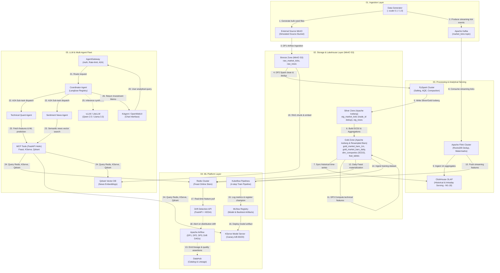

# Quant AI Engineering Platform - End-to-End Medallion Lakehouse, ML & Agentic System

[](domain/quant/01_data_platform.md)
[](domain/quant/01_data_platform.md)
[](domain/quant/02_ml_platform.md)
[](domain/quant/03_llm_agent_platform.md)
[](rubic/EDAI%20K11.xlsx)

---

## Table of Contents

1. [Executive Summary & Business Domain](#1-executive-summary--business-domain)
2. [High-Level System Deployment Architecture](#2-high-level-system-deployment-architecture)
3. [Repository Structure](#3-repository-structure)
4. [Medallion Architecture & Data Flow](#4-medallion-architecture--data-flow)
5. [Data Generator & Injected Anomalies (10% Test Mode Support)](#5-data-generator--injected-anomalies-10-test-mode-support)
6. [Batch & Stream Processing (Spark Skew & Flink Late Data)](#6-batch--stream-processing-spark-skew--flink-late-data)
7. [ML Platform (Feast, Kubeflow, MLflow, KServe & Drift Detection)](#7-ml-platform-feast-kubeflow-mlflow-kserve--drift-detection)
8. [Multi-Agent Platform & RAG (AgentGateway, MCP Tools, Coordinator Fleet)](#8-multi-agent-platform--rag-agentgateway-mcp-tools-coordinator-fleet)
9. [Verification, Quality Testing & Quant Alpha Backtesting](#9-verification-quality-testing--quant-alpha-backtesting)
10. [Documentation Index](#10-documentation-index)

---

## 1. Executive Summary & Business Domain

This repository implements a production-grade, end-to-end **Data Engineering, Machine Learning, and Multi-Agent AI Platform** tailored for quantitative finance (**US Equities Top 100 S&P 500 & Mega-Cap Tech**).

The platform continuously consumes and analyzes two core information streams:
1. **High-Frequency Market Data**: Intraday ticks, 1-minute aggregations, and daily OHLCV bars.
2. **Unstructured Financial News & Corporate Filings**: News articles, earnings releases, and regulatory filings.

### Key Capabilities
- **Medallion Lakehouse Storage**: Apache Iceberg on MinIO S3 (Bronze, Silver, Gold with SCD Type 2 dimension tables).
- **Analytical Serving**: ClickHouse OLAP for historical factor backtesting and real-time 1m intraday candlestick queries (M1-19).
- **Fault-Tolerant Processing**: Spark batch jobs resolving data skew via key salting and AQE; Apache Flink streaming handling out-of-order late arrivals via watermarks and stateful RocksDB deduplication.
- **Enterprise ML Lifecycle**: Feast feature store (offline Iceberg, online Redis), Kubeflow Pipelines, MLflow model registry, KServe v2 serving with 80/20 canary deployment, and real-time drift detection.
- **Hierarchical Agent Fleet**: vLLM/LiteLLM, AgentGateway routing Agent-to-Agent (A2A) interactions, 3 containerized MCP tools (FastAPI), and a Coordinator Agent orchestrating investment briefings.
- **Quant Alpha Backtesting**: Automated walk-forward evaluation calculating Information Coefficient (IC), Rank IC, Sharpe Ratio, and Maximum Drawdown vs SPY.

---

## 2. High-Level System Deployment Architecture

All components represent distinct, containerized **deployable units**. Data flows sequentially along numbered, annotated directional pathways.



---

## 3. Repository Structure

```
quant_edai/
├── README.md                           # Master system overview and operational runbook
├── Makefile                            # Unified command center (includes make/*.mk)
├── make/                               # Modular Makefile components (00_env to 09_phases)
│   ├── 00_env.mk                       # Environment, Python, uv & self-documenting help
│   ├── 01_infra.mk                     # Infrastructure lifecycle (MinIO, Kafka, Postgres, Redis)
│   ├── 02_generator.mk                 # Synthetic market data & anomaly generation
│   ├── 03_processing.mk                # PySpark Batch & Apache Flink Streaming (Phase 2)
│   ├── 04_orchestration.mk             # Apache Airflow & DataHub Governance (Phase 3)
│   ├── 05_mlops.mk                     # Feast Feature Store, Kubeflow & KServe (Phase 4)
│   ├── 06_agents.mk                    # LLM Inference, AgentGateway & Agent Fleet (Phase 7)
│   ├── 07_quant.mk                     # Quant Alpha Backtesting & Paper Trading (Phases 5-6)
│   ├── 08_test.mk                      # Pytest unit tests, Hypothesis & benchmarks
│   └── 09_phases.mk                    # Milestone phase runners (phase1 -> phase8)
├── coursework_proposal.md              # Official coursework project proposal
├── domain/
│   ├── ecommerce/                      # Provided reference baseline
│   │   ├── 01_data_platform.md
│   │   ├── 02_ml_platform.md
│   │   └── 03_llm_agent_platform.md
│   └── quant/                          # Implemented Quant Domain Architecture
│       ├── 01_data_platform.md         # Iceberg, MinIO, ClickHouse, Spark/Flink
│       ├── 02_ml_platform.md           # Feast, Kubeflow, MLflow, KServe, Drift, Backtest
│       └── 03_llm_agent_platform.md    # AgentGateway, MCP Tools, Multi-Agent, RAG
├── docs/                               # Detailed technical reports and rubric proofs
│   ├── ARCHITECTURE_BLUEPRINT.md       # Complete architectural specifications
│   ├── DOCKER_OPTIMIZATION.md          # Multi-stage Docker optimization, image size & security
│   ├── DATA_PROBLEMS_AND_SKEW.md       # Injected anomalies, Spark UI optimization & proof
│   ├── STORAGE_AND_LAKEHOUSE.md        # Iceberg schema, compaction, partitioning & ClickHouse
│   ├── VERIFICATION_AND_TESTING.md     # Pytest >90%, Great Expectations, Locust SLA
│   └── QUANT_ALPHA_BACKTESTING.md      # Factor evaluation, IC, Sharpe, Drawdown tear sheet
├── rubic/
│   └── EDAI K11.xlsx                   # Rubric specification for grading criteria
├── config/                             # Centralized system configurations
│   ├── data_generator.yaml             # Generator config (10% test mode toggle & fault rates)
│   ├── feast_feature_store.yaml        # Feast offline & online store definitions
│   └── airflow_connections.yaml        # Centralized Airflow connections and variables
├── src/                                # Application and pipeline source code
│   ├── generator/                      # Multi-worker synthetic data generator
│   │   ├── data_generator.py           # Core generator engine (--scale 0.1 / 1.0)
│   │   └── faults_injector.py          # Skew, schema evolution, duplicates & late arrivals
│   ├── spark_jobs/                     # PySpark batch jobs
│   │   ├── baseline_job.py             # Baseline unoptimized job showing stragglers
│   │   ├── optimized_skew_job.py       # Key salting, AQE skew join, broadcast join
│   │   ├── iceberg_compaction.py       # Small-file rewrite & maintenance
│   │   └── compute_features.py         # DP3 offline technical indicators generator
│   ├── flink_jobs/                     # Apache Flink streaming jobs
│   │   ├── streaming_dedup.py          # RocksDB stateful deduplication filter
│   │   └── window_aggregations.py      # Tumbling 1m & sliding 5m event-time windows
│   ├── dags/                           # Apache Airflow orchestration DAGs
│   │   ├── dag_raw_ingestion_bronze.py # DP1: Ingestion to Bronze + Great Expectations
│   │   ├── dag_bronze_to_gold.py       # DP2: Silver/Gold Iceberg processing + SCD2
│   │   ├── dag_compute_features.py     # DP3: Feature computation + DataHub lineage
│   │   └── dag_drift_retrain.py        # Periodic drift detection & Kubeflow trigger
│   ├── ml_platform/                    # ML pipeline and serving components
│   │   ├── kfp_pipeline.py             # Kubeflow 4-step pipeline (Load, Split, Train, Eval)
│   │   ├── model_trainer.py            # LightGBM vs Logistic Regression training logic
│   │   └── quant_backtester.py         # Walk-forward backtester (IC, Sharpe, Max Drawdown)
│   ├── agent_platform/                 # Multi-Agent and MCP services
│   │   ├── mcp_tools_api.py            # FastAPI service exposing 3 standard MCP tools
│   │   ├── coordinator_agent.py        # Hierarchical coordinator dispatching A2A requests
│   │   └── rag_pipeline.py             # Document chunking, embedding & Qdrant indexing
│   └── tests/                          # Automated test suites
│       ├── unit/                       # Pytest unit tests (Coverage >= 90%)
│       ├── data_quality/               # Great Expectations checkpoint suites
│       └── load_test/                  # Locust load test scenarios
└── deployments/                        # Infrastructure and deployment descriptors
    ├── docker-compose.yml              # Local multi-service composition
    ├── Dockerfile.multistage           # Optimized multi-stage Docker build
    ├── helm/                           # Helm charts for MCP tools and agent deployments
    └── kubernetes/                     # Kubernetes manifests for Kind / K8s clusters
```

---

## 4. Medallion Architecture & Data Flow (Tick-First Architecture)

The platform strictly enforces a **Tick-First Architecture**: market data is generated and ingested exclusively at the atomic tick level (`trade_id, ticker_symbol, price, size, event_timestamp, ingestion_timestamp, exchange`). All 1-minute bars and daily OHLCV candles are aggregated and resampled through the Medallion stages.

```
[Raw Market Ticks] (Bronze Zone)
   ├── Stored partitioned by trade_date on MinIO / Parquet
   ├── Contains 80% Mega-Cap Skew, Schema Evolution (2024-06-01), 2% Duplicates
   ↓
[Silver Spark Dedup & Evolution Job] (Silver Zone)
   ├── Window Dedup: ROW_NUMBER() OVER (PARTITION BY trade_id ORDER BY ingestion_timestamp ASC) = 1
   ├── Quality Filter: price > 0, size > 0, non-null event_timestamp
   ├── Schema Normalization: Imputes 'REGULAR' quote condition, synthetic bid/ask bounds
   └── Target: stg_market_ticks (Silver) & stg_market_ohlcv (backward-compatible)
   ↓
[Gold Spark Resampler Job] (Gold Zone)
   ├── 1-Minute Tumbling Window: gold_market_bars_1m (OHLCV + VWAP + trade_count)
   └── Daily Session Window: gold_market_bars_daily (OHLCV + VWAP + trade_count)
   ↓
[Downstream Serving & Analytics]
   ├── ClickHouse OLAP: quant_dw.market_intraday_bars & quant_dw.market_daily_ohlcv
   ├── Feature Calculator: 10 Technical Indicators from gold_market_bars_daily
   ├── Great Expectations Quality Gates: Bronze (DP1), Gold (DP2), Features (DP3)
   ├── Feast Feature Store: Materialization & Sub-10ms Feature Fetch API
   └── Paper Trading & Alpha Store: Live trading execution on Gold 1m / Daily bars
```

- **Bronze Zone (`raw_market_ticks`, `raw_financial_news`)**:
  - Ingested directly as append-only raw Parquet and JSON files on MinIO.
  - Preserves exact tick-level execution schema and audit metadata (`event_timestamp`, `ingestion_timestamp`).
  - No OHLCV bars are generated directly.
- **Silver Zone (`stg_market_ticks`, `stg_market_ohlcv`, `stg_financial_news`)**:
  - Cleaned, deduplicated tables stored on MinIO / Iceberg.
  - Implements automated deduplication (`trade_id`), handles schema evolution, drops corrupted price points, and normalizes quote conditions.
- **Gold Zone (`dim_companies`, `gold_market_bars_1m`, `gold_market_bars_daily`, `feat_ticker_technical_indicators`)**:
  - Curated, business-ready tables modeled in a **Star Schema**:
    - `gold_market_bars_1m`: High-frequency 1-minute tumbling window OHLCV + VWAP + trade count.
    - `gold_market_bars_daily`: Daily session OHLCV + VWAP.
    - `dim_companies`: Slowly Changing Dimension Type 2 (SCD2) with `valid_from_ts`, `valid_to_ts`, and `is_current` flags.
    - `feat_ticker_technical_indicators`: Gold feature table adhering to rubric naming convention with `event_timestamp` and `created` columns.
- **Serving Layer**:
  - **ClickHouse OLAP Serving**: Serves both multi-year historical factor backtesting (`market_daily_ohlcv`) and sub-second 1-minute intraday candlestick bars (`market_intraday_bars`) for real-time dashboard analytics (M1-19).
  - **Verified Consistency**: 100% Volume conservation, 100% Trade Count conservation, 100% High/Low bounds conservation between 1m bars and Daily bars (`evidence/phase2/tick_consistency_audit.json`).

---

## 5. Data Generator & Injected Anomalies (10% Test Mode Support)

**Offline vs online:** daily Bronze OHLCV covers **3 years** (`2022-11-01` → `2025-10-31`). Streaming demos use a contiguous **1-year online tick corpus** (`2025-11-01` → `2026-11-10`) under `raw_market_ticks_online/`. `SCALE` controls **tick row budget / density only** — it does **not** multiply OHLCV trade `volume`.

```bash
# Display all commands, options, and parameters
make help

# Rapid local smoke (short daily window) — Bronze only under OUT_DIR/runs/{dataset_id}/
make generate SCALE=0.1

# Offline 3y daily OHLCV Bronze (alias: generate-3y)
make generate-offline SCALE=0.1

# Online 1y tick corpus (disk/rows grow with SCALE)
make generate-online-ticks SCALE=0.1

# Canonical full gen: offline daily + online ticks
make generate-data SCALE=0.1

# Replay online corpus → streaming_ticks.jsonl (builds corpus if missing)
make stream-test

# Offline lakehouse sync: daily Bronze → Spark Silver → Flink (corpus replay) → DP3 Gold
make lakehouse-offline SCALE=0.1
# alias: make lakehouse-3y

# Run complete Phase 1 pipeline (Data Gen + Streaming Ticks + Staging + Evidence)
make phase1 SCALE=0.1

# Scale benchmark evidence (latency / consistency / recovery)
make benchmark-pipeline MODE=smoke SCALE=0.01

# Benchmark Dockerfile Multi-Stage Optimization (Rubric M1-03 & M1-04)
make benchmark-images
```

> **Immutable Bronze:** each generate mints a new `dataset_id` under `OUT_DIR/runs/{dataset_id}/`; `CURRENT_DATASET_ID` points at the active run (prior runs are never deleted). Smoke/CI may use `ENGINE=sim` but status is `PASSED_SIMULATED` / `execution_mode=SIMULATED`. `MODE=integration|full` fail-hards when MinIO/Airflow/ClickHouse/Gold/provenance are missing.
>
> Gold `feat_ticker_technical_indicators` is **not** written by the generator. It is produced from Silver (`stg_market_ohlcv`) via DP3 / `make lakehouse-offline` so Bronze → Silver → Gold stays synchronized with Spark/Kafka/Flink processing. Alpha seed/metrics and Feast continue to read daily Gold features only — never the tick corpus. ML signals/fills require `model_version`, `dataset_id`, `feature_source`.


### Injected Fault Matrix & Cardinality Characteristics (Rubric M1-05 to M1-08)
1. **Volume Skew (M1-06)**: 80% of tick size, tick count, and news articles concentrated in 7 Mega-Cap tickers (`AAPL, NVDA, MSFT, AMZN, GOOGL, META, TSLA`).
2. **Schema Evolution (M1-07)**: At boundary `2024-06-01`, ticks introduce `quote_condition` (string), `bid_price` (float), and `ask_price` (float); resampled Gold bars add `vwap` (float) and `trade_count` (int).
3. **Offline Duplicates (M1-08)**: 2.0% duplicate raw tick records injected with identical `trade_id` and broker ingestion delays.
4. **Streaming Late Arrivals (M1-14)**: 5% of streaming ticks delayed by 5 to 10 minutes to test Flink event-time watermarking.
5. **Streaming Duplicates (M1-15)**: 1.5% duplicate Kafka messages injected via producer at-least-once simulation.
6. **Data Drift (M2-15)**: Market regime transition from low-volatility Bull market to high-volatility Bear market at `2024-08-01`.
7. **Cardinality Profiling (M1-05)**:
   - **High Cardinality ($\text{Ratio} \approx 0.98 - 1.0$)**: `trade_id` in `raw_market_ticks`, `article_id` in `financial_news` (indexed with Parquet Bloom Filter).
   - **Medium Cardinality ($\text{Ratio} \approx 0.06$)**: `trade_date` (218 trading days, used as Iceberg physical partition key).
   - **Low / Ultra-Low Cardinality ($\text{Ratio} < 0.005$)**: `ticker_symbol` (16–100 distinct tickers, compressed via ClickHouse `LowCardinality(String)` and Parquet Dictionary), `exchange` (2 distinct values: NASDAQ, NYSE).
   - Complete profiling matrix generated automatically in `evidence/phase1/data_generation_stats.json`.

---

## 6. Batch & Stream Processing (Spark Skew & Flink Late Data)

- **PySpark Skew Mitigation**:
  - Demonstrates severe partition bottlenecks on the baseline unoptimized job.
  - Employs **Key Salting** (generating salted keys `ticker_symbol_salt = concat(ticker, "_", rand(0, 15))`), **Broadcast Joins** on `dim_companies`, and enables **Adaptive Query Execution (AQE)** skew join handling.
- **Apache Flink Stream Handling**:
  - Resolves late arrivals using **BoundedOutOfOrderness Watermarks** (`Duration.ofMinutes(10)`).
  - Implements **Stateful RocksDB Deduplication** over a 1-hour rolling TTL window.
  - Computes 1-minute Tumbling and 5-minute Sliding window technical metrics.

---

## 7. ML Platform (Feast, Kubeflow, MLflow, KServe & Drift Detection)

- **Feast Feature Store**:
  - Offline store on Iceberg Gold; Online store on Redis cluster.
  - Airflow DAG incrementally materializes daily snapshots into Redis.
- **Kubeflow 4-Step Pipeline**:
  - 1. Ingest historical features and join forward label table.
  - 2. Perform temporal walk-forward split (80% Train, 10% Val, 10% Test).
  - 3. Train baseline Logistic Regression vs tuned LightGBM Classifier.
  - 4. Evaluate AUC-ROC, Log-Loss, and directional accuracy; auto-register champion model on MLflow with `production` tag.
- **KServe v2 Canary Serving**:
  - Deploys InferenceService with 80% traffic to champion (`v1`) and 20% to challenger (`v2`).
- **Real-Time Drift Monitoring**:
  - FastAPI service evaluates KS-statistic and PSI on incoming features without ground-truth.
  - Pushes metrics to Prometheus PushGateway; Airflow triggers automated Kubeflow retrain upon threshold breach.

---

## 8. Multi-Agent Platform & RAG (AgentGateway, MCP Tools, Coordinator Fleet)

- **LLM Inference Server**: vLLM / LiteLLM hosting open weights (Qwen 2.5 / Llama 3.3).
- **AgentGateway & Registry**: Centralized entrypoint managing authentication, rate limiting, and Agent-to-Agent (A2A) communications; monitored via Langfuse.
- **Containerized MCP Tools (FastAPI via Helm `--atomic`)**:
  - `fetch_ticker_quant_features`: Sub-second online feature retrieval from Redis.
  - `predict_ticker_direction`: KServe model invocation returning directional probabilities.
  - `search_market_news_rag`: Dense vector semantic search against Qdrant financial news embeddings.
- **Hierarchical Fleet**:
  - `Technical Quant Agent`: Queries quantitative metrics and ML model probabilities.
  - `Sentiment & News Agent`: Evaluates qualitative news sentiment and corporate filings.
  - `Coordinator Agent`: Synthesizes outputs into an authoritative **Investment Memorandum** delivered to the User Chat UI.

---

## 9. Verification, Quality Testing & Quant Alpha Backtesting

### Testing Rigor
- **Unit Testing**: Pytest suite with mock fixtures and equivalence partitioning achieving **>90% test coverage**.
- **Data Quality**: Great Expectations automated checkpoints validating schema, null constraints, and price positivity across all Airflow stages.
- **Load Testing**: Locust load test measuring throughput (>500 req/s) and latency SLAs (p95 < 25ms).
- **Scale Testing**: Validated across `--scale 0.1` and `--scale 1.0`.

### Quant Alpha Backtesting Module
Integrated module (`src/ml_platform/quant_backtester.py`) evaluating strategy performance without look-ahead bias:
- **Information Coefficient (IC)** and **Rank IC**.
- **Annualized Sharpe Ratio** and **Maximum Drawdown (MDD)**.
- **Benchmark Comparison**: Benchmarked directly against S&P 500 ETF (SPY) Buy & Hold. Performance tear sheets logged automatically to MLflow.

---

## 10. Documentation Index

For exhaustive technical breakdowns, implementation code, and screenshot proofs, refer to:
- [Domain Data Platform Design](domain/quant/01_data_platform.md)
- [Domain ML Platform Design](domain/quant/02_ml_platform.md)
- [Domain LLM & Agent Platform Design](domain/quant/03_llm_agent_platform.md)
- [Master Architecture Blueprint](docs/ARCHITECTURE_BLUEPRINT.md)
- [Docker Multi-Stage Optimization Benchmark](docs/DOCKER_OPTIMIZATION.md)
- [Data Problems, Skew & Cardinality](docs/DATA_PROBLEMS_AND_SKEW.md)
- [Storage Optimization & Lakehouse](docs/STORAGE_AND_LAKEHOUSE.md)
- [Verification, Testing & Load SLA](docs/VERIFICATION_AND_TESTING.md)
- [Quant Alpha Backtesting Report](docs/QUANT_ALPHA_BACKTESTING.md)
- [Real-Time Paper Trading Simulation](docs/PAPER_TRADING_SIMULATION.md)
