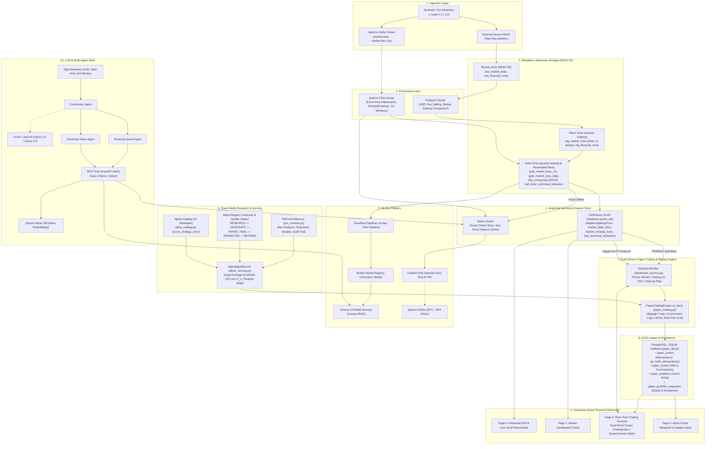

# Architecture Blueprint: Quant AI Engineering Platform

## 1. System Vision & Objective

The **Quant AI Engineering Platform** provides an institutional-grade, end-to-end infrastructure for quantitative equity trading, factor research, and automated financial intelligence. It synthesizes:
- **Tick-First Big Data Engineering**: Streaming and batch ingestion of high-frequency market ticks and financial news into an Apache Iceberg Medallion Lakehouse on MinIO S3.
- **High-Performance OLAP Analytical Serving**: Sub-50ms vectorized queries on ClickHouse (`quant_dw`) serving multi-year factor research and intraday 1-minute bars.
- **Enterprise MLOps & Real-Time Feature Store**: Point-in-time correct feature management via Feast (offline Iceberg, online Redis), automated training via Kubeflow Pipelines, artifact tracking in MLflow, canary serving on KServe v2, and automated data drift monitoring.
- **Quantitative Alpha Research & Lifecycle Governance**: A 10-alpha strategy catalog, institutional quality gates, 3-split walk-forward validation (IS, OOS, TRADING), dynamic regime adaptation, and PM governance risk controls.
- **Event-Driven Paper Trading & Market Replay**: Institutional scalping engine (`PaperTradingEngine`) with realistic friction (5 bps slippage, 1 bps commission), strict risk guards (Stop-Loss, Take-Profit, Circuit Breaker, EOD flatting), and dual-panel time-synchronized charts (TradingView / QuantConnect style).
- **PostgreSQL ACID Ledger & State Persistence**: Comprehensive order and trade audit logging with unique idempotency constraints and automated SQLite fallback.
- **Agentic AI & RAG Platform**: Hierarchical Multi-Agent Fleet communicating via Model Context Protocol (MCP) and AgentGateway to deliver contextualized Investment Memorandums.
- **Interactive Multi-Page Quant Terminal**: Streamlit application providing real-time charting, alpha lifecycle management, live simulation control, and OLAP benchmarking.

---

## 2. End-to-End System Architecture Diagram

---

## 3. Core Architectural Stacks & Responsibilities

| Stack | Primary Technologies | Core Responsibilities & Missions | Key Components |
|---|---|---|---|
| **1. Data Platform & Lakehouse** | MinIO S3, Apache Iceberg, PySpark, Apache Flink, Kafka | Atomic tick ingestion, deduplication (`trade_id`), schema evolution (`2024-06-01`), skew mitigation (salting + AQE), tumbling 1m and sliding 5m aggregations, SCD Type 2 dimension tables. | `data_generator.py`, `dedup_job.py`, `resample_job.py`, `iceberg_compaction.py`, `scd2_builder.py` |
| **2. Analytical OLAP Serving** | ClickHouse (`quant_dw`), Vectorized SIMD | Sub-50ms interactive querying for 1m intraday candles and multi-year daily bars; point-in-time technical indicators join without look-ahead bias; 7.1x speedup over direct Parquet scans. | `quant_dw.market_intraday_bars`, `quant_dw.market_daily_ohlcv`, `quant_dw.feat_technical_indicators`, `clickhouse_sync.py` |
| **3. MLOps & Real-Time Feature Store** | Feast, Redis, Kubeflow Pipelines, MLflow, KServe v2 | Point-in-time offline feature storage, sub-10ms Redis online feature serving, 4-step training pipeline (Logistic Regression vs LightGBM), canary 80/20 deployment, real-time drift detection (KS-test + PSI). | `feast_manager.py`, `kfp/pipeline.py`, `trainer.py`, `drift_api.py`, `mock_kserve_v2.py` |
| **4. Quant Alpha Research** | Python, NumPy, Pandas, SciPy | 10-alpha strategy catalog, 5-stage alpha lifecycle governance (`RESEARCH` to `APPROVED_FROZEN`), walk-forward validation (IS, OOS, TRADING), dynamic regime adaptation, PM governance risk controls. | `alpha_catalog.py`, `alpha_registry.py`, `alpha_serving.py`, `alpha_split_evaluation.py`, `pm_controls.py` |
| **5. Paper Trading & Replay Engine** | Python, Multi-threading | Microsecond event-driven execution on 1m bars, parametric institutional friction (5 bps slippage, 1 bps commission), risk guards (SL -12 bps, TP +20 bps, Circuit Breaker -2.0%, EOD flat 15:55 ET), Single Alpha & Top-5 Ensemble replay. | `paper_trading.py`, `market_replay.py`, `continuous_bar_feeder.py`, `ReplayController` |
| **6. ACID Ledger & Persistence** | PostgreSQL, SQLite Fallback | Complete transactional persistence for orders, trades, active positions, and portfolio valuation snapshots; hard idempotency key `uq_order_idempotency` preventing duplicate executions. | `paper_db.py`, `02_paper_trading_schema.sql` |
| **7. Multi-Agent AI Platform** | vLLM, LiteLLM, AgentGateway, MCP Tools, Qdrant | Hierarchical multi-agent fleet (Coordinator, Technical Quant, Sentiment News), standard MCP tool microservices, semantic vector search on financial filings, automated Investment Memorandum generation. | `mcp_tools_api.py`, `coordinator_agent.py`, `rag_pipeline.py` |
| **8. Interactive Quant Terminal** | Streamlit, Plotly | Unified 4-page UI for real-time candlestick visualization, alpha lifecycle management, live simulation controls, and OLAP benchmarking; dual-panel time-synchronized performance charts. | `1_Market_Charts.py`, `2_Alpha_Research.py`, `3_Real_Time_Trading.py`, `4_Historical_EDA_and_Engineering.py` |

---

## 4. Canonical 4-Year Dataset Splitting & Zero Look-Ahead Protection

To prevent data snooping and information leakage across training and trading:
- **In-Sample (IS)**: Start Date $\longrightarrow$ `2025-04-30` (Used exclusively for model training, alpha factor calibration, and baseline backtesting).
- **Out-of-Sample (OOS)**: `2025-05-01` $\longrightarrow$ `2026-04-30` (Used exclusively for quality gate evaluation, candidate ranking, and ensemble freezing).
- **Trading Replay (TRADING)**: `2026-05-01` $\longrightarrow$ `2026-10-31` (Held-out forward simulation data fed strictly into `PaperTradingEngine`).

Point-in-time features from ClickHouse are joined with a mandatory 1-day lag (`event_timestamp + Timedelta(days=1)`) to ensure bar scoring at Day $T$ uses only indicators computed up through Day $T-1$.
