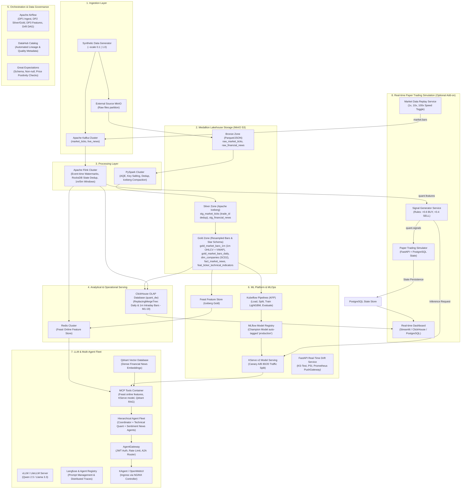

# Architecture Blueprint: Quant AI Engineering Platform

## 1. System Vision & Objective

The Quant AI Engineering Platform provides an institutional-grade data, machine learning, and generative AI infrastructure tailored for quantitative equity trading and research.

The architecture synthesizes:
- **Streaming & Batch Big Data Engineering**: Ingesting high-frequency market data and corporate filings into a unified Medallion Lakehouse.
- **Enterprise MLOps**: Managing feature engineering with point-in-time correctness, automated model training pipelines, canary model deployments, and real-time distribution drift monitoring.
- **Agentic AI & RAG**: Hierarchical Multi-Agent Fleet communicating via Model Context Protocol (MCP) and AgentGateway to deliver contextualized, data-backed financial memorandums.

---

## 2. Layer-by-Layer Architectural Breakdown



---

## 3. Storage Layer & Medallion Schema Design (Tick-First Architecture)

### Bronze Zone (MinIO S3)
- Stores immutable, append-only raw ingested atomic tick and news files.
- Prefixes: `lakehouse-bronze/raw_market_ticks/trade_date=YYYY-MM-DD/*.parquet` and `lakehouse-bronze/raw_financial_news/date=YYYY-MM-DD/*.json`.
- Schema (`raw_market_ticks`): `trade_id`, `ticker_symbol`, `trade_date`, `price`, `size`, `event_timestamp`, `ingestion_timestamp`, `exchange`. No synthetic OHLCV directly generated.

### Silver Zone (Apache Iceberg / Parquet)
- Tables: `lakehouse.silver.stg_market_ticks` and `lakehouse.silver.stg_financial_news`.
- Deduplication: `ROW_NUMBER() OVER (PARTITION BY trade_id ORDER BY ingestion_timestamp ASC) = 1` removes 2% offline duplicates.
- Schema Evolution: Dynamically unifies post-`2024-06-01` schema additions (`quote_condition`, `bid_price`, `ask_price`).

### Gold Zone (Resampled Bars & Star Schema)
- `gold_market_bars_1m` (Intraday Candlesticks):
  - 1-minute tumbling window resampled from Silver ticks via Spark Resampler (`resample_job.py`) and Flink Streaming (`streaming_job.py`).
  - Measures: `open`, `high`, `low`, `close`, `volume`, `vwap`, `trade_count`, `window_start`, `window_end`.
- `gold_market_bars_daily` / `fact_daily_ohlcv`:
  - Daily aggregated OHLCV bars mathematically conserving Volume, Trade Count, and High/Low bounds from 1m bars.
- `dim_companies` (Slowly Changing Dimension Type 2):
  - Primary Key: `company_key` (surrogate), `ticker_symbol`.
  - Temporal Tracking: `valid_from_ts`, `valid_to_ts`, `is_current` (boolean).
  - Attributes: `company_name`, `sector`, `industry`, `market_cap_tier`, `exchange`.
- `fact_market_news`:
  - Grain: One row per published article.
  - Measures: `sentiment_score` ($-1.0$ to $+1.0$), `relevance_score`, `article_tokens`.
- `feat_ticker_technical_indicators`:
  - Standard Rubric Feature Table with required metadata columns: `event_timestamp`, `created`.
  - Measures: `rsi_14d`, `sma_ratio_20_50`, `macd_histogram_12_26`, `bollinger_pct_b`, `realized_volatility_30d`.

---

## 4. Analytical Serving (ClickHouse OLAP - M1-19)

- **Source**: Synced in micro-batches from Gold 1m bars (`quant_dw.market_intraday_bars`), Gold daily bars (`quant_dw.market_daily_ohlcv`), and technical features (`quant_dw.feat_technical_indicators`).
- **Purpose**: Multi-year historical factor backtesting and sub-second analytical queries (<30ms) for real-time 1m/5m candlestick dashboard visualization.
- **Engine**: `ReplacingMergeTree` with `ORDER BY (ticker_symbol, event_timestamp)` and primary key indexing (satisfies Rubric **M1-19**).

---

## 5. Orchestration & Data Governance

### Airflow DAG Flow
```
[External MinIO / Tick Generator]
       │
       ▼ (DP1: Raw Tick Ingestion to Bronze)
[Bronze Zone: raw_market_ticks, raw_news] ──> [Great Expectations Checkpoint]
       │
       ▼ (DP2: Silver Dedup & Gold Resampling)
[Silver Zone: stg_market_ticks] ──> [Gold Resampler: 1m & Daily Bars] ──> [ClickHouse Sync]
       │
       ▼ (DP3: Feature Generation from Daily Bars)
[Gold Zone: feat_ticker_technical_indicators] ──> [Feast Offline Catalog]
       │
       ▼ (Daily Materialize)
[Redis Online Feature Store]
```

All DAG executions emit automated open lineage via `acryl-datahub-airflow-plugin` to **DataHub**, displaying complete graph lineage and validation results.

---

## 6. Real-time Paper Trading Simulation Layer (Operational Add-on)

To demonstrate real-time closed-loop decision making, the platform includes a decoupled, optional **Paper Trading Simulation Module**:
- **Market Data Replay**: Replays out-of-sample historical OHLCV bars into Kafka topic `market.bars` with configurable speed (1x, 10x, 100x).
- **Streaming Pipeline**: Flink consumes bars, computes rolling indicators, and publishes to `quant.features`.
- **ML Scoring**: Signal Generator queries KServe v2 for $P(\text{Up})$ and emits BUY/SELL/HOLD events to `quant.signals`.
- **Execution Simulator**: Ingests signals, executes orders at Next Bar Open with realistic transaction costs (5 bps), and persists state in PostgreSQL (`sim_portfolios`, `sim_positions`, `sim_trades`).
- **Telemetry & Visualization**: ClickHouse OLAP and PostgreSQL power a live dashboard tracking real-time equity curves, win rates, Sharpe Ratio, and Alpha vs. SPY Buy & Hold.

Detailed contracts, state schemas, and verification plans are in [PAPER_TRADING_SIMULATION.md](PAPER_TRADING_SIMULATION.md).
