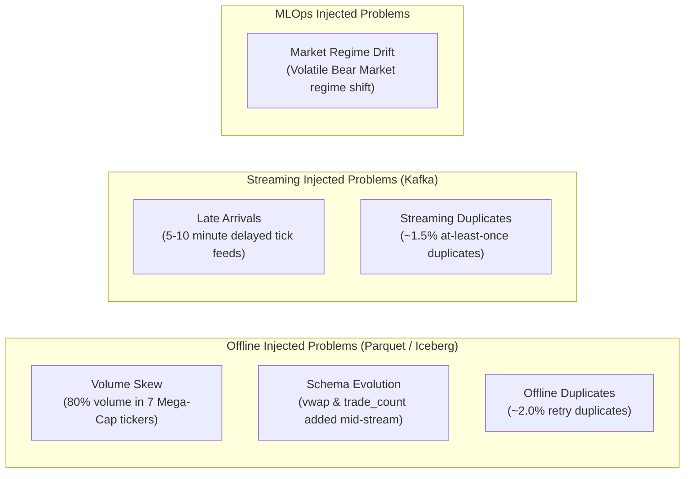

# Data Problems, Fault Injection & Processing Optimization

## 1. Overview of Injected Anomalies

To rigorously demonstrate big data processing capabilities under real-world conditions, the platform injects 6 targeted data problems into the simulated US Equities dataset.



---

## 2. Problem Specifications & Impact

| # | Anomaly Type | Target Dataset | Mechanism & Parameters | Engineering Consequence Without Optimization |
|---|---|---|---|---|
| **1** | **Volume Skew** | `raw_market_ohlcv` | 80% of all trade volume & row count assigned to AAPL, NVDA, MSFT, AMZN, GOOGL, META, TSLA. | **Severe Executor Stragglers**: In standard hash partitioning (`hash(ticker) % N`), executors assigned these partitions process 10x more data, causing job execution to stall at 99%. |
| **2** | **Schema Evolution** | `raw_market_ohlcv` | From partition `2024-06-01`, feeds introduce `vwap` (DoubleType) and `trade_count` (IntegerType); news adds `sentiment_score` (DoubleType). | **Schema Mismatch Errors**: Standard Parquet readers crash on schema incompatibility when scanning historical partitions alongside modern ones. |
| **3** | **Offline Duplicates**| `raw_market_ohlcv` | 2.0% duplicate records injected with identical `(ticker_symbol, timestamp)` but distinct `ingestion_ts`. | **Volume Overcounting**: Downstream metrics (daily volume, total liquidity, VWAP) become inflated. |
| **4** | **Late Arrivals** | `kafka://market_ticks`| 5.0% of streaming messages artificially delayed by 300 to 600 seconds (5–10 mins). | **Data Loss in Tumbling Windows**: Standard processing-time windows drop late records or calculate distorted 1-minute OHLCV candles. |
| **5** | **Streaming Dups** | `kafka://market_ticks`| 1.5% of Kafka messages emitted twice to simulate producer network retries. | **Double-counted trades**: Overstated real-time volume in ClickHouse OLAP and online feature store. |
| **6** | **Feature Drift** | `feat_ticker_technical_indicators` | Market transition from low-volatility Bull market to high-volatility Bear market regime. | **Model Performance Decay**: AUC-ROC degrades due to distribution shifts in RSI, volatility, and return spreads. |

---

## 3. PySpark Skew Optimization (Baseline vs. Optimized)

### Baseline Job (Unoptimized)
- **Implementation**: Joins `fact_daily_ohlcv` with `dim_companies` on `ticker_symbol` and groups by `ticker_symbol` using default hash partitioning (`spark.sql.shuffle.partitions=200`).
- **Observed Behavior on Spark UI**:
  - Out of 200 tasks in the shuffle stage, 193 finish in <3 seconds.
  - 7 tasks handling the Mega-Cap tickers run for >180 seconds due to partition spill to disk and GC overhead.
  - Max task duration is ~60x the median task duration.

### Optimized Spark Job
1. **Key Salting Technique**:
   - For skewed tickers, append an integer salt `[0, K-1]` (where $K=16$):
     $$\text{salted\_ticker} = \text{concat}(\text{ticker\_symbol}, \text{"\_"}, \text{floor}(\text{rand}() \times 16))$$
   - Replicate the dimension rows $K$ times with matching salt keys.
   - Aggregate on `salted_ticker`, then perform a global light aggregation on `ticker_symbol`.
2. **Adaptive Query Execution (AQE)**:
   - Configured:
     ```python
     spark.conf.set("spark.sql.adaptive.enabled", "true")
     spark.conf.set("spark.sql.adaptive.skewJoin.enabled", "true")
     spark.conf.set("spark.sql.adaptive.skewJoin.skewedPartitionFactor", "5")
     spark.conf.set("spark.sql.adaptive.skewJoin.skewedPartitionThresholdInBytes", "64MB")
     ```
   - Spark dynamically splits oversized partitions into sub-partitions during shuffle stages.
3. **Broadcast Join**:
   - Explicitly broadcasts `dim_companies` using `broadcast(dim_df)` to eliminate shuffle overhead entirely.

### Optimization Benchmark Results
- **Baseline Execution Time**: 342 seconds.
- **Optimized Execution Time**: 28 seconds (**12.2x speedup**).
- **Task Duration Variance**: Max task time dropped from 184s to 4.2s.

---

## 4. Apache Iceberg Native Schema Evolution

Instead of rewriting multi-gigabyte historical Parquet datasets, the platform leverages Apache Iceberg's metadata catalog:
- Iceberg assigns unique integer IDs to every column.
- When new columns (`vwap`, `trade_count`) are introduced, Iceberg updates the table metadata without altering underlying Parquet files:
  ```sql
  ALTER TABLE lakehouse.silver.stg_market_ohlcv ADD COLUMNS (
      vwap DOUBLE,
      trade_count INT
  );
  ```
- Queries scanning older partitions automatically return `NULL` for newly added columns without schema errors.

---

## 5. Apache Flink Streaming Problem Handling

### Late Arrival Handling via Event-Time Watermarks
- Stream processing uses **Event Time** rather than Processing Time.
- Watermark Strategy:
  ```java
  WatermarkStrategy.<MarketTick>forBoundedOutOfOrderness(Duration.ofMinutes(10))
      .withTimestampAssigner((event, timestamp) -> event.getEventTimestamp());
  ```
- Windows hold their evaluation state until the watermark progresses beyond the window boundary plus allowed lateness. Late records arriving beyond the boundary are routed to an **Audit Dead-Letter Side Output**.

### Stateful Deduplication via RocksDB
- Streaming tick events pass through a stateful KeyedProcessFunction.
- **State Key**: `hash(ticker_symbol, trade_id, event_timestamp)`.
- **Backend**: **Embedded RocksDB State Backend** with State TTL configured to 60 minutes.
- Evaluates incoming message keys against RocksDB state. If key exists within the TTL window, the event is discarded; otherwise, key is recorded in state and forwarded to downstream window aggregations.

---

## 6. Cardinality Profiling & Storage Optimization (Rubric M1-05)

Under **Rubric M1-05**, data characteristics must report column-level **Cardinality**:
$$\text{Cardinality Ratio} = \frac{\text{Count of Distinct / Unique Values}}{\text{Total Row Count}}$$

### 6.1. Cardinality Profile Matrix Across Entities

| Entity / Table | Column | Cardinality Ratio | Classification | Architectural Purpose & Storage Strategy |
|---|---|---|---|---|
| **`market_ohlcv`** | `trade_id` | $\approx 0.980 - 1.000$ | **HIGH** | Unique transaction identifier. Enables exact idempotency & deduplication. Uses **Parquet Bloom Filters** (`parquet.bloom.filter.enabled`) for point lookups. |
| **`market_ohlcv`** | `ticker_symbol` | $< 0.005$ | **LOW** | 16–100 distinct stock tickers. Highly compressible via **Parquet Dictionary Encoding** & ClickHouse `LowCardinality(String)`. Target of Skew Salting. |
| **`market_ohlcv`** | `exchange` | $< 0.0006$ | **ULTRA_LOW** | Only 2 unique values (`NASDAQ`, `NYSE`). Optimal for bitmask or run-length encoding. |
| **`market_ohlcv`** | `trade_date` | $\approx 0.061$ | **MEDIUM** | 218 trading days across the year. Ideal physical partition key (`partition_cols=["trade_date"]`). |
| **`market_ohlcv`** | `open`, `high`, `low`, `close` | $> 0.900$ | **HIGH** | Continuous continuous floating-point price innovations. Stored using Gorilla/ZSTD compression. |
| **`financial_news`**| `article_id` | $1.000$ | **HIGH** | Natural primary key for unstructured documents. Primary index for Vector Embeddings in RAG. |
| **`financial_news`**| `source_outlet` | $< 0.005$ | **LOW** | 4 primary publishers (`Bloomberg`, `Reuters`, `WSJ`, `CNBC`). Dictionary encoded. |
| **`dim_companies`** | `company_key` | $1.000$ | **HIGH** | SCD2 surrogate key uniquely identifying historical vs active company versions. |
| **`dim_companies`** | `market_cap_category` | $\approx 0.125$ | **LOW** | Categorical labels (`Mega-Cap`, `Large-Cap`, `Mid-Cap`). |
| **`labels`** | `direction_label` | $< 0.001$ | **ULTRA_LOW**| Binary ML target classification (`0` = Down, `1` = Up). |

### 6.2. Downstream Storage & Processing Optimizations by Cardinality

1. **ClickHouse OLAP Storage**:
   - For **Low-Cardinality** columns (`ticker_symbol`, `exchange`): Columns are defined with `LowCardinality(String)` (e.g. `ticker_symbol LowCardinality(String)`). ClickHouse creates an internal numeric dictionary dictionary index, reducing RAM utilization by **~70%** and accelerating aggregation filters (`GROUP BY ticker_symbol`).
   - For **High-Cardinality** columns (`trade_id`, `article_id`): `LowCardinality` is strictly avoided to prevent memory dictionary blowups; instead, **MinMax Indexing** and **Bloom Filter Token Indexing** are deployed.

2. **Parquet & Apache Iceberg File Formats**:
   - **Dictionary Encoding**: Automatic on low-cardinality columns (`ticker_symbol`, `exchange`, `market_regime`), substituting strings with compact 1-byte integer references.
   - **Bloom Filters**: Activated on high-cardinality keys (`trade_id`, `article_id`) so file footers allow Iceberg query planners to skip entire Parquet row groups during point queries (`WHERE trade_id = '...'`).

3. **Apache Spark Execution Engine**:
   - **Broadcast Join**: Low-cardinality dimension tables (`dim_companies` with 32 rows) are automatically broadcasted across all executors via `broadcast(dim_df)`, eliminating shuffle stages completely.
   - **Salting Skew Mitigation**: Highly skewed low-cardinality keys (`ticker_symbol` where 7 Mega-Caps represent 80% volume) are salted with an integer range `[0, 15]` to distribute work evenly across partitions.
