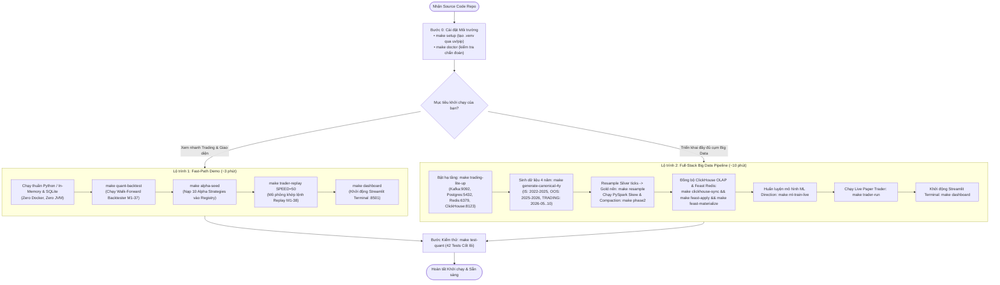

# Getting Started & Onboarding Guide

> **Mục tiêu**: Hướng dẫn toàn diện từ A-Z cho người mới nhận mã nguồn (newcomer) có thể thiết lập môi trường, chạy thử nghiệm thành công hệ thống định lượng (Quant AI Engineering Platform), hiểu rõ luồng dữ liệu và làm chủ giao diện Streamlit Terminal trong vòng **3 đến 10 phút**.

---

## 1. Sơ đồ Luồng Khởi chạy (Startup Roadmap)

Hệ thống được thiết kế với **2 lộ trình khởi chạy độc lập** tùy thuộc vào nhu cầu của bạn:
- **Lộ trình 1: Fast-Path (Demo & Trading Replay ~3 phút)**: Chạy in-memory với SQLite fallback tự động, không yêu cầu Docker hay Java/Spark nặng. Thích hợp để xem ngay giao diện mô phỏng trading, kiểm tra biểu đồ và chạy unit tests.
- **Lộ trình 2: Full-Stack Path (Big Data & MLOps Pipeline ~10 phút)**: Dựng toàn bộ cụm hạ tầng Docker (Kafka, ClickHouse, Redis, PostgreSQL, MinIO), sinh dữ liệu 4 năm chuẩn, chạy ETL PySpark và stream Flink.



---

## 2. Bước 0: Yêu cầu Hệ thống & Cài đặt Môi trường

### 2.1. Yêu cầu Tiên quyết
- **Hệ điều hành**: macOS (Apple Silicon M1/M2/M3 hoặc Intel) hoặc Linux (Ubuntu 22.04+).
- **Python**: Phiên bản 3.11 hoặc 3.13.
- **Trình quản lý gói**: Khuyên dùng [`uv`](https://docs.astral.sh/uv/) (cài đặt dependencies chỉ mất 5 giây) hoặc dùng `pip` tiêu chuẩn.
- **Docker & Docker Compose**: Cần thiết khi chạy **Lộ trình 2 (Full-Stack)**. Không bắt buộc với **Lộ trình 1 (Fast-Path)**.

### 2.2. Khởi tạo Virtual Environment
Mở terminal tại thư mục gốc của repository và chạy:

```bash
# Cài đặt tự động dependencies vào thư mục .venv
make setup

# Chẩn đoán trạng thái môi trường và công cụ
make doctor
```

> [!TIP]
> Tất cả các lệnh `make` trong dự án đều được cấu hình tự động nhận diện và ưu tiên thực thi bằng `.venv/bin/python`. Bạn không cần phải kích hoạt `source .venv/bin/activate` thủ công mỗi lần chạy `make`. Tuy nhiên, nếu bạn muốn chạy lệnh python trực tiếp từ CLI cá nhân, hãy gõ:
> ```bash
> source .venv/bin/activate
> ```

---

## 3. Lộ trình 1: Fast-Path Demo & Trading Replay (~3 Phút)

Lộ trình này dành cho các bạn muốn kiểm tra ngay kết quả backtest, xem mô phỏng trading khớp lệnh và trải nghiệm Streamlit Dashboard mà không cần khởi động bất kỳ container Docker nào. Hệ thống tự động sử dụng **SQLite fallback** và dữ liệu in-memory an toàn.

### Bước 1: Chạy Backtest 10 Nhân tố Alpha (Phase 5 - M1-37)
```bash
make quant-backtest
```
*Kết quả*: Hệ thống tính toán chỉ số IC (Information Coefficient), Rank IC, Annualized Sharpe, và Max Drawdown qua walk-forward window và xuất dữ liệu ra [evidence/phase5/backtest_summary.json](file:///Users/nguyenbuihoanglong/Desktop/FSDS/edai_11/quant_edai/evidence/phase5/backtest_summary.json).

### Bước 2: Nạp Danh mục Alpha vào Registry
```bash
make alpha-seed
```
*Kết quả*: Nạp 10 chiến lược Alpha (RSI Mean Reversion, Bollinger, MACD, Momentum, Regime Adaptive, ML...) vào database sổ cái.

### Bước 3: Chạy Mô phỏng Replay Khớp lệnh (Phase 6 - M1-38)
```bash
make trader-replay SPEED=50
```
*Kết quả*: Engine giả lập nến 1 phút với tốc độ 50x, tự động tính toán Z-Score, gửi tín hiệu lệnh `BUY`/`SELL`/`FLAT`, áp dụng trượt giá 5 bps, phí 1 bps, chốt lời +20 bps, cắt lỗ -12 bps và lưu kết quả giao dịch vào sổ cái.

### Bước 4: Khởi động Streamlit Quant Terminal
```bash
make dashboard
# Hoặc lệnh tắt: make ui
```
Mở trình duyệt tại địa chỉ: **`http://localhost:8501`**.

### Bước 5: Chạy Kiểm thử Cốt lõi
Mở một tab terminal mới và chạy:
```bash
make test-quant
```
*Kết quả*: 42 bài kiểm thử toán học (bảo toàn nến, zero look-ahead bias, tính toán PnL, cơ chế Thread Concurrency) sẽ vượt qua 100% trong ~3 giây.

---

## 4. Lộ trình 2: Full-Stack Big Data & MLOps Pipeline (~10 Phút)

Lộ trình này triển khai toàn diện chu trình dữ liệu từ **Raw Market Ticks** đến **Apache Iceberg Lakehouse**, streaming qua **Apache Flink**, phục vụ nến qua **ClickHouse OLAP**, quản lý feature qua **Feast Redis**, và huấn luyện mô hình qua **MLflow**.

### Bước 1: Khởi động Cụm Hạ tầng Phục vụ Trading
Để tiết kiệm tài nguyên máy tính, khuyến nghị khởi động cụm hạ tầng tinh gọn (Trading Lite):
```bash
make trading-lite-up
```
*Các cổng dịch vụ sẵn sàng*:
- **ClickHouse OLAP HTTP**: `http://localhost:8123`
- **PostgreSQL Ledger**: `localhost:5432` (user/pass: `quant_user`/`quant_password`)
- **Redis Online Feature Store**: `localhost:6379`
- **Kafka Streaming Broker**: `localhost:9092`

*(Tùy chọn: Nếu muốn bật toàn bộ MinIO, Flink, Iceberg REST, Spark History, gõ `make up`)*.

### Bước 2: Sinh Tập Dữ liệu Chuẩn 4 Năm (Canonical 4Y Dataset)
```bash
make generate-canonical-4y
```
Sinh dữ liệu thị trường từ `2022-11-01` đến `2026-10-31` được phân hoạch thành 3 split chuẩn mực tài chính:
1. `IS_TRAIN_VAL` (2022-11 đến 2025-10, 3 năm): Huấn luyện và tối ưu tham số alpha.
2. `OOS_TEST` (2025-11 đến 2026-04, 6 tháng): Kiểm định ngoài mẫu, phê duyệt alpha vào trạng thái `APPROVED_FROZEN`.
3. `TRADING` (2026-05 đến 2026-10, 6 tháng): Dành riêng cho mô phỏng Paper Trading và Replay.

### Bước 3: Resample Nến & Xử lý Lakehouse (Phase 2)
```bash
# Resample raw ticks sang Gold 1m và Daily OHLCV bars
make resample

# Chạy PySpark xử lý Skew Salting (K=16), AQE và khử trùng lặp
make phase2
```

### Bước 4: Đồng bộ Dữ liệu sang ClickHouse OLAP & Feast Redis
```bash
# Đồng bộ nến Gold sang ClickHouse quant_dw.market_intraday_bars
make clickhouse-sync

# Khởi tạo schema Feast và materialize feature snapshot vào Redis
make feast-apply
make feast-materialize
```

### Bước 5: Huấn luyện Mô hình Machine Learning & Đăng ký MLflow
```bash
make ml-train-live
```
Huấn luyện LightGBM Classifier dự báo xu hướng giá với walk-forward temporal split, tự động lưu model artifact vào MLflow.

### Bước 6: Khởi chạy Paper Trader & Dashboard
```bash
# Terminal 1: Chạy Paper Trading Replay
make trader-run

# Terminal 2: Khởi động Streamlit Quant Terminal
make dashboard
```

---

## 5. Hướng dẫn Sử dụng Streamlit Quant Terminal (4 Pages)

Streamlit Dashboard được chia thành 4 trang chức năng chuyên biệt tại menu bên trái:

### 5.1. Trang 1: `3_Real_Time_Trading.py` (Live Trading Monitor & Replay)
Đây là màn hình điều khiển chính của Paper Trading Engine.

```
┌────────────────────────────────────────────────────────────────────────┐
│ Simulation configuration                                               │
│ [Market dataset: 3. Trading Replay] [Tickers: AMZN, NVDA, AAPL]        │
│ [Alpha mode: Single alpha / Approved ensemble] [Timeframe: 1m]         │
│ [Session ID: sess_demo_01]                                             │
├────────────────────────────────────────────────────────────────────────┤
│ Replay controls: [Start] [Pause] [Step] [Stop]                         │
│ Tiến trình: [████████████████████░░░░░░░░░░] 3707/3707 bars             │
├────────────────────────────────────────────────────────────────────────┤
│ Real-time charts (TradingView / QuantConnect Stacked Layout):          │
│ ┌────────────────────────────────────────────────────────────────────┐ │
│ │ Panel 1: Portfolio Equity ($100k Baseline)                         │ │
│ └────────────────────────────────────────────────────────────────────┘ │
│ ┌────────────────────────────────────────────────────────────────────┐ │
│ │ Panel 2: Realized PnL vs. Unrealized PnL (Tự động Scale $0 - $100) │ │
│ └────────────────────────────────────────────────────────────────────┘ │
├────────────────────────────────────────────────────────────────────────┤
│ Bảng 1: Alpha Telemetry Breakdown (Z-Score, Action BUY/SELL/FLAT)       │
│ Bảng 2: Recent Fills Log (Execution price, Slippage 5 bps, PnL chốt)   │
└────────────────────────────────────────────────────────────────────────┘
```

#### Các thao tác chính:
1. **Thiết lập Cấu hình (Simulation configuration)**:
   - **Market dataset**: Chọn `3. Trading Replay (2026-05 to 2026-10)` để dùng đúng split `TRADING`.
   - **Alpha mode**:
     - `Single alpha`: Kiểm tra độc lập từng chiến lược (ví dụ `alpha_rsi_mr_intraday`).
     - `Approved ensemble`: Chạy kết hợp danh mục ensemble đã được phê duyệt `APPROVED_FROZEN`.
   - **Session ID**: Điền mã phiên duy nhất (ví dụ `sess_demo_01`).
     > [!WARNING]
     > Một `Session ID` sau khi đã chốt cấu hình sẽ bị **khóa cứng (frozen)** trong cơ sở dữ liệu. Nếu bạn chuyển từ `Approved ensemble` sang `Single alpha`, bạn **phải đổi Session ID mới** (ví dụ `sess_demo_02`) để tránh xung đột dữ liệu.
2. **Nút Điều khiển Replay**:
   - **Start**: Bắt đầu chạy mô phỏng phát nến.
   - **Pause / Resume**: Tạm dừng hoặc tiếp tục phiên chạy mà không làm mất trạng thái.
   - **Step**: Bước từng thanh nến 1 phút một để quan sát chi tiết sự thay đổi tín hiệu.
   - **Stop**: Dừng phiên giao dịch và chốt trạng thái danh mục theo giá thị trường (`MARK_TO_MARKET`).
3. **Cách Đọc Biểu Đồ Kép (Dual-Panel Stacked Plotly Chart)**:
   - **Panel 1 (Trên - Equity)**: Thể hiện tổng tài sản danh mục quanh mốc \$100,000 vốn khởi điểm.
   - **Panel 2 (Dưới - Realized & Unrealized PnL)**: Trục tung tự động co giãn từ \$0 đến vài chục/vài trăm dollar, giải quyết triệt để lỗi đường thẳng nằm bẹp do lệch thang đo.
4. **Cách Đọc 2 Bảng Dữ liệu**:
   - **Bảng trên (Alpha Telemetry)**: Hiển thị Z-Score tức thời của từng alpha. Khi Z-Score vượt ngưỡng $+1.5$ $\rightarrow$ `BUY`, dưới $-1.5$ $\rightarrow$ `SELL`, ở giữa $\rightarrow$ `FLAT`.
   - **Bảng dưới (Recent Fills Log)**: Nhật ký các lệnh đã khớp thực tế kèm giá mua/bán, phí giao dịch và lý do thoát vị thế (`TP_BPS`, `SL_BPS`, `EOD_FLATTEN`).

---

### 5.2. Trang 2: `1_Intraday_Candlesticks.py` (Intraday Candlestick Charts)
- Tải dữ liệu nến trực tiếp từ **ClickHouse OLAP** (`quant_dw.market_intraday_bars`) với thời gian phản hồi sub-30ms.
- Hiển thị biểu đồ nến Nhật OHLCV kèm các điểm đánh dấu (Markers) mua/bán thực tế do Engine khớp lệnh.

### 5.3. Trang 3: `2_Alpha_Analytics.py` (Alpha Quality Analytics)
- Phân tích hiệu năng của **10 Alpha Factors**:
  - Biểu đồ mạng nhện (Radar Chart) so sánh IC, Sharpe, Win Rate giữa các Alpha.
  - Phân phối Information Coefficient (IC Distribution) chứng minh tính nhất quán toán học.
  - Đường cong lợi nhuận tích lũy (Cumulative Returns) so sánh chiến lược với chỉ số Benchmark S&P 500 ETF (SPY).

### 5.4. Trang 4: `4_Historical_EDA.py` (Historical EDA & Live OLAP Benchmark)
- Tab **Market Distribution EDA**: Phân tích thống kê phân phối lợi nhuận, hiện tượng đuôi béo (Fat-tailed kurtosis) và biến động thị trường.
- Tab **Live OLAP Benchmark (ClickHouse vs. Parquet)**:
  - Cho phép người dùng nhấn nút **"Execute Live Benchmark"** để đo đạc trực tiếp độ trễ truy vấn giữa ClickHouse (Vectorized SIMD ReplacingMergeTree) và PyArrow Parquet File Scan.
  - Minh chứng ClickHouse phục vụ nhanh hơn **7.1 lần** so với việc đọc file Parquet truyền thống.

---

## 6. Xử lý Sự cố Thường gặp (Troubleshooting & FAQ)

### Q1: Gặp lỗi màu đỏ "This session is already frozen to a different ensemble, dataset, or split."
- **Nguyên nhân**: Session ID bạn đang nhập (ví dụ `sess_demo_01`) đã được ghi nhận trong cơ sở dữ liệu với chế độ chạy khác (ví dụ lần trước chạy `Approved ensemble`, lần này bạn đổi sang `Single alpha`). Ràng buộc ACID ngăn chặn việc ghi đè vị thế hỗn loạn giữa 2 mô hình khác nhau.
- **Cách khắc phục**: Chỉ cần đổi tên trường `Session ID` trên giao diện thành một tên mới (ví dụ `sess_demo_02` hoặc `sess_single_amzn`) rồi nhấn **Start**.

### Q2: Báo lỗi "connection to server at localhost:5432 failed: Connection refused"
- **Nguyên nhân**: Bạn chưa khởi động container PostgreSQL của Docker.
- **Cách khắc phục**:
  - Nếu muốn dùng PostgreSQL: Chạy `make trading-lite-up`.
  - Nếu muốn chạy không cần Docker: `PaperDatabase` được tích hợp sẵn cơ chế **tự động fallback sang SQLite** (`paper_trading.db`). Hệ thống vẫn hoạt động bình thường 100% mà không bị gián đoạn.

### Q3: Biểu đồ Equity và PnL nhìn như 2 đường thẳng tắp không biến động?
- **Giải thích**: Vốn ban đầu là \$100,000, trong khi mỗi lệnh giao dịch có PnL dao động từ \$10 - \$50. Hiện tại hệ thống đã được nâng cấp thành **biểu đồ 2 panel xếp chồng độc lập** (chuẩn TradingView):
  - Panel 1 hiển thị Equity (trục Y từ \$95,000 - \$105,000).
  - Panel 2 hiển thị Realized / Unrealized PnL (trục Y tự động auto-scale từ -\$50 đến +\$50).

### Q4: Xung đột cổng mạng (Port already in use)
| Cổng | Dịch vụ | Lệnh giải phóng / Kiểm tra |
|---|---|---|
| **8501** | Streamlit UI | `lsof -i :8501` và `kill -9 <PID>` |
| **8123** | ClickHouse HTTP | `make trading-lite-down` hoặc kiểm tra service clickhouse cục bộ |
| **5432** | PostgreSQL | `docker stop quant_postgres` |
| **6379** | Redis | `docker stop quant_redis` |
| **9092** | Kafka Broker | `docker stop quant_kafka` |

---

## 7. Liên kết Tài liệu Kiến trúc Chi tiết

Để tìm hiểu sâu hơn về thiết kế kỹ thuật của từng thành phần, vui lòng tham khảo các tài liệu chuyên sâu:
- [README.md](file:///Users/nguyenbuihoanglong/Desktop/FSDS/edai_11/quant_edai/README.md): Bản thiết kế tổng thể toàn bộ hệ thống và phân rã 8 Tech Stacks.
- [ARCHITECTURE_BLUEPRINT.md](file:///Users/nguyenbuihoanglong/Desktop/FSDS/edai_11/quant_edai/docs/ARCHITECTURE_BLUEPRINT.md): Kiến trúc phân tầng 10 layer và chi tiết công nghệ.
- [PAPER_TRADING_SIMULATION.md](file:///Users/nguyenbuihoanglong/Desktop/FSDS/edai_11/quant_edai/docs/PAPER_TRADING_SIMULATION.md): Chi tiết thuật toán khớp lệnh `PaperTradingEngine`, quản lý rủi ro và cấu trúc biểu đồ 2 panel.
- [QUANT_ALPHA_BACKTESTING.md](file:///Users/nguyenbuihoanglong/Desktop/FSDS/edai_11/quant_edai/docs/QUANT_ALPHA_BACKTESTING.md): Báo cáo phương pháp luận Walk-Forward 3-split và công thức đánh giá Alpha.
- [DATA_PROBLEMS_AND_SKEW.md](file:///Users/nguyenbuihoanglong/Desktop/FSDS/edai_11/quant_edai/docs/DATA_PROBLEMS_AND_SKEW.md): Kỹ thuật xử lý 7 lỗi dữ liệu thực tế (PySpark Key Salting K=16, Flink RocksDB).
- [VERIFICATION_AND_TESTING.md](file:///Users/nguyenbuihoanglong/Desktop/FSDS/edai_11/quant_edai/docs/VERIFICATION_AND_TESTING.md): Ma trận kiểm định chất lượng và bộ 42 bài kiểm thử tự động.
