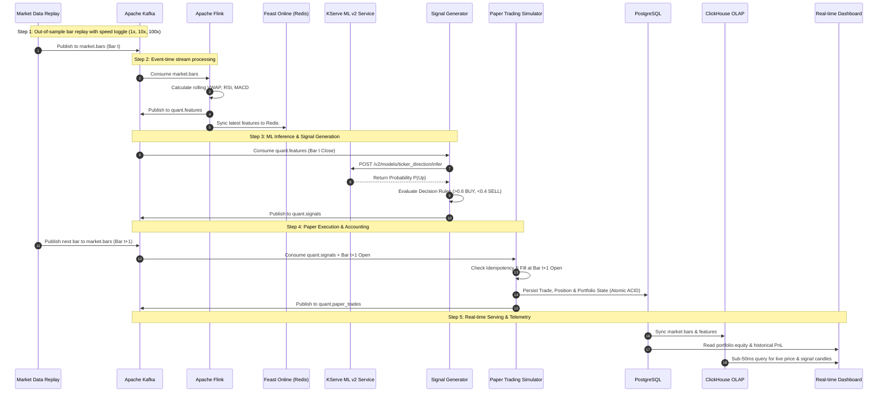

# Real-time Paper Trading Simulation Specification

## 1. Executive Summary & Objective

The **Real-time Paper Trading Simulation Module** is an operational, real-time extension built on top of the Quant Data & AI Platform. It demonstrates end-to-end production readiness by connecting:

$$\text{Market Data Replay} \longrightarrow \text{Kafka} \longrightarrow \text{Flink} \longrightarrow \text{Feast} \longrightarrow \text{KServe} \longrightarrow \text{Signal Gen} \longrightarrow \text{Paper Simulator} \longrightarrow \text{ClickHouse / Dashboard}$$

### Core Design Principles
1. **Zero Pipeline Disruption**: Runs as an optional add-on that consumes from existing feeds or a dedicated replay topic; does not break batch Lakehouse or offline training jobs.
2. **Reusing Existing Tech Stack**: Implemented strictly in Python (FastAPI), Apache Kafka, Apache Flink, ClickHouse OLAP, and PostgreSQL. No external heavy broker APIs or matching engines.
3. **Temporal Integrity (Zero Look-Ahead Bias)**: Enforces strict separation between `event_timestamp`, `signal_timestamp`, `prediction_horizon`, and `execution_timestamp`.
4. **State Persistence & Idempotency**: Resilient against stream retries, Kafka rebalances, and service crashes via PostgreSQL transactions and event deduplication tables.
5. **Unified Alpha Evaluation**: Reuses the core metrics (IC, Sharpe, Max Drawdown, Benchmark Alpha) established in the offline backtesting module.

---

## 2. End-to-End Data Flow & Sequence Diagram



---

## 3. Data Contracts & Kafka Topics Specification

All messages are serialized as JSON with strict schema validation.

### Topic 1: `market.bars`
Represents continuous OHLCV market bars replayed from out-of-sample data.
```json
{
  "$schema": "http://json-schema.org/draft-07/schema#",
  "title": "MarketBarEvent",
  "type": "object",
  "properties": {
    "ticker_symbol": { "type": "string" },
    "event_timestamp": { "type": "string", "format": "date-time" },
    "ingestion_timestamp": { "type": "string", "format": "date-time" },
    "open_price": { "type": "number", "minimum": 0.01 },
    "high_price": { "type": "number", "minimum": 0.01 },
    "low_price": { "type": "number", "minimum": 0.01 },
    "close_price": { "type": "number", "minimum": 0.01 },
    "volume": { "type": "integer", "minimum": 0 },
    "vwap": { "type": "number", "minimum": 0.01 },
    "replay_sequence_id": { "type": "integer" },
    "is_synthetic": { "type": "boolean" }
  },
  "required": ["ticker_symbol", "event_timestamp", "ingestion_timestamp", "open_price", "close_price", "volume"]
}
```

### Topic 2: `quant.features`
Technical indicators generated by Apache Flink based on event-time sliding windows.
```json
{
  "ticker_symbol": "NVDA",
  "feature_timestamp": "2024-10-15T15:59:00Z",
  "event_timestamp": "2024-10-15T15:59:00Z",
  "rsi_14": 42.6,
  "sma_ratio_20_50": 1.025,
  "macd_histogram": 0.18,
  "intraday_vwap_spread": -0.0032,
  "rolling_volatility_15m": 0.0185
}
```

### Topic 3: `quant.predictions`
Raw output from KServe model inference for directional forecasting.
```json
{
  "ticker_symbol": "NVDA",
  "prediction_timestamp": "2024-10-15T15:59:05Z",
  "feature_event_timestamp": "2024-10-15T15:59:00Z",
  "prediction_horizon": "T+1_CLOSE",
  "model_version": "v1.2-champion",
  "probability_up": 0.684,
  "predicted_class": 1
}
```

### Topic 4: `quant.signals`
Decision actionable signals emitted after applying decision thresholds.
```json
{
  "signal_id": "sig-nvda-20241015-155900",
  "ticker_symbol": "NVDA",
  "signal_timestamp": "2024-10-15T15:59:06Z",
  "source_bar_timestamp": "2024-10-15T15:59:00Z",
  "target_execution_horizon": "NEXT_BAR_OPEN",
  "signal_action": "BUY",
  "ml_probability": 0.684,
  "alpha_score": 0.732,
  "confidence": "HIGH"
}
```

### Topic 5: `quant.paper_trades`
Simulated order fill event published after executing against the next bar's Open price.
```json
{
  "trade_id": "trd-20241015-0012",
  "order_id": "ord-20241015-0012",
  "signal_id": "sig-nvda-20241015-155900",
  "ticker_symbol": "NVDA",
  "side": "BUY",
  "quantity": 15,
  "execution_price": 132.50,
  "execution_timestamp": "2024-10-15T16:00:00Z",
  "transaction_cost": 0.99,
  "cash_balance_after": 8011.50,
  "portfolio_equity_after": 10000.00
}
```

---

## 4. Simulator State & PostgreSQL Storage Schema

To ensure **idempotency** and **instant recovery** after pod restarts, the simulator stores state in PostgreSQL (or SQLite fallback via `PaperDatabase`) using relational tables and unique constraints matching [02_paper_trading_schema.sql](file:///Users/nguyenbuihoanglong/Desktop/FSDS/edai_11/quant_edai/sql/postgres/02_paper_trading_schema.sql) and [paper_db.py](file:///Users/nguyenbuihoanglong/Desktop/FSDS/edai_11/quant_edai/src/quant_edai/quant/paper_db.py):

```sql
-- 1. Paper Orders (Atomic order generation & deduplication key)
CREATE TABLE IF NOT EXISTS paper_orders (
    order_id VARCHAR(64) PRIMARY KEY,
    session_id VARCHAR(64) NOT NULL,
    ticker_symbol VARCHAR(16) NOT NULL,
    order_type VARCHAR(16) NOT NULL,    -- 'MARKET', 'STOP_LOSS', 'TAKE_PROFIT', 'EOD_FLAT', 'CIRCUIT_BREAKER'
    direction VARCHAR(8) NOT NULL,      -- 'BUY', 'SELL'
    quantity NUMERIC(14, 4) NOT NULL,
    requested_price NUMERIC(14, 4) NOT NULL,
    status VARCHAR(16) NOT NULL,        -- 'FILLED', 'REJECTED', 'CANCELLED'
    bar_timestamp TIMESTAMP WITH TIME ZONE NOT NULL,
    created_at TIMESTAMP WITH TIME ZONE NOT NULL DEFAULT NOW(),
    CONSTRAINT uq_order_idempotency UNIQUE (session_id, ticker_symbol, bar_timestamp, direction, order_type)
);

-- 2. Paper Trades (Executed fills with slippage, commission, and PnL)
CREATE TABLE IF NOT EXISTS paper_trades (
    trade_id VARCHAR(64) PRIMARY KEY,
    order_id VARCHAR(64) REFERENCES paper_orders(order_id),
    session_id VARCHAR(64) NOT NULL,
    ticker_symbol VARCHAR(16) NOT NULL,
    direction VARCHAR(8) NOT NULL,
    fill_price NUMERIC(14, 4) NOT NULL,
    fill_quantity NUMERIC(14, 4) NOT NULL,
    slippage_bps NUMERIC(8, 2) NOT NULL DEFAULT 5.0,
    commission NUMERIC(10, 4) NOT NULL DEFAULT 0.0,
    realized_pnl NUMERIC(14, 4) NOT NULL DEFAULT 0.0,
    executed_at TIMESTAMP WITH TIME ZONE NOT NULL
);

-- 3. Paper Positions (Active mark-to-market positions)
CREATE TABLE IF NOT EXISTS paper_positions (
    session_id VARCHAR(64) NOT NULL,
    ticker_symbol VARCHAR(16) NOT NULL,
    side VARCHAR(8) NOT NULL,
    quantity NUMERIC(14, 4) NOT NULL,
    average_entry_price NUMERIC(14, 4) NOT NULL,
    current_mark_price NUMERIC(14, 4) NOT NULL,
    unrealized_pnl NUMERIC(14, 4) NOT NULL DEFAULT 0.0,
    unrealized_pnl_pct NUMERIC(8, 4) NOT NULL DEFAULT 0.0,
    stop_loss_price NUMERIC(14, 4),
    take_profit_price NUMERIC(14, 4),
    updated_at TIMESTAMP WITH TIME ZONE NOT NULL,
    PRIMARY KEY (session_id, ticker_symbol)
);

-- 4. Equity Time-Series Snapshots (Drawdown, Sharpe, and portfolio valuation)
CREATE TABLE IF NOT EXISTS paper_portfolio_snapshots (
    snapshot_id BIGSERIAL PRIMARY KEY,
    session_id VARCHAR(64) NOT NULL,
    cash_balance NUMERIC(16, 4) NOT NULL,
    invested_equity NUMERIC(16, 4) NOT NULL,
    total_portfolio_equity NUMERIC(16, 4) NOT NULL,
    realized_pnl NUMERIC(16, 4) NOT NULL DEFAULT 0.0,
    unrealized_pnl NUMERIC(16, 4) NOT NULL DEFAULT 0.0,
    drawdown_pct NUMERIC(8, 4) NOT NULL DEFAULT 0.0,
    snapshot_timestamp TIMESTAMP WITH TIME ZONE NOT NULL
);

-- 5. ML Model Provenance & Signal Tables (Shared with Alpha Serving)
CREATE TABLE IF NOT EXISTS alpha_registry (
    alpha_id VARCHAR(64) PRIMARY KEY,
    alpha_name VARCHAR(128) NOT NULL,
    alpha_type VARCHAR(32) NOT NULL,
    formula_or_model VARCHAR(256) NOT NULL,
    hyperparams JSONB DEFAULT '{}'::jsonb,
    is_active BOOLEAN NOT NULL DEFAULT TRUE,
    created_at TIMESTAMP WITH TIME ZONE NOT NULL DEFAULT NOW()
);

CREATE TABLE IF NOT EXISTS alpha_signals_daily (
    signal_id BIGSERIAL PRIMARY KEY,
    alpha_id VARCHAR(64) REFERENCES alpha_registry(alpha_id),
    ticker_symbol VARCHAR(16) NOT NULL,
    trade_date DATE NOT NULL,
    raw_score NUMERIC(12, 6) NOT NULL,
    rank_score NUMERIC(6, 4) NOT NULL,
    target_weight NUMERIC(6, 4) NOT NULL,
    model_version VARCHAR(64) NOT NULL,
    dataset_id VARCHAR(64) NOT NULL,
    feature_source VARCHAR(64) NOT NULL,
    created_at TIMESTAMP WITH TIME ZONE NOT NULL DEFAULT NOW(),
    CONSTRAINT uq_signal_date UNIQUE (alpha_id, ticker_symbol, trade_date)
);
```

---

## 5. Paper Trading Execution Rules

1. **Initial Virtual Capital**: Exactly **$10,000.00 USD**.
2. **Strategy Style**: **Long/Flat**. No margin, no leverage, no naked short-selling.
3. **Decision Thresholds**:
   - $\text{Probability}(Up) > 0.60 \implies \mathbf{BUY}$ (if flat or below position cap).
   - $\text{Probability}(Up) < 0.40 \implies \mathbf{SELL}$ (liquidate existing long position to Flat).
   - $0.40 \le \text{Probability}(Up) \le 0.60 \implies \mathbf{HOLD}$ (no trading action).
4. **Position Sizing & Risk Cap**:
   - Max capital per ticker: **20% of total portfolio equity** ($2,000 initially).
   - Max active positions: 5 tickers simultaneously.
   - Sizing formula:
     $$\text{Target Capital} = \min(0.20 \times \text{Equity}, \text{Cash Balance})$$
     $$\text{Order Quantity} = \lfloor \frac{\text{Target Capital}}{\text{Open Price}_{t+1}} \rfloor$$
5. **Fill Simulation (Next Bar Open)**:
   - Signals generated at close of Bar $t$ are queued and filled strictly at the **Open price of Bar $t+1$**.
   - Transaction friction: 5 basis points ($0.05\%$) simulated slippage and commission.

---

## 6. API Contracts (FastAPI Microservice)

The simulator exposes clean, asynchronous REST endpoints for control and telemetry:

| Method | Endpoint | Description |
|---|---|---|
| `POST` | `/api/v1/replay/start` | Starts historical bar replay (`speed_multiplier`: 1, 10, 100; `seed`: 42; `sample_rate`: 0.1 / 1.0). |
| `POST` | `/api/v1/replay/stop` | Pauses or stops the ongoing market data replay. |
| `GET` | `/api/v1/replay/status` | Returns current replay progress, speed, and processed event count. |
| `GET` | `/api/v1/portfolio/state` | Returns live cash balance, open positions, total equity, and current PnL. |
| `GET` | `/api/v1/portfolio/equity-curve` | Time-series data of portfolio equity vs SPY benchmark. |
| `GET` | `/api/v1/portfolio/trades` | Paginated simulated order fills with execution timestamps. |
| `GET` | `/api/v1/portfolio/performance` | Returns Sharpe Ratio, Max Drawdown, Cumulative Return, Win Rate, and Alpha vs SPY. |
| `POST` | `/api/v1/portfolio/reset` | Resets portfolio to $10,000.00 and clears historical simulation state. |

---

## 7. Testing & Verification Strategy

### 1. Deterministic Replay Verification
- Given the same seed and input parquet files, running replay at `1x`, `10x`, or `100x` must yield the exact identical sequence of signals, trades, and ending equity down to the penny.

### 2. Idempotency & Duplicate Resiliency
- Injected duplicates in `market.bars` (1.5%) and re-delivered messages on `quant.signals` must be filtered out by `uq_order_idempotency UNIQUE (session_id, ticker_symbol, bar_timestamp, direction, order_type)`.
- Assert that zero duplicate orders/trades are inserted into `paper_orders` and `paper_trades`.

### 3. Timestamp & Anti-Lookahead Audit
- For every simulated trade:
  $$\text{Execution Timestamp} > \text{Signal Timestamp} \ge \text{Feature Timestamp}$$
- Assert that no feature calculated using Bar $t+1$ data is ever consumed to generate a signal for Bar $t$.

### 4. Recovery Testing
- Kill the simulator service container mid-replay.
- Upon container restart, the service must reload its state from `sim_portfolios` and `sim_positions` in PostgreSQL, consume from the committed Kafka offset, and continue execution without balance corruption.

### 5. Multi-Strategy Performance Comparison
The platform evaluates and reports:
- **ML-Based Strategy**: Adaptive signals ($P > 0.6 \implies \text{BUY}, P < 0.4 \implies \text{SELL}$).
- **Technical-Only Baseline**: Traditional RSI/SMA crossover strategy without ML.
- **Passive Benchmark**: SPY Buy & Hold over the identical period.

---

## 8. Dashboard Specification (Real-Time Visuals)

A lightweight web dashboard (Streamlit or Grafana) connecting to ClickHouse and PostgreSQL:
1. **Live Price & Candlesticks**: Displays incoming replayed OHLCV with overlaid BUY/SELL markers.
2. **Model Probability Gauges**: Real-time gauge of $P(\text{Up})$ alongside current feature values (RSI, VWAP spread).
3. **Portfolio Equity vs. Benchmark**: Live line chart showing simulated $10k portfolio equity vs. SPY Buy & Hold.
4. **Key Alpha Metrics KPI Cards**: Cumulative Return (%), Annualized Sharpe Ratio, Max Drawdown (%), and Win Rate (%).
5. **Recent Trades Ledger**: Scrolling table of the last 20 simulated order executions.
