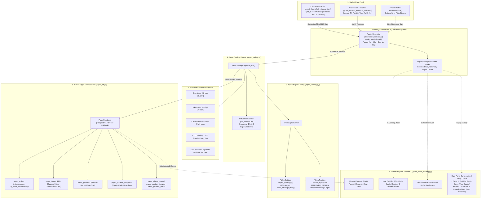
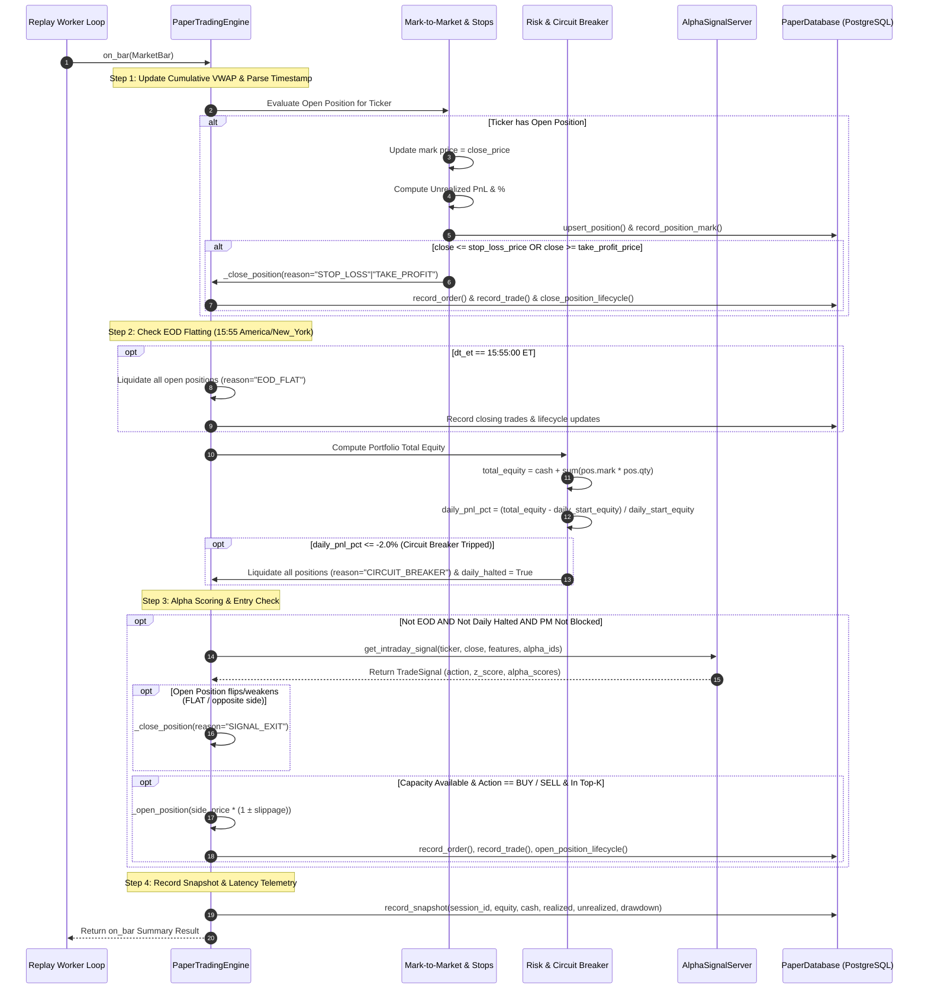
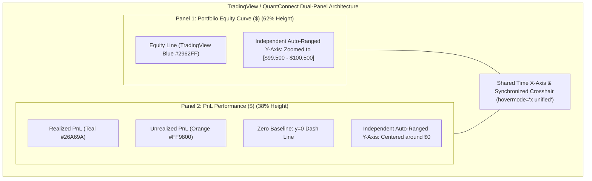

# Real-Time Event-Driven Paper Trading & Market Replay Specification

## 1. Executive Summary & Objective

The **Real-Time Paper Trading Simulation & Market Replay Module** (Rubric M1-38, M1-39) provides an institutional-grade, event-driven paper execution engine and market replay controller. It bridges big data analytical serving (ClickHouse), quantitative alpha research (Alpha Registry & Signal Server), and real-time portfolio execution with strict ACID persistence (PostgreSQL / SQLite).

---

## 2. Core Execution Engine (`PaperTradingEngine`)

### 2.1 Dependencies & Initialization
Located at [`src/quant_edai/quant/paper_trading.py`](file:///Users/nguyenbuihoanglong/Desktop/FSDS/edai_11/quant_edai/src/quant_edai/quant/paper_trading.py#L87-L187).

- **Dependencies**:
  - `PaperDatabase`: Data access layer for PostgreSQL with automatic SQLite fallback (`paper_db.py`).
  - `AlphaSignalServer`: Multi-alpha signal scoring and equal-average aggregation (`alpha_serving.py`).
  - `PMControlService`: Portfolio Manager governance checks and emergency circuit overrides (`pm_controls.py`).
  - `market_time`: Timezone utilities for Eastern Time (ET) session windows and EOD flat checks (`common/market_time.py`).
- **Institutional Execution Parameters**:
  - `starting_cash`: `$100,000.00` default portfolio cash.
  - `trade_notional`: Fixed `$10,000.00` notional position size.
  - `max_positions`: 5 concurrent open positions.
  - `slippage_bps`: `5.0 bps` ($0.05\%$) institutional spread and market impact.
  - `commission_bps`: `1.0 bps` ($0.01\%$) broker/exchange fee.
  - `tp_bps`: `+20.0 bps` ($+0.20\%$) Take-Profit target.
  - `sl_bps`: `-12.0 bps` ($-0.12\%$) Stop-Loss threshold.
  - `max_daily_loss_pct`: `-2.0%` daily portfolio circuit breaker.
  - `alpha_source`: `"store"` (pure `AlphaSignalServer`) or `"inline"` (local rolling buffers).

### 2.2 Complete `on_bar()` Sequence Flow

---

## 3. Alpha Research & Signal Serving Stack

### 3.1 10-Alpha Strategy Catalog (`alpha_catalog.py`)
All alphas operate under standardized `FeatureContext` and output normalized `(z_score, confidence)`:
1. `alpha_mom_z`: OHLCV return rolling z-score momentum.
2. `alpha_vwap_z`: Close vs. VWAP deviation z-score.
3. `alpha_rsi_mr`: RSI-14 mean-reversion factor.
4. `alpha_macd_z`: MACD histogram z-score.
5. `alpha_sma_cross`: SMA 20/50 ratio trend factor.
6. `alpha_vol_break`: Price breakout vs. rolling volatility.
7. `alpha_volume_z`: Volume surge z-score.
8. `alpha_ml_prob`: Centered ML directional probability $(P_{\text{ML}} - 0.5) \times 4.0$.
9. `alpha_composite_eq`: Equal-weight blend of momentum, technical, and ML factors.
10. `alpha_regime_adapt`: Market regime-adaptive factor weighting (Bull / Bear / Sideway).

### 3.2 Dual Scoring Modes: Strict vs. Fallback
- `score_strategy_strict()`: Strictly evaluates real features and clean rolling buffers. Returns `(0.0, 0.0)` if inputs are missing; strictly **forbids** synthetic trigonometric imputation.
- `score_strategy()`: Fallback mode for smoke testing with graceful geometric imputation.

### 3.3 Multi-Alpha Combination: Equal Average (Rule 5)
For an ensemble of $K$ active alphas:
$$Z_{\text{combined}} = \frac{1}{K} \sum_{i=1}^{K} Z_i, \quad \text{Action} = \begin{cases} \text{BUY} & \text{if } Z_{\text{combined}} \ge \bar{Z}_{\text{entry}} \\ \text{SELL} & \text{if } Z_{\text{combined}} \le -\bar{Z}_{\text{entry}} \\ \text{FLAT} & \text{otherwise} \end{cases}$$

---

## 4. Replay Controller & Concurrency Management

Located at [`src/quant_edai/serving/dashboard/dashboard_service.py`](file:///Users/nguyenbuihoanglong/Desktop/FSDS/edai_11/quant_edai/src/quant_edai/serving/dashboard/dashboard_service.py#L2285).

- **Execution Threading**: Runs in a dedicated background `threading.Thread(daemon=True)` to prevent blocking the Streamlit UI.
- **Pacing Mechanism**: Adjustable replay speed (1x, 5x, 10x, 25x, 50x) via `time.sleep(0.05 / speed)`.
- **Step-by-Step Execution**: While paused, pressing `Step` queues `pending_steps += 1`, allowing exactly one bar to process through the engine before pausing again.
- **Session Modes**:
  - **Approved Ensemble Mode**: Strictly validates `load_approved_replay_ensemble(dataset_id)` and freezes session metadata into `replay_session_ensemble`.
  - **Single Alpha Studio Mode**: Allows executing any standalone registered alpha with isolated session IDs.

---

## 5. PostgreSQL ACID Ledger & State Persistence

### 5.1 Tables & Schema Constraints
1. **`paper_orders`**:
   - Primary Key: `order_id VARCHAR(64)`.
   - Idempotency Guarantee: `CONSTRAINT uq_order_idempotency UNIQUE (session_id, ticker_symbol, bar_timestamp, direction, order_type)`.
2. **`paper_trades`**: Executed fills with `fill_price`, `slippage_bps`, `commission`, `realized_pnl`, `executed_at`, and ML provenance tags.
3. **`paper_positions`**: Current active mark-to-market positions keyed by `(session_id, ticker_symbol)`.
4. **`paper_portfolio_snapshots`**: Sequential portfolio valuation keyed by `snapshot_id BIGSERIAL`.
5. **Additive Audit Tables**:
   - `paper_alpha_scores`: Historical individual alpha scores per bar.
   - `paper_position_lifecycle`: End-to-end trade roundtrips with entry, peak open mark, exit reason, and net realized PnL.
   - `paper_position_marks`: Granular mark-to-market trajectory per open position.

---

## 6. Streamlit Visual Terminal: Dual-Panel Performance Charts

Located at [`src/quant_edai/serving/dashboard/pages/3_Real_Time_Trading.py`](file:///Users/nguyenbuihoanglong/Desktop/FSDS/edai_11/quant_edai/src/quant_edai/serving/dashboard/pages/3_Real_Time_Trading.py).

To eliminate the **Scale Mismatch** problem (where small PnL variations appear flat against $100,000 cash), the terminal uses a **TradingView / QuantConnect dual-panel stacked layout**:

- **Synchronized Hover**: Crosshairs and tooltips move simultaneously across both panels.
- **Zero-Lag Telemetry**: In-memory `live_metrics` are pushed to the UI, while historical audit reconciliation reads PostgreSQL on demand.
