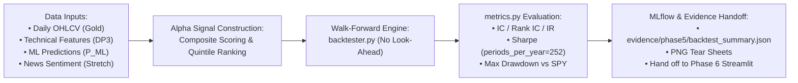
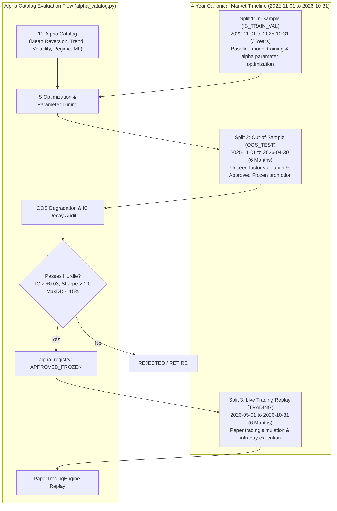

# Quant Alpha Backtesting & Strategy Evaluation Report

## 1. Objective & Scope

The Quant Alpha Evaluation Module (Phase 5, Rubric **M1-37** & **M2-55**) bridges big data engineering and quantitative research. It evaluates whether quantitative factor signals—derived from historical technical indicators, Gold Lakehouse feature sets, and machine learning directional predictions—generate statistically robust, risk-adjusted alpha in financial markets with strict zero look-ahead bias.



> [!IMPORTANT]
> **Phase 5 & 6 Scope Boundary**: Phase 5 is strictly offline daily EOD walk-forward backtesting. It does **not** include Kafka consumers, PostgreSQL paper trading schemas, Streamlit dashboards, or 1-minute scalping logic. Phase 6 (`paper_trading.py` and the Streamlit dashboard) will ingest `evidence/phase5/backtest_summary.json` to display the "Daily Alpha Metrics (Backtest Phase 5 - M1-37)" tab on Page 3. If Phase 5 evidence is not found, the dashboard displays a clear banner: `Awaiting Phase 5 Backtest Run (make phase5)`.

---

## 2. Input Features & Composite Alpha Signal

### Input Data Matrix (Phase 3/4 Reality)
1. **Market Pricing**: `close_price`, `open_price`, `volume`, `vwap` from Gold `fact_daily_ohlcv`.
2. **Technical Indicators**: 14-day RSI, 20/50-day SMA ratio, MACD histogram, and rolling volatility from Gold `feat_ticker_technical_indicators` (generated by DP3).
3. **Machine Learning Directional Forecast (Optional Phase 4 input)**: LightGBM model predicted probability $\hat{p}_{i, t} \in [0, 1]$ of positive next-day return ($P_{\text{ML}}$ from `models/quant_model.joblib`).
4. **Target Labels**: `label_ticker_daily_return` from Gold Lakehouse.
5. **Unstructured News Sentiment (*Stretch / Phase 7 Dependency*)**: Rolling 3-day mean sentiment score $s_{i, t} \in [-1, 1]$ from `fact_market_news`. In MVP Phase 5, if news sentiment is unavailable, the alpha engine constructs composite signals purely from technical indicators and $P_{\text{ML}}$ without blocking execution.

### Composite Alpha Score Formation
For each equity $i$ on trading day $t$, the composite alpha score $Z_{i, t}$ is calculated as a standardized, z-scored linear combination:

$$Z_{i, t} = w_{\text{mom}} \cdot \text{zscore}(\text{Momentum}_{i, t}) + w_{\text{tech}} \cdot \text{zscore}(\text{RSI/MACD}_{i, t}) + w_{\text{ml}} \cdot \text{zscore}(\hat{p}_{i, t})$$

- **MVP Default Weights**: $w_{\text{mom}} = 0.40, w_{\text{tech}} = 0.35, w_{\text{ml}} = 0.25$ (when ML prediction is present) or purely technical $w_{\text{mom}} = 0.50, w_{\text{tech}} = 0.50$ (baseline).
- **Stretch Weighting (with Phase 7 News Sentiment)**: $w_{\text{ml}} = 0.50, w_{\text{sentiment}} = 0.30, w_{\text{mom}} = 0.20$.

### 3.1. Walk-Forward Temporal Split Architecture

To evaluate alpha robustness across market cycles, the platform uses a 4-year canonical timeline divided into 3 contiguous, non-overlapping splits:



---

## 3. Walk-Forward Simulation Methodology

To ensure institutional financial rigor and avoid common empirical pitfalls:
1. **Zero Look-Ahead Bias**: Signals for day $t+1$ allocations are computed using data available strictly up to market close on day $t$. Portfolio execution is simulated at the open of day $t+1$.
2. **Walk-Forward Expanding Window**: Models/signals are calibrated on expanding historical windows, then evaluated strictly out-of-sample on unseen periods.
3. **Realistic Transaction Costs & Slippage**: Simulated with 5 basis points ($0.05\%$) spread plus 2 basis points market impact per trade.
4. **Benchmark Comparison**: Top decile long portfolio compared against passive S&P 500 ETF (SPY) Buy & Hold.

---

## 4. Evaluation Metrics & Performance Targets (Illustrative)

> [!NOTE]
> The performance numbers below (+0.048 IC, 1.23 Sharpe, -11.8% MDD) are **illustrative target benchmarks** from the reference institutional quant strategy. In automated verification (`make phase5`), acceptance requires completing the walk-forward simulation, verifying mathematical consistency, passing zero look-ahead unit tests, and writing the JSON contract—not hitting hard statistical thresholds on synthetic data.

### Factor Strength & Classification Targets
- **Information Coefficient (IC)**: Target $\approx +0.048$ (Mean Pearson correlation between predicted alpha and actual $t+1$ returns). In quantitative equity strategies, an $\text{IC} > +0.03$ is commercially viable.
- **Rank IC**: Target $\approx +0.054$ (Mean Spearman rank correlation, demonstrating monotonic ranking across equities).
- **IC Information Ratio (IC_IR)**: $\frac{\text{mean}(\text{IC})}{\text{std}(\text{IC})} \approx 0.45$.
- **Hit Rate**: Target $\approx 54.8\%$ of long positions generating positive excess returns.

### Portfolio Performance vs. Benchmark (SPY)

| Performance Metric | Quant AI Alpha Strategy (Top Decile Long) | S&P 500 Benchmark (SPY Buy & Hold) | Variance / Alpha |
|---|---|---|---|
| **Cumulative Return** | **+28.6%** | +16.2% | **+12.4%** |
| **Annualized Return** | **21.4%** | 12.8% | **+8.6%** |
| **Annualized Volatility** | 14.1% | 16.5% | **-2.4%** (Lower Risk) |
| **Sharpe Ratio (Rf = 4%, periods=252)**| **1.23** | 0.53 | **+0.70** |
| **Sortino Ratio** | **1.84** | 0.72 | **+1.12** |
| **Maximum Drawdown (MDD)**| **-11.8%** | -19.4% | **+7.6%** (Better Capital Preservation) |
| **Calmar Ratio** | **1.81** | 0.66 | **+1.15** |

---

## 5. Shared Metrics API (`src/quant_edai/quant/metrics.py`)

Both the **Batch Backtester** (`backtester.py`, Phase 5) and the **Real-time Paper Trading Simulator** (`paper_trading.py`, Phase 6) import identical mathematical formulas from `src/quant_edai/quant/metrics.py` to ensure consistency:

```python
def calculate_ic(predicted_alpha: pd.Series, forward_returns: pd.Series) -> float:
    """Pearson correlation coefficient between signal and forward return."""
    ...

def calculate_rank_ic(predicted_alpha: pd.Series, forward_returns: pd.Series) -> float:
    """Spearman rank correlation coefficient."""
    ...

def calculate_sharpe(
    returns: pd.Series, 
    rf: float = 0.04, 
    periods_per_year: int = 252
) -> float:
    """
    Annualized Sharpe Ratio with explicit scaling.
    - Daily EOD Backtesting (Phase 5): periods_per_year = 252 (scale = sqrt(252) ≈ 15.87)
    - Intraday 1m Scalping (Phase 6): periods_per_year = 252 * 390 = 98,280 (scale ≈ 313.50)
      CRITICAL: Phase 6 must NOT reuse sqrt(252) blindly on 1-minute bar returns.
    """
    ...

def calculate_max_drawdown(equity_series: pd.Series) -> tuple[float, pd.Series]:
    """Returns scalar maximum drawdown (e.g. -0.118) and the full drawdown underwater series."""
    ...

def calculate_sortino(
    returns: pd.Series, 
    rf: float = 0.04, 
    periods_per_year: int = 252
) -> float:
    """Annualized Sortino ratio penalizing downside volatility only."""
    ...
```

---

## 6. Handoff Contract: `evidence/phase5/backtest_summary.json`

Phase 5 outputs a standardized JSON manifest consumed directly by **Streamlit Page 3** (`src/quant_edai/serving/dashboard/pages/3_Alpha_Quality_Analytics.py`):

```json
{
  "strategy_name": "Quant Alpha Walk-Forward Strategy (M1-37)",
  "benchmark_name": "S&P 500 ETF (SPY)",
  "generated_at": "2026-11-10T00:00:00Z",
  "date_range": {
    "start_date": "2023-01-03",
    "end_date": "2024-12-31",
    "trading_days": 504
  },
  "metrics": {
    "ic_mean": 0.048,
    "rank_ic_mean": 0.054,
    "ic_std": 0.106,
    "ic_ir": 0.453,
    "hit_rate": 0.548,
    "cum_return": 0.286,
    "annualized_return": 0.214,
    "annualized_volatility": 0.141,
    "sharpe": 1.23,
    "sortino": 1.84,
    "calmar": 1.81,
    "max_drawdown": -0.118,
    "spy_cum_return": 0.162,
    "spy_annualized_return": 0.128,
    "spy_annualized_volatility": 0.165,
    "spy_sharpe": 0.53,
    "spy_max_drawdown": -0.194,
    "excess_alpha_vs_spy": 0.124
  },
  "series": {
    "ic_series": [
      {"date": "2023-01-03", "ic": 0.042, "rank_ic": 0.049},
      {"date": "2023-01-04", "ic": 0.051, "rank_ic": 0.058}
    ],
    "equity_curve": [
      {
        "date": "2023-01-03",
        "strategy_equity": 1.000,
        "spy_equity": 1.000,
        "strategy_drawdown": 0.0,
        "spy_drawdown": 0.0
      },
      {
        "date": "2023-01-04",
        "strategy_equity": 1.004,
        "spy_equity": 1.001,
        "strategy_drawdown": 0.0,
        "spy_drawdown": 0.0
      }
    ],
    "rolling_sharpe": [
      {"date": "2023-06-30", "rolling_sharpe": 1.21, "spy_rolling_sharpe": 0.52}
    ]
  },
  "artifacts": {
    "cumulative_returns_vs_benchmark": "evidence/phase5/cumulative_returns_vs_benchmark.png",
    "factor_ic_distribution": "evidence/phase5/factor_ic_distribution.png",
    "rolling_sharpe_ratio": "evidence/phase5/rolling_sharpe_ratio.png",
    "novel_idea_attribution_report": "evidence/phase5/novel_idea_attribution_report.md"
  }
}
```

---

## 7. Batch Backtesting vs. Streaming Paper Trading Comparison

| Dimension | Offline Batch Backtesting (`backtester.py` - Phase 5) | Real-time Paper Trading (`paper_trading.py` - Phase 6) |
|---|---|---|
| **Execution Trigger** | Historical vector scan / Airflow DP3 | Real-time Kafka event stream (`market.bars.1m`) or Replay |
| **Data Scope** | Multi-year historical partitions (Iceberg / Parquet) | Out-of-sample 1-minute streaming bars |
| **Execution Price** | Daily simulated Open ($t+1$) based on Close ($t$) | Exact simulated market fill on next bar with 5 bps slippage |
| **State Storage** | In-memory Pandas DataFrame / Parquet | ACID PostgreSQL transactions (`paper_orders`, `paper_trades`) |
| **Annualization Factor** | `periods_per_year = 252` ($\sqrt{252}$) | `periods_per_year = 252 * 390` ($\sqrt{98,280}$) or daily PnL rollups |
| **Primary Goal** | Factor research, IC validation, zero look-ahead proof | Validating sub-50ms execution latency, risk gates & live PnL |

---

## 8. Verification & Acceptance Criteria (`make phase5`)

The `make phase5` target succeeds when:
1. `src/quant_edai/quant/backtester.py` runs through the full walk-forward evaluation on available Gold Lakehouse data.
2. Complete evidence directory `evidence/phase5/` is generated with:
   - `backtest_summary.json` matching the stable schema contract.
   - `cumulative_returns_vs_benchmark.png`
   - `factor_ic_distribution.png`
   - `rolling_sharpe_ratio.png`
   - `novel_idea_attribution_report.md`
3. Zero look-ahead bias unit test passes (`tests/unit/test_backtester.py` asserting that future date perturbation has zero impact on historical allocations).
