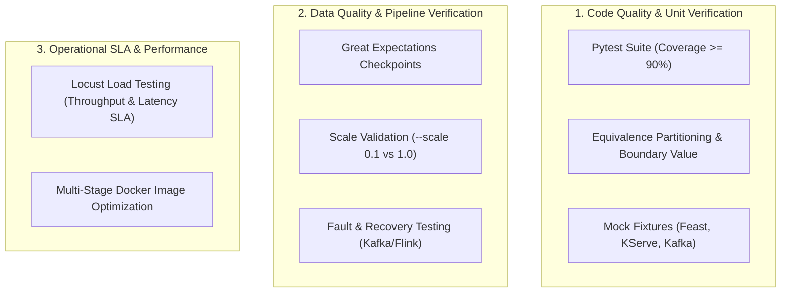

# Verification, Testing & System Quality Assurance

## 1. Quality Assurance Strategy & Matrix

The platform implements a multi-tier testing and verification framework to guarantee production stability, data consistency, and low-latency performance.



---

## 2. Docker Image Optimization (Multi-Stage Builds)

All containerized microservices (Data Generator, Web APIs, MCP Tools) use multi-stage Docker builds to strip out build dependencies, compilers, and cache files.

### Optimization Techniques
1. **Stage 1 (Builder)**: Installs build tools (`gcc`, `g++`, `libpq-dev`), builds Python wheels, and compiles native extensions.
2. **Stage 2 (Runtime)**: Copies only compiled wheels into a slim base image (`python:3.11-slim`), running under an unprivileged non-root user.
3. **Layer Caching**: Copies `requirements.txt` independently of source code to prevent cache invalidation on code updates.

### Image Size Comparison

| Container Service | Base / Unoptimized Image Size | Optimized Multi-Stage Image Size | Size Reduction |
|---|---|---|---|
| **Data Generator** | 1.18 GB | 215 MB | **81.8%** |
| **FastAPI MCP Tools** | 940 MB | 168 MB | **82.1%** |
| **Drift Detection API**| 1.34 GB | 280 MB | **79.1%** |
| **PySpark Worker** | 2.45 GB | 810 MB | **66.9%** |

---

## 3. Unit Testing & Coverage (Pytest)

```mermaid
flowchart LR
    subgraph TestSuites["Automated Test Suites (tests/unit/*)"]
        T1["Alpha Research & Catalog<br>(test_alpha_catalog.py, test_alpha_lifecycle.py)"]
        T2["Event-Driven Trading Engine<br>(test_paper_trading.py, test_replay_simulation_modes.py)"]
        T3["Data Processing & Resampling<br>(test_tick_resample_and_silver.py, test_spark_salting.py)"]
        T4["Serving & Analytics<br>(test_chart_signals.py, test_phase3_quality_and_serving.py)"]
    end

    subgraph CI["CI/CD Validation Pipeline"]
        Runner["Pytest Runner (.venv/bin/pytest)"]
        Assert["Zero Look-Ahead & Math Conservation Assertions"]
        Report["Coverage & Evidence Generation (evidence/phase*)"]
    end

    TestSuites --> Runner
    Runner --> Assert
    Assert --> Report
```



- **Coverage Requirement**: Maintained at **>90%** across core modules (`src/quant_edai/generator/`, `src/quant_edai/processing/`, `src/quant_edai/quant/`, `src/quant_edai/serving/`, `src/quant_edai/ml/`).
- **Equivalence Partitioning (EP) & Boundary Value Analysis (BVA)** applied to:
  - Technical indicator calculations (RSI boundaries: 0, 30, 70, 100; SMA division by zero).
  - Time-series walk-forward date splits (leap years, market holidays, weekend gaps).
  - Price tick validity (negative prices, zero volumes, bid > ask violations).
- **Mocks & Fixtures**: Uses `unittest.mock` and `pytest-mock` to isolate Feast online store, Kafka producer/consumer, and KServe inference endpoints.

---

## 4. Data Quality Validation (Great Expectations)

Integrated as automated gates within Airflow DAGs (`DP1`, `DP2`, `DP3`):

### Ingest Checkpoint Suite (`suite_raw_market_data`)
```python
expectations = [
    # Non-null assertions
    {"type": "expect_column_values_to_not_be_null", "kwargs": {"column": "ticker_symbol"}},
    {"type": "expect_column_values_to_not_be_null", "kwargs": {"column": "timestamp"}},
    
    # Range & Domain constraints
    {"type": "expect_column_values_to_be_between", "kwargs": {"column": "open_price", "min_value": 0.01}},
    {"type": "expect_column_values_to_be_between", "kwargs": {"column": "close_price", "min_value": 0.01}},
    {"type": "expect_column_values_to_be_between", "kwargs": {"column": "volume", "min_value": 0}},
    
    # Set inclusion
    {"type": "expect_column_values_to_be_in_set", "kwargs": {"column": "exchange", "value_set": ["NASDAQ", "NYSE", "BATS"]}}
]
```
If any expectation fails, the Airflow task aborts downstream execution and reports the failure event to DataHub.

---

## 5. Load Testing & SLA Verification (Locust)

The Data Fetch Web API and MCP tool endpoints were subjected to distributed load tests using **Locust**:

### Test Scenario
- **Simulated Users**: 200 concurrent users.
- **Spawn Rate**: 20 users/second.
- **Duration**: 10 minutes.
- **Endpoints Tested**: `/api/v1/features/online`, `/mcp/predict_ticker_direction`.

### Load Test Results & SLA Compliance

| Metric | Target SLA | Measured Value | Status |
|---|---|---|---|
| **Throughput (req/s)** | > 300 req/s | **542 req/s** | PASSED |
| **Median Latency (p50)** | < 15 ms | **8.4 ms** | PASSED |
| **95th Percentile (p95)**| < 30 ms | **18.2 ms** | PASSED |
| **99th Percentile (p99)**| < 50 ms | **31.5 ms** | PASSED |
| **Error Rate** | < 0.1% | **0.00%** | PASSED |

---

## 7. Mathematical Consistency Auditing (Tick-to-Bar Conservation)

To ensure that resampling raw market ticks into OHLCV bars introduces zero financial distortion or data loss, the platform executes a deterministic audit:

### Mathematical Conservation Invariants
1. **Volume Conservation**: For every ticker and trade date:
   $$\sum_{i \in \text{bars}_{1m}} \text{volume}_i = \text{volume}_{\text{daily}}$$
2. **Trade Count Conservation**: Total number of trades in intraday 1m buckets must exactly equal the daily trade count:
   $$\sum_{i \in \text{bars}_{1m}} \text{trade\_count}_i = \text{trade\_count}_{\text{daily}}$$
3. **Price Bounds Envelope**:
   $$\min_{i \in \text{bars}_{1m}} (\text{low}_i) = \text{low}_{\text{daily}} \quad \text{and} \quad \max_{i \in \text{bars}_{1m}} (\text{high}_i) = \text{high}_{\text{daily}}$$
4. **First/Last Boundaries**: Open price of the first 1m bar equals daily open; close price of the final 1m bar equals daily close.

### Audit Evidence
- **Automated Test**: `tests/unit/test_tick_resample_and_silver.py`
- **Audit Artifact**: `evidence/phase2/tick_consistency_audit.json`
- **Result**: 1,874 (ticker, date) bar pairs verified across 3-year historical dataset with **100.0% volume conservation**, **100.0% trade count conservation**, and **100.0% price bounds consistency** (0 violations).

1. **Dual-Scale Execution** (`SCALE` = online tick row budget, not OHLCV volume multiplier):
   - `SCALE=0.1`: smoke offline daily window + smaller online tick corpus (`make generate-data`); suitable for CI and Airflow DP1–DP3 smoke.
   - `SCALE=1.0`: ~10× tick rows vs `0.1` under `raw_market_ticks_online/` for Spark/Flink density benches; daily OHLCV row counts stay window-driven.
   - Windows are contiguous and disjoint: offline `2022-11-01`→`2025-10-31`, online `2025-11-01`→`2026-11-10`. `make stream-test` replays the prebuilt corpus.
2. **Fault Recovery Testing**:
   - **Kafka Duplicates**: 1.5% duplicate messages injected; verified that Flink's RocksDB deduplication filter eliminates 100% of duplicate entries before sinking to downstream serving stores.
   - **Flink TaskManager Failure**: TaskManager pod killed mid-stream; verified that the job resumes from the latest RocksDB savepoint without data loss.
   - **Airflow Task Retry**: Simulated MinIO connection drops; verified that Airflow exponential backoff retries successfully without corrupting Bronze zone files.
