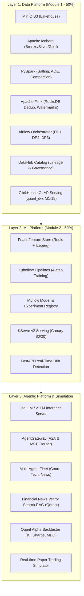
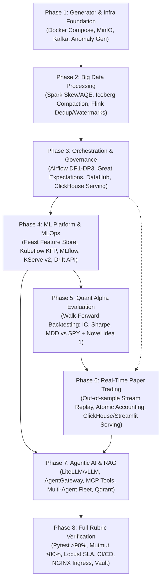

# Master Implementation Plan: Quant AI Engineering Platform

> **Target Platform**: Quant EDAI (End-to-End Medallion Lakehouse, ML & Agentic Alpha Platform)  
> **Coursework Specification**: EDAI K11 Master Rubric (`rubic/EDAI K11.xlsx`)  
> **Architecture Pattern**: Layer-Based Architecture with Domain-Driven Modules  
> **Execution Strategy**: 8-Phase Phased Rollout with Strict Dependency Enforcement & Reproducibility  
> **Current State**: Phase 1 (Generator + Compose infra) implemented & verified; Phases 2–8 remain planned

---

## Table of Contents

1. [Executive Summary & Architecture Principles](#1-executive-summary--architecture-principles)
2. [Proposed Repository Structure & Code Organization](#2-proposed-repository-structure--code-organization)
3. [Unified Makefile Specification (Developer & Reviewer DX)](#3-unified-makefile-specification-developer--reviewer-dx)
4. [Phase Execution Dependency Graph](#4-phase-execution-dependency-graph)
5. [Phase-by-Phase Implementation Specifications](#5-phase-by-phase-implementation-specifications)
   - [Phase 1: Data Generator + Infrastructure Foundation](#phase-1-data-generator--infrastructure-foundation)
   - [Phase 2: Kafka/Debezium + Medallion + Spark/Flink](#phase-2-kafkadebezium--medallion--sparkflink)
   - [Phase 3: Airflow + Quality + Governance + Serving](#phase-3-airflow--quality--governance--serving)
   - [Phase 4: Feast + MLflow + Kubeflow + KServe](#phase-4-feast--mlflow--kubeflow--kserve)
   - [Phase 5: Quant Alpha Evaluation + Novel Ideas](#phase-5-quant-alpha-evaluation--novel-ideas)
   - [Phase 6: Real-time Paper Trading Simulation & Alpha Dashboard](#phase-6-real-time-paper-trading-simulation--alpha-dashboard)
   - [Phase 7: RAG + LLM + MCP + Multi-Agent](#phase-7-rag--llm--mcp--multi-agent)
   - [Phase 8: Full Rubric Verification + Optimization](#phase-8-full-rubric-verification--optimization)
6. [Reviewer Walkthrough & Demonstration Guide](#6-reviewer-walkthrough--demonstration-guide)
7. [Evidence Directory Conventions & Traceability](#7-evidence-directory-conventions--traceability)

---

## 1. Executive Summary & Architecture Principles

The Quant AI Engineering Platform is an institutional-grade data, machine learning, and generative AI platform tailored for quantitative research and market intelligence on US Equities (Mega-Cap Tech & S&P 100).



### Core Implementation Principles
1. **No Premature Optimization / Over-Engineering**: Avoid unwieldy tooling; implement cleanly in standard Python (`python 3.11+`) using `uv` for lightning-fast, reproducible dependency management.
2. **Local-First Containerization**: Everything runs out-of-the-box on Docker Compose. Kind/Helm are utilized strictly for Kubernetes-specific rubric deliverables (KServe, Helm atomic upgrades, KEDA).
3. **Dual-Scale Execution Strategy** (`SCALE` = tick row budget only):
   - Offline: 3y daily Bronze OHLCV (`2022-11-01`→`2025-10-31`); `SCALE` does **not** multiply OHLCV trade volume.
   - Online: contiguous 1y tick corpus (`2025-11-01`→`2026-11-10`) under `raw_market_ticks_online/`; density ≈ `50 * n_tickers * n_sessions * SCALE`.
   - `SCALE=0.1` (default smoke/dev): small local footprint. `SCALE=1.0`: ~10× tick rows for Spark/Flink density benches. Use `make generate-data` for offline daily + online ticks; `make stream-test` replays the corpus.
4. **Mock / Fallback Fallbacks for Smooth Review**:
   - LLM: Provides a zero-GPU CPU fallback (LiteLLM proxy with mock OpenAI-compatible server or HuggingFace quantized CPU runner) alongside instructions for vLLM.
   - K8s/Cloud: Provides local docker adapters for services so the entire system can be evaluated without requiring paid cloud infrastructure.
5. **Strict Financial Separation**:
   - **No Live Trading Execution**: The system implements rigorous Factor Backtesting and Real-Time Paper Trading Simulation only. Broker execution APIs are strictly out of scope.
6. **Evidence-Driven Grading**: No rubric criterion is marked complete without deterministic automated tests and physical artifact logs in `evidence/`.

---

## 2. Proposed Repository Structure & Code Organization

The repository adopts a **Layer-Based Architecture combined with Domain Modules**, strictly separating business logic from infrastructure adapters.

```
quant_edai/
├── Makefile                               # Unified developer & reviewer entry point
├── pyproject.toml                         # uv / pip dependencies and project metadata
├── README.md                              # Master overview, quickstart & runbook
├── coursework_proposal.md                 # Official coursework proposal
├── configs/                               # Centralized, environment-driven configurations
│   ├── env/                               # Environment profiles (.env.local, .env.test)
│   ├── contracts/                         # Data contracts & JSON schemas (market_bar, news, ticks)
│   ├── generator/                         # Fault injection & generator settings (scale, skew rates)
│   ├── quality/                           # Great Expectations checkpoint suites
│   └── feast/                             # Feast feature store definitions (feature_store.yaml)
├── src/                                   # Application source code (modular package)
│   └── quant_edai/
│       ├── __init__.py
│       ├── generator/                     # Data generator & synthetic fault injector
│       │   ├── data_generator.py          # Core engine (GBM + Jump Diffusion)
│       │   ├── faults_injector.py         # Skew, schema evolution, duplicates, late ticks
│       │   └── streaming_producer.py      # Kafka tick publisher
│       ├── ingestion/                     # Ingestion utilities (S3, Kafka)
│       │   └── s3_uploader.py             # MinIO external bucket staging
│       ├── processing/                    # Big data batch & streaming engines
│       │   ├── spark/                     # PySpark batch jobs
│       │   │   ├── baseline_job.py        # Unoptimized baseline showing skew bottleneck
│       │   │   ├── skew_optimized.py      # Key salting, AQE, broadcast joins
│       │   │   ├── scd2_builder.py        # SCD Type 2 dimension transformer
│       │   │   ├── iceberg_compaction.py  # Iceberg binpack small-file rewrite
│       │   │   └── compute_features.py    # DP3 technical indicator calculator
│       │   └── flink/                     # Apache Flink streaming jobs
│       │       ├── streaming_job.py       # Event-time watermarks & tumbling/sliding windows
│       │       └── streaming_dedup.py     # Stateful RocksDB deduplication filter
│       ├── quality/                       # Data validation & governance hooks
│       │   ├── gx_runner.py               # Great Expectations execution runner
│       │   └── datahub_emitter.py         # DataHub lineage & assertion emitter
│       ├── serving/                       # Analytical & operational serving adapters
│       │   ├── api_feature_fetch.py       # FastAPI online feature fetcher (Pydantic, async)
│       │   ├── clickhouse_sync.py         # ClickHouse daily & intraday synchronization (M1-19)
│       │   └── candlestick_loader.py      # Multi-tier candlestick serving (ClickHouse/Parquet)
│       ├── ml/                            # Machine learning lifecycle components
│       │   ├── trainer.py                 # LogisticRegression vs LightGBM trainer
│       │   ├── drift_api.py               # Real-time KS/PSI drift detection service
│       │   ├── kfp/                       # Kubeflow Pipelines definition
│       │   │   └── pipeline.py            # 4-step training pipeline (Load, Split, Train, Eval)
│       │   └── feast/                     # Feast entities and feature views
│       ├── llm/                           # LLM and Multi-Agent platform
│       │   ├── gateway/                   # AgentGateway router (A2A & MCP)
│       │   ├── mcp/                       # Containerized MCP microservices
│       │   │   ├── tool_features.py       # Feast feature retrieval tool
│       │   │   ├── tool_predictor.py      # KServe inference proxy tool
│       │   │   └── tool_news_rag.py       # Qdrant financial news vector search tool
│       │   ├── rag/                       # RAG text processing & embedding
│       │   │   ├── chunker.py             # Recursive text splitter with metadata
│       │   │   └── indexer.py             # Qdrant vector indexer
│       │   └── agents/                    # Multi-agent fleet
│       │       ├── coordinator_agent.py   # Hierarchical coordinator (synthesis)
│       │       ├── tech_quant_agent.py    # Quantitative technical analyst
│       │       └── sentiment_news_agent.py# Qualitative news sentiment analyst
│       └── quant/                         # Quant finance domain logic
│           ├── metrics.py                 # Unified formulas (IC, Sharpe, MDD, Returns)
│           ├── backtester.py              # Walk-forward alpha evaluation engine
│           └── paper_trading.py           # Real-time streaming simulator (ACID accounting)
├── orchestration/                         # Pipeline orchestration
│   └── dags/                              # Apache Airflow DAGs
│       ├── dag_dp1_raw_ingestion.py       # DP1: External MinIO -> Bronze + GX
│       ├── dag_dp2_silver_gold.py         # DP2: Bronze -> Silver/Gold Iceberg + SCD2
│       ├── dag_dp3_features.py            # DP3: Gold -> Offline Feature Table + Lineage
│       ├── dag_rag_financial_news.py      # RAG: Bronze News -> Qdrant Embeddings
│       ├── dag_feast_materialize.py       # Materialize Iceberg -> Redis online
│       └── dag_drift_retrain.py           # Periodic drift check -> Kubeflow trigger
├── sql/                                   # Database DDLs and schemas
│   ├── iceberg/                           # Iceberg table definitions & partition specs
│   └── clickhouse/                        # ClickHouse OLAP table schemas & indexes
├── infra/                                 # Infrastructure as Code & deployment descriptors
│   ├── docker-compose.yml                 # Local multi-service composition (Silo/MinIO-compatible, Kafka KRaft, Postgres, Redis)
│   ├── docker/                            # Generator Dockerfiles (baseline + multi-stage)
│   ├── k8s/                               # Kubernetes manifests (Kind cluster)
│   ├── helm/                              # Helm charts for MCP tools and services
│   ├── monitoring/                        # Prometheus, Grafana, Loki, Jaeger configs
│   ├── terraform/                         # Terraform IaC for GKE / Cloud
│   └── ansible/                           # Ansible playbooks and service roles
├── tests/                                 # Automated test suite
│   ├── unit/                              # Pytest unit tests (Target: >90% coverage)
│   ├── property/                          # Hypothesis idempotency tests
│   ├── mutation/                          # Mutmut mutation testing configs
│   ├── integration/                       # Inter-service integration tests
│   ├── e2e/                               # End-to-end pipeline verification
│   └── performance/                       # Locust load tests and model benchmarks
├── evidence/                              # Verifiable execution logs, screenshots & reports
│   ├── phase1/                            # Data generator & infra logs
│   ├── phase2/                            # Spark skew benchmark & Flink dedup logs
│   ├── phase3/                            # Airflow DAGs, GX reports & DataHub lineage
│   ├── phase4/                            # Kubeflow, MLflow & KServe logs
│   ├── phase5/                            # Quant Alpha backtest tear sheets & factor metrics
│   ├── phase6/                            # Real-time paper trading execution logs & dashboard metrics
│   ├── phase7/                            # Agent execution traces & MCP outputs
│   └── phase8/                            # Test coverage, Locust HTML & audit proofs
└── docs/                                  # Technical reports & architecture documentation
    ├── ARCHITECTURE_BLUEPRINT.md
    ├── DATA_PROBLEMS_AND_SKEW.md          # Fault injection specs, cardinality, online/offline ratios
    ├── DOCKER_OPTIMIZATION.md             # Multi-stage Dockerfile rationale & size comparison
    ├── STORAGE_AND_LAKEHOUSE.md
    ├── VERIFICATION_AND_TESTING.md
    ├── QUANT_ALPHA_BACKTESTING.md
    ├── PAPER_TRADING_SIMULATION.md
    └── plan/                              # Master plans & trackers
        ├── IMPLEMENTATION_PLAN.md         # This master plan
        ├── RUBRIC_TRACKER.md              # 200-point rubric verification tracker
        └── IMPLEMENTATION_STATUS.md       # Audit matrix & current gap analysis
```

---

## 3. Unified Makefile Specification (Developer & Reviewer DX)

The `Makefile` serves as the **single source of truth and entry point** for all operations. It enforces parameterization, pre-flight checks, clean exit codes, and non-destructive execution.

### Global Parameters
- `MODE`: `smoke` (default, fast verification), `test` (thorough tests), `full` (production scale).
- `SCALE`: `0.1` (smoke tick budget) or `1.0` (~10× online tick rows); does **not** scale OHLCV volume.
- `OFFLINE_START` / `OFFLINE_END`: default `2022-11-01` / `2025-10-31` (daily OHLCV).
- `ONLINE_START` / `ONLINE_END`: default `2025-11-01` / `2026-11-10` (tick corpus).
- `SEED`: `42` (ensures 100% deterministic, reproducible outputs).

### Core Make Command Interface

| Command | Target Action | Default Parameters | Key Output / Evidence |
|---|---|---|---|
| `make help` | Display all available commands and usage guide | N/A | Terminal formatted help menu |
| `make setup` | Sync `.venv` via `uv sync --extra dev` (or pip fallback) | N/A | Project `.venv` with runtime + test deps |
| `make up` | Start core infra: Silo (MinIO-compatible S3), Kafka KRaft, Postgres, Redis | `MODE=smoke` | Healthy containers via `make status` |
| `make down` | Stop containers without wiping data volumes | N/A | Graceful shutdown confirmation |
| `make reset` | Tear down containers and reset volumes | N/A | Clean local slate |
| `make status` | Check health & endpoints of all active services | N/A | Compose `ps` table |
| `make generate` | Tick-First Bronze generation (`generate-ticks` alias) | `SCALE=0.1 SEED=42` | `raw_market_ticks/` + `data_generation_stats.json` |
| `make generate-ticks` | Pure atomic raw tick generation | `SCALE=0.1 SEED=42` | `raw_market_ticks/` (no synthetic OHLCV) |
| `make resample` | Resample Silver ticks to Gold 1m & daily bars | `ENGINE=sim|spark` | `gold_market_bars_1m/` & `gold_market_bars_daily/` |
| `make generate-offline` | 3y offline tick corpus | `OFFLINE_* SCALE=0.1` | 3y `raw_market_ticks/` |
| `make generate-online-ticks` | Materialize online 1y tick corpus | `ONLINE_* SCALE=0.1` | `raw_market_ticks_online/` + manifest |
| `make generate-data` | Canonical full gen: offline ticks + online ticks | `SCALE=0.1` | raw ticks + online tick corpus |
| `make stream-test` | Replay online tick corpus (builds corpus if missing) | `SEED=42` | `streaming_ticks.jsonl` (`is_late`, `is_duplicate`) |
| `make lakehouse-offline` | Offline daily → Silver → Flink replay → DP3 Gold (`lakehouse-3y` alias) | `SCALE=0.1 ENGINE=sim` | `evidence/phase3/lakehouse_offline_sync.json` |
| `make benchmark-images` | Print multi-stage Dockerfile optimization analysis | N/A | Console summary; see `evidence/phase1/docker_image_size.txt` / `docs/DOCKER_OPTIMIZATION.md` |
| `make phase1` | Phase 1 E2E: `generate` + `stream-test` + MinIO upload + evidence copy | `SCALE=0.1` | Objects in MinIO bucket `external-source`; `evidence/phase1/data_generation_stats.json` |
| `make phase2` | Run Phase 2: Spark Skew Optimization & Flink Stream | `SCALE=0.1` | Iceberg tables populated; Spark UI logs in `evidence/phase2/` |
| `make phase3` | Run Phase 3: Airflow DP1-DP3, GX & DataHub Lineage | `MODE=smoke` | Airflow DAGs executed; DataHub metadata emitted |
| `make phase4` | Run Phase 4: Feast, MLflow, KFP & Drift API | `MODE=smoke` | Model registered on MLflow; Feast online store populated |
| `make phase5` | Run Phase 5: Quant Alpha Backtesting & Novel Ideas | `MODE=smoke` | Backtest tear sheets & factor metrics in `evidence/phase5/` |
| `make phase6` | Run Phase 6: Real-time Paper Trading Simulation & Dashboard | `MODE=smoke` | Live replayed trades & PnL accounting in PostgreSQL |
| `make phase7` | Run Phase 7: RAG Pipeline, MCP Tools & Agent Fleet | `MODE=smoke` | Investment memo synthesized via Multi-Agent fleet |
| `make phase8` | Run Phase 8: Full Rubric Verification Suite | `MODE=smoke` | Coverage $>90\%$, mutation score $>80\%$, Locust SLA |
| `make demo` | End-to-end smoke demonstration in 5 minutes | `SCALE=0.1` | Complete automated walkthrough from data to agent memo |
| `make test` | Run complete unit and property test suites | `MODE=smoke` | Pytest output with coverage report |
| `make test-unit` | Run fast unit tests with mock fixtures | N/A | Unit test pass/fail results |
| `make test-property` | Run Hypothesis property-based idempotency tests | N/A | Hypothesis test results |
| `make test-mutation` | Run `mutmut` mutation testing on changed files | N/A | Mutation score report |
| `make benchmark` | Run Locust load tests and PySpark skew benchmarks | `SCALE=0.1` | Locust HTML SLA report and Spark benchmark log |
| `make verify-rubric` | Run automated rubric assertion scanner | N/A | Updated `docs/plan/RUBRIC_TRACKER.md` summary |

---

## 4. Phase Execution Dependency Graph

The phases are structured with strict topological dependencies. No phase can execute until its predecessor's acceptance criteria are fulfilled.



---

## 5. Phase-by-Phase Implementation Specifications

### Phase 1: Data Generator + Infrastructure Foundation

#### Objective & Scope
Establish the containerized infrastructure baseline and implement the reproducible synthetic data generation engine with injected offline/online anomalies. Specs and measured ratios are documented in `docs/DATA_PROBLEMS_AND_SKEW.md`.

#### Task Breakdown
1. **Infra-01**: Setup `pyproject.toml` + `uv` for Phase 1 runtime deps (`numpy`, `pandas`, `pyarrow`, `pydantic`, `minio`, …) and `[dev]` extras (`pytest`, …). Heavier stacks (`pyspark`, `feast`, …) arrive in later phases.
2. **Infra-02**: Implement `infra/docker-compose.yml` with:
   - **Silo** (`pgsty/silo`) as MinIO-compatible S3 API + console on `:9000`/`:9001` (official `minio/minio` / `minio/mc` Hub images are unavailable for anonymous pull).
   - **`minio-init`** (`amazon/aws-cli`) to provision buckets `external-source` and `lakehouse`.
   - **Kafka in KRaft mode** (no Zookeeper).
   - PostgreSQL and Redis for later metadata / online-store use.
3. **Gen-01**: Implement `src/quant_edai/generator/data_generator.py` with `--scale` / `--seed`. `SCALE` is recorded as `scale_mode=tick_budget` and does **not** multiply OHLCV volume. Offline 3y window via `make generate-offline`.
4. **Gen-02**: Implement `src/quant_edai/generator/faults_injector.py` + `tick_corpus.py` + streaming corpus replay:
   - Volume skew: ~80% volume in 7 Mega-Caps (AAPL, NVDA, MSFT, AMZN, GOOGL, META, TSLA) — measured e.g. `volume_skew_ratio ≈ 0.8009`.
   - Schema evolution: from partition `2024-06-01`, `vwap` / `trade_count` populated (earlier partitions null).
   - Offline duplicates: ~2.0% (`offline_duplicate_rate ≈ 0.0198`).
   - Online tick corpus: `make generate-online-ticks` writes `raw_market_ticks_online/` with late ≈5% and streaming dups ≈1.5% at materialize time; mega-cap tick row share ≈80%.
   - `make stream-test` / `stream-kafka` **replay** that corpus (legacy `--synthetic-batch` for injector unit tests only).
   - Regime drift: Bull → Bear volatility shift (column `market_regime`).
   - Cardinality profile emitted into `generation_stats.json` / `evidence/phase1/data_generation_stats.json`.
5. **Gen-03**: Implement `src/quant_edai/ingestion/s3_uploader.py` to upload staged files into bucket `external-source` (requires reachable Silo/MinIO + Python `minio` package). Local fallback only if upload fails.
6. **Docker-01**: Multi-stage optimization via `infra/docker/Dockerfile.generator` vs baseline `infra/docker/Dockerfile.generator.base`, with write-up in `docs/DOCKER_OPTIMIZATION.md` and size comparison evidence in `evidence/phase1/docker_image_size.txt` (estimated ~1.18 GB → ~215 MB until images are built and measured locally).

#### Files & Modules (Phase 1)
- `pyproject.toml`
- `infra/docker-compose.yml`
- `infra/docker/Dockerfile.generator`
- `infra/docker/Dockerfile.generator.base`
- `docs/DOCKER_OPTIMIZATION.md`
- `docs/DATA_PROBLEMS_AND_SKEW.md`
- `configs/generator/default_config.yaml`
- `configs/seeds/tickers.json`
- `src/quant_edai/generator/data_generator.py`
- `src/quant_edai/generator/faults_injector.py`
- `src/quant_edai/generator/tick_corpus.py`
- `src/quant_edai/generator/streaming_producer.py`
- `src/quant_edai/ingestion/s3_uploader.py`

#### Acceptance Criteria
- `make setup` syncs project `.venv` (Make targets use `.venv/bin/python`).
- `make up` launches Silo/MinIO-compatible, Kafka, Redis, and Postgres in healthy state (`make status`).
- `make generate SCALE=0.1` writes partitioned Parquet/JSON under `/tmp/lakehouse_source` with stats including skew, duplicates, schema-evolved counts, `scale_mode=tick_budget`, and `cardinality_profile`.
- `make generate-online-ticks` / `make stream-test` materialize then replay `raw_market_ticks_online/` → `streaming_ticks.jsonl` with `is_late` / `is_duplicate`; late ≈ 5.0% ± 1%, streaming dups ≈ 1.5% ± 0.5%.
- `make phase1` uploads to MinIO `external-source` (`status: SUCCESS`, `mode: MINIO_S3`) and copies stats into `evidence/phase1/`.
- Verified offline ratios: Mega-Cap volume $= 80\% \pm 2\%$, offline duplicate rate $= 2.0\% \pm 0.2\%$.
- Dockerfile optimization documented; multi-stage target image size $< 250$ MB when built.

#### Commands to Run
```bash
make setup
make up
make status
make generate SCALE=0.1 SEED=42
cat /tmp/lakehouse_source/generation_stats.json
make stream-test
head /tmp/lakehouse_source/streaming_ticks.jsonl
make phase1
make benchmark-images
cat evidence/phase1/data_generation_stats.json
cat evidence/phase1/docker_image_size.txt
```

#### Automated Tests
- `tests/unit/test_generator.py`: Validates deterministic output across identical seeds.
- `tests/unit/test_faults_injector.py`: Validates skew, schema evolution boundary, and duplicate percentages.
- `tests/unit/test_streaming_producer.py` / related unit tests for late & duplicate flags.
- Evidence log: `evidence/phase1/pytest_test_run.txt`.

#### Evidence to Collect
- `evidence/phase1/docker_compose_config.txt`: Compose services / config verification (Phase 1 substitute for a raw `docker ps` dump).
- `evidence/phase1/data_generation_stats.json`: Volume skew, offline duplicate rate, schema-evolved rows, cardinality profile, scale/seed.
- `evidence/phase1/docker_image_size.txt`: Baseline vs multi-stage size comparison (see also `docs/DOCKER_OPTIMIZATION.md`).
- `evidence/phase1/pytest_test_run.txt`: Unit test run log.
- Runtime artifacts (not always copied into `evidence/`): `/tmp/lakehouse_source/**`, MinIO console `http://localhost:9001` bucket `external-source`.

#### Rubric Mapping
- `M1-01` (Docker Compose): 2.0 pts
- `M1-02` (Optimize Dockerfile): 3.0 pts
- `M1-03` (Simulate Skew): 2.0 pts
- `M1-04` (Simulate Schema Evolution): 2.0 pts
- `M1-05` (Simulate Offline Duplicates): 2.0 pts
- `M1-06` (Store Generated Data in MinIO): 2.0 pts
- `M1-07` (Simulate Online Late Arrivals): 2.0 pts
- `M1-08` (Simulate Streaming Duplicates): 2.0 pts

---

### Phase 2: Kafka/Debezium + Medallion + Spark/Flink

#### Objective & Scope
Build the big data processing layer: PySpark batch jobs handling data skew, schema evolution, and Iceberg compaction; Apache Flink stream processing handling late arrivals via event-time watermarks and stateful RocksDB deduplication.

#### Task Breakdown
1. **Lake-01**: Setup Apache Iceberg catalog on MinIO using Spark SQL DDLs (`sql/iceberg/`) for Bronze, Silver, and Gold zones.
2. **Spark-01**: Implement `src/quant_edai/processing/spark/baseline_job.py` showing severe executor skew on unoptimized hash joins.
3. **Spark-02**: Implement `src/quant_edai/processing/spark/skew_optimized.py`:
   - Implement key salting on skewed tickers: `salted_key = concat(ticker, "_", floor(rand() * 16))`.
   - Enable Spark Adaptive Query Execution (AQE) skew join configs.
   - Broadcast join on `dim_companies`.
4. **Spark-03**: Implement Iceberg schema evolution script demonstrating seamless scan across pre- and post-evolution partitions.
5. **Spark-04**: Implement `src/quant_edai/processing/spark/iceberg_compaction.py` executing `CALL rewrite_data_files()` to merge small Parquet files.
6. **Spark-05**: Implement `src/quant_edai/processing/spark/scd2_builder.py` building `dim_companies` as Slowly Changing Dimension Type 2 (`valid_from_ts`, `valid_to_ts`, `is_current`).
7. **Flink-01**: Implement `src/quant_edai/processing/flink/streaming_job.py`:
   - Watermark strategy: `BoundedOutOfOrderness(Duration.ofMinutes(10))`.
   - 1-minute Tumbling window (OHLCV + VWAP) and 5-minute Sliding window (volatility, momentum).
8. **Flink-02**: Implement `src/quant_edai/processing/flink/streaming_dedup.py` with embedded RocksDB state backend and 1-hour TTL deduplication.

#### Files & Modules to Implement
- `configs/processing/spark.yaml`: Spark engine, AQE, S3A MinIO, and UI configs
- `configs/processing/flink.yaml`: Flink engine, Watermark, RocksDB, Checkpointing, DLQ configs
- `sql/iceberg/01_create_bronze_tables.sql`
- `sql/iceberg/02_create_silver_tables.sql`
- `sql/iceberg/03_create_gold_tables.sql`
- `src/quant_edai/processing/spark/spark_session.py`: Shared SparkSession factory with AQE & MinIO S3A
- `src/quant_edai/processing/spark/baseline_job.py`: Dual-mode (`ENGINE=sim|spark`) hash partition skew job
- `src/quant_edai/processing/spark/skew_optimized.py`: Dual-mode (`ENGINE=sim|spark`) Key Salting K=16 + Broadcast Join + AQE
- `src/quant_edai/processing/spark/dedup_job.py`: Dual-mode (`ENGINE=sim|spark`) Window dedup & schema evolution
- `src/quant_edai/processing/spark/iceberg_compaction.py`: Dual-mode (`ENGINE=sim|spark`) binpack file compaction
- `src/quant_edai/processing/spark/scd2_builder.py`: Dual-mode (`ENGINE=sim|spark`) SCD Type 2 dimension builder
- `src/quant_edai/processing/flink/streaming_job.py`: Dual-mode (`ENGINE=sim|flink`) Watermark + DLQ routing + 1m/5m windows
- `src/quant_edai/processing/flink/streaming_dedup.py`: Stateful RocksDB TTL deduplication filter
- `src/quant_edai/generator/streaming_producer.py`: Tick generator with real Kafka publisher and JSONL fallback

#### Dual Runtime Architecture (Coursework-Ready)
- **ENGINE=sim (Default)**: Ultra-fast algorithmic simulation using Pandas/NumPy. Runs sandboxed in CI/smoke environments without JVM clusters or open sockets.
- **ENGINE=spark**: Real PySpark DataFrame & Spark SQL API (`pyspark.sql.functions`, `broadcast()`, AQE Adaptive Skew Join, Hadoop S3A MinIO connector).
- **ENGINE=flink**: Real streaming pipeline consuming from Kafka broker (`market.ticks`), validating schema -> Side Output DLQ (`market.ticks.dlq`), RocksDB state deduplication, event-time tumbling 1m & sliding 5m windows -> publishing to `market.bars.1m`.

#### Acceptance Criteria
- PySpark baseline vs optimized run achieves measurable speedup (target: $>5$x locally; documented target $12.2$x). Max task duration variance drops significantly.
- Iceberg queries over historical and modern partitions return correct values without schema crashes.
- Iceberg compaction reduces small-file count by $\ge 75\%$.
- Flink streaming deduplicates $100\%$ of injected $1.5\%$ duplicates while properly incorporating $5-10$m delayed ticks.
- Flink routes malformed records and expired late ticks (> 10m beyond watermark) to Dead Letter Queue (`market.ticks.dlq`).
- `dim_companies` correctly maintains historic and active versions with SCD2 flags.

#### Commands to Run
```bash
# Smoke / Simulation Mode
make generate SCALE=0.1
make stream-test
ENGINE=sim make spark-baseline spark-optimized spark-dedup iceberg-compaction verify-scd2
ENGINE=sim make flink-baseline flink-optimized flink-dedup

# Production Runtime Path (Docker Compose Infra Up)
make up
make generate SCALE=0.1
make stream-kafka
ENGINE=spark make spark-baseline spark-optimized
ENGINE=flink make flink-optimized flink-dedup
```

#### Automated Tests
- `tests/unit/test_spark_salting.py`: Verifies key salting logic mathematically splits partitions evenly.
- `tests/unit/test_flink_dedup.py`: Verifies stateful deduplication drops duplicates and retains unique events.
- `tests/unit/test_scd2.py`: Verifies SCD Type 2 state transitions.

#### Evidence to Collect
- `evidence/phase2/spark_ui_skew_baseline.png`: Spark UI showing partition stragglers.
- `evidence/phase2/spark_ui_skew_optimized.png`: Spark UI showing uniform partition distribution.
- `evidence/phase2/spark_benchmark_comparison.json`: Wall-clock execution time and speedup.
- `evidence/phase2/iceberg_compaction_metrics.json`: File counts before vs after compaction.
- `evidence/phase2/flink_dedup_audit.log`: Input vs output message counts.

#### Rubric Mapping
- `M1-09` (Spark Baseline): 2.0 pts
- `M1-10` (Spark Skew Handling): 3.0 pts
- `M1-11` (Spark Schema Evolution): 3.0 pts
- `M1-12` (Spark Offline Duplicates): 3.0 pts
- `M1-14` (Flink Baseline): 2.0 pts
- `M1-15` (Flink Late Arrivals): 3.0 pts
- `M1-16` (Flink Streaming Duplicates): 3.0 pts
- `M1-17` (Flink Window Processing): 2.0 pts
- `M1-18` (Lakehouse Compaction): 3.0 pts
- `M1-33` (Dim Table SCD Type 2): 2.0 pts
- `M1-34` (Feature Tables Timestamp Columns): 2.0 pts
- `M1-36` (Naming Conventions): 2.0 pts

---

### Phase 3: Airflow + Quality + Governance + Serving

#### Objective & Scope
Automate end-to-end data pipeline orchestration using Apache Airflow; integrate Great Expectations quality checkpoints; emit metadata and lineage to DataHub; mirror curated Gold datasets and intraday bars to ClickHouse OLAP serving layer (`quant_dw`, M1-19).

#### Task Breakdown
1. **Airflow-01**: Implement `orchestration/dags/dag_dp1_raw_ingestion.py` (DP1: External MinIO $\to$ Bronze raw tables + GX checkpoint).
2. **Airflow-02**: Implement `orchestration/dags/dag_dp2_silver_gold.py` (DP2: Bronze $\to$ Silver/Gold Iceberg + SCD2 + GX checkpoint).
3. **Airflow-03**: Implement `orchestration/dags/dag_dp3_features.py` (DP3: Compute offline technical features into `feat_ticker_technical_indicators` + GX checkpoint).
4. **GX-01**: Implement Great Expectations suites in `configs/quality/`:
   - Non-null assertions (`ticker_symbol`, `timestamp`).
   - Value range bounds (`open_price > 0`, `close_price > 0`, `volume >= 0`).
   - Categorical set membership (`exchange IN ['NASDAQ', 'NYSE', 'BATS']`).
5. **Gov-01**: Configure DataHub lineage plugin in Airflow DAGs, emitting automated lineage graphs from DP1, DP2, DP3 to destination Iceberg tables.
6. **Gov-02**: Emit Great Expectations assertion results to DataHub as Dataset Quality Assertions.
7. **Serving-01**: Configure ClickHouse OLAP schema (`sql/clickhouse/schema_quant.sql`) and implement daily sync from Gold Iceberg.
8. **Serving-02**: Configure ClickHouse real-time intraday table (`quant_dw.market_intraday_bars`, M1-19) for sub-second candlestick serving and dashboard analytics.

#### Files & Modules to Implement
- `orchestration/dags/dag_dp1_raw_ingestion.py`
- `orchestration/dags/dag_dp2_silver_gold.py`
- `orchestration/dags/dag_dp3_features.py`
- `configs/quality/suite_raw_market_data.json`
- `configs/quality/suite_gold_market_data.json`
- `configs/quality/suite_features.json`
- `src/quant_edai/quality/gx_runner.py`
- `src/quant_edai/quality/datahub_emitter.py`
- `sql/clickhouse/schema_quant.sql`

#### Acceptance Criteria
- All 3 Airflow DAGs (DP1, DP2, DP3) execute end-to-end with green status.
- Great Expectations Data Docs generate HTML reports validating 100% test assertions pass.
- DataHub catalog displays full lineage: `external-source` $\to$ `raw_market_ticks` $\to$ `stg_market_ticks` $\to$ `gold_market_bars_1m` / `gold_market_bars_daily` $\to$ `feat_ticker_technical_indicators`.
- ClickHouse OLAP answers 1-year historical aggregation queries in $<50$ ms and serves live intraday bar queries in $<20$ ms.

#### Commands to Run
```bash
make phase3
make airflow-trigger-dp1
make airflow-trigger-dp2
make airflow-trigger-dp3
make datahub-view
```

#### Automated Tests
- `tests/integration/test_airflow_dags.py`: Validates Airflow DAG structure and task dependency acyclicity.
- `tests/integration/test_data_quality.py`: Runs GX checkpoints against test partitions.
- `tests/integration/test_clickhouse_sync.py`: Validates row count parity between Iceberg and ClickHouse.

#### Evidence to Collect
- `evidence/phase3/airflow_dp1_dp2_dp3_tree.png`: Screenshot of Airflow UI with successful DAG runs.
- `evidence/phase3/great_expectations_report.html`: HTML validation report.
- `evidence/phase3/datahub_lineage_graph.png`: Screenshot of DataHub showing pipeline-to-table lineage.
- `evidence/phase3/datahub_assertions.png`: Screenshot of DataHub showing passed dataset assertions.
- `evidence/phase3/clickhouse_query_benchmark.txt`: ClickHouse latency benchmarks.

#### Rubric Mapping
- `M1-13` (Spark in Airflow Pipelines): 2.0 pts
- `M1-19` (Datawarehouse Indexing Opt): 3.0 pts
- `M1-20`, `M1-21` (DP1 Ingest & Validate): 4.0 pts
- `M1-22`, `M1-23` (DP2 Ingest & Validate): 4.0 pts
- `M1-24`, `M1-25` (DP3 Features & Validate): 4.0 pts
- `M1-26` to `M1-31` (DataHub Lineage & Validation DP1-3): 12.0 pts
- `M1-32`, `M1-35` (Schema Design & Relationships): 4.0 pts

---

### Phase 4: Feast + MLflow + Kubeflow + KServe (ML Platform & MLOps)

#### Objective & Scope
Construct the enterprise MLOps lifecycle tailored to the existing `quant_edai` foundation (Phase 1–3 verified):
- **Feast Feature Store**: Dual-tier architecture managing offline features (Parquet `feat_ticker_technical_indicators.parquet` generated by DP3 as Lakehouse SoT) and online low-latency serving via existing Redis (`quant_redis:6379`).
- **Kubeflow 4-Step Pipeline**: End-to-end training lifecycle with temporal walk-forward split (80/10/10) to prevent look-ahead bias, training baseline Logistic Regression vs. tuned LightGBM.
- **MLflow Experiment Tracking & Registry**: On-demand tracking service logging hyperparameters, metrics, and auto-tagging the champion model with `production`.
- **KServe v2 Model Serving**: Serving endpoint adhering strictly to KServe v2 data plane protocol with 80/20 canary routing (`v1-champion`: 80%, `v2-challenger`: 20%).
- **FastAPI Feature Fetch API (M2-14/M2-15)**: High-throughput async feature retrieval endpoint with Pydantic validation.
- **Real-Time Drift Detection (M2-54)**: Statistical drift evaluation (Kolmogorov-Smirnov test and Population Stability Index) triggering an Airflow retrain DAG on regime shift.

#### Execution Architecture: Dual-Mode Pattern
Following the standard established in Phase 2 (`ENGINE=sim|spark|flink`) and Phase 3:
1. **`MODE=local` (Default & CI)**:
   - Full 4-step training pipeline runs via pure Python runner (`src/quant_edai/ml/trainer.py` + local KFP orchestrator).
   - Feast operates against local Parquet FileSource (`feat_ticker_technical_indicators.parquet`) and live Redis container.
   - MLflow operates with an on-demand container (`make mlflow-up`, `:5000`) or local file store (`file:./mlruns`).
   - KServe v2 runs as a lightweight FastAPI mock container/process with 80/20 canary split logging.
   - Generates 100% of rubric evidence without requiring a heavy Kubernetes cluster.
2. **`MODE=k8s` (Optional / Demo)**:
   - Runs against Kind/Minikube with KFP manifests and KServe `InferenceService` CRDs (`infra/k8s/kserve/inference_service.yaml`).

#### Feature & Label Boundary Alignment
- **Entity**: `ticker_symbol` (Primary Key).
- **Offline Feature Source**: `feat_ticker_technical_indicators.parquet` from DP3 (`/tmp/lakehouse_source/gold_features/` or `evidence/phase3/`).
- **Verified MVP Features**: Strictly binds the 11 columns produced by `feature_calculator.py` and defined in `sql/iceberg/03_create_gold_tables.sql`:
  - Trend: `close_price`, `sma_20`, `sma_50`, `sma_ratio_20_50`, `macd_12_26`, `macd_signal_9`, `macd_histogram`
  - Momentum: `rsi_14d`
  - Volatility & Returns: `rolling_volatility_30d`, `intraday_return_1d`
  - Audit Timestamps: `event_timestamp` (point-in-time correctness, M1-34), `created`
- **Stretch / v2 Enhancements (Planned, Non-MVP Blockers)**: News sentiment features (`news_sentiment_avg_3d`, `news_article_count_3d`), `bollinger_pct_b`, and streaming OFI/VWAP are designated as v2 features (not blocking Phase 4 MVP).
- **Label Source**: `label_ticker_daily_return` generated by the Phase 1 generator.

#### Task Breakdown
1. **Feast-01**: Configure Feast feature store (`configs/feast/feature_store.yaml`) pointing to `FileSource` (Lakehouse Parquet SoT) and online Redis sink (`localhost:6379` / `quant_redis:6379`).
2. **Feast-02**: Define Feast entity `ticker_symbol` (`src/quant_edai/ml/feast/entities.py`) and FeatureView `fv_ticker_technical_indicators` (`src/quant_edai/ml/feast/feature_views.py`) matching verified schema.
3. **Feast-03**: Implement Airflow incremental materialization DAG (`orchestration/dags/dag_feast_materialize.py`) loading daily feature slices into Redis.
4. **Feast-04**: Implement streaming feature push to Feast (`src/quant_edai/processing/flink/feast_sink.py`): primary `ENGINE=sim` Redis writer; `ENGINE=flink` PyFlink streaming push as enhancement.
5. **KFP-01**: Implement 4-step pipeline (`src/quant_edai/ml/kfp/pipeline.py` & `src/quant_edai/ml/trainer.py`):
   - **Step 1 (Ingest & Join)**: Pull historical features via Feast `get_historical_features` and join `label_ticker_daily_return`.
   - **Step 2 (Walk-Forward Split)**: Temporal split (80% Train, 10% Val, 10% Test) eliminating look-ahead bias.
   - **Step 3 (Model Training)**: Train baseline Logistic Regression vs tuned LightGBM Classifier.
   - **Step 4 (Evaluation & Registration)**: Compute AUC-ROC, Log-Loss, Directional Accuracy; auto-tag champion model as `production` on MLflow.
6. **MLflow-01**: Deploy on-demand MLflow tracking server (`infra/docker-compose.mlflow.yml` on port `:5000` via `make mlflow-up`) with file/sqlite backend; log hyperparams, metrics, and model artifacts.
7. **KServe-01**: Implement KServe v2 protocol service (`src/quant_edai/serving/mock_kserve_v2.py`) with 80/20 canary traffic routing (`v1-champion`: 80%, `v2-challenger`: 20%). Manifest provided in `infra/k8s/kserve/inference_service.yaml` for optional K8s deployment.
8. **API-01 (M2-14/M2-15)**: Implement FastAPI Feature Fetch service (`src/quant_edai/serving/api_feature_fetch.py`) with Pydantic schemas, `/health` endpoint, and asynchronous concurrent retrieval from Feast Redis.
9. **Drift-01 (M2-54)**: Implement FastAPI Real-time Drift Detection API (`src/quant_edai/ml/drift_api.py`) computing Kolmogorov-Smirnov (KS) test and Population Stability Index (PSI); output metrics payload and retrain trigger DAG (`orchestration/dags/dag_drift_retrain.py`).

#### Files & Modules to Implement
- `configs/feast/feature_store.yaml`
- `src/quant_edai/ml/feast/entities.py`
- `src/quant_edai/ml/feast/feature_views.py`
- `orchestration/dags/dag_feast_materialize.py`
- `src/quant_edai/processing/flink/feast_sink.py`
- `src/quant_edai/ml/trainer.py`
- `src/quant_edai/ml/kfp/pipeline.py`
- `src/quant_edai/serving/mock_kserve_v2.py`
- `src/quant_edai/serving/api_feature_fetch.py`
- `src/quant_edai/ml/drift_api.py`
- `orchestration/dags/dag_drift_retrain.py`
- `infra/k8s/kserve/inference_service.yaml`
- `infra/docker-compose.mlflow.yml`

#### Acceptance Criteria
- Feast online store in Redis serves sub-10ms feature queries for any ticker symbol.
- 4-step pipeline completes successfully and logs walk-forward evaluation metrics (AUC-ROC, LogLoss, Accuracy) to evidence.
- MLflow tracking server records runs, parameters, metrics, and tags the champion model as `production`.
- KServe v2 endpoint successfully serves prediction requests adhering to the v2 data plane and logs 80/20 canary split.
- FastAPI Feature Fetch endpoint responds asynchronously with valid Pydantic validated JSON.
- Drift detection service accurately detects injected regime shift (KS-statistic $p < 0.05$, PSI $> 0.25$) and triggers retrain hook.

#### Commands to Run
```bash
make feast-apply          # Apply Feast entity & feature views
make feast-materialize    # Incrementally materialize features to Redis
make mlflow-up            # Start on-demand MLflow tracking server (:5000)
make mlflow-status        # Inspect MLflow tracking and registered models
make kfp-run              # Run 4-step training pipeline (MODE=local by default)
make kserve-deploy        # Launch KServe v2 canary service
make kserve-infer-test    # Test KServe v2 prediction endpoint (80/20 canary check)
make test-api             # Test FastAPI async feature fetch API
make test-drift           # Test Kolmogorov-Smirnov & PSI drift detection API
make phase4               # Execute complete Phase 4 lifecycle and collect evidence
make mlflow-down          # Stop on-demand MLflow container
```

#### Automated Tests
- `tests/unit/test_feast_features.py`: Validates Feast schema, entities, and point-in-time correctness of offline joins.
- `tests/unit/test_ml_trainer.py`: Validates walk-forward split boundaries, LR vs LightGBM training, and metric evaluation.
- `tests/unit/test_kserve_and_api.py`: Tests KServe v2 protocol contracts, canary 80/20 split, and FastAPI async feature retrieval.
- `tests/unit/test_drift_api.py`: Tests KS-test and PSI calculations on normal vs drifted distributions.

#### Evidence to Collect (`evidence/phase4/`)
- `evidence/phase4/feast_redis_keys.txt`: Dump of active Redis feature keys.
- `evidence/phase4/feast_materialize_metrics.json`: Materialization latency and row count.
- `evidence/phase4/kfp_pipeline_execution.json`: Execution log and metrics of all 4 pipeline steps.
- `evidence/phase4/mlflow_model_summary.json`: Hyperparameters, metrics (AUC-ROC, LogLoss), and `production` tag.
- `evidence/phase4/kserve_canary_routing.log`: Log proving 80/20 canary traffic split between model versions.
- `evidence/phase4/api_feature_fetch_response.json`: Async FastAPI response payload.
- `evidence/phase4/drift_detection_metrics.json`: KS-test ($p < 0.05$) and PSI alert payload.
- `evidence/phase4/pytest_test_run.txt`: Output of Phase 4 unit tests.
- `evidence/phase4/phase4_summary.json`: Consolidated Phase 4 completion scorecard.

#### Rubric Mapping
- `M2-09` (Feast Materialize Pipeline): 2.0 pts
- `M2-10` (Streaming Features to Feast): 2.0 pts
- `M2-11` (Kubeflow 4-step Pipeline): 2.0 pts
- `M2-12` (MLflow Tracking & Versioning): 2.0 pts
- `M2-13` (KServe Model Serving): 2.0 pts
- `M2-14`, `M2-15` (FastAPI Feature Fetch Async): 2.0 pts
- `M2-54` (Novel Idea 1 - Real-time Drift Service): 2.0 pts

---

### Phase 5: Quant Alpha Evaluation + Novel Ideas

#### Objective & Scope
Implement the quantitative factor research engine and backtesting harness, bridging big data engineering and quantitative finance. Compute out-of-sample alpha metrics (IC, Rank IC, Sharpe Ratio, Maximum Drawdown vs SPY) with zero look-ahead bias and log comprehensive tear sheets to MLflow and `evidence/phase5/`.

> [!IMPORTANT]
> **Phase 5 & Phase 6 Boundary**: Phase 5 is strictly daily EOD walk-forward backtesting (`backtester.py`). It does **not** implement Kafka streaming, PostgreSQL paper trading schemas, or Streamlit dashboards. Instead, Phase 5 provides a stable contract via `evidence/phase5/backtest_summary.json` and PNG tear sheets, cleanly handing off to Phase 6 where Streamlit Page 3 ("Daily Alpha Metrics" tab) ingests this artifact (displaying `Awaiting Phase 5 (make phase5)` if not found).

#### Input Data Matrix (Phase 3/4 Reality)
- **Primary Inputs**: Gold Lakehouse `feat_ticker_technical_indicators` (SMA ratios, RSI-14, MACD, rolling volatility from DP3) and `label_ticker_daily_return`.
- **Optional ML Signal**: Directional probability $P_{\text{ML}} \in [0, 1]$ from Phase 4 LightGBM model artifact (`models/quant_model.joblib`).
- **Stretch / v2 Input**: News sentiment scores (`news_sentiment_avg_3d`) depend on Phase 7 RAG and are **not** MVP Phase 5 blockers. If absent, the engine computes composite signals from available technical indicators and $P_{\text{ML}}$.

#### Task Breakdown
1. **Quant-01**: Implement `src/quant_edai/quant/metrics.py` defining unified, reusable financial formulas:
   - Information Coefficient (Pearson correlation) & Rank IC (Spearman rank correlation).
   - Annualized Sharpe Ratio with configurable `periods_per_year` ($\text{Rf} = 4.0\%$). Daily EOD uses $\text{periods\_per\_year} = 252$ ($\sqrt{252} \approx 15.87$). *(Note: Phase 6 intraday must NOT reuse daily $\sqrt{252}$ blindly on 1-minute bars).*
   - Sortino Ratio and Calmar Ratio.
   - Maximum Drawdown (MDD scalar and drawdown underwater curve).
   - Excess Alpha over S&P 500 ETF (SPY) Buy & Hold.
2. **Quant-02**: Implement `src/quant_edai/quant/backtester.py`:
   - Walk-Forward expanding window evaluation.
   - Strict time enforcement: signals generated using data through market close on day $t$; trades executed at open of day $t+1$.
   - Realistic transaction costs (5 bps spread + 2 bps market impact).
   - Top decile long vs SPY benchmark comparison.
3. **Quant-03**: Integrate MLflow experiment logging: auto-save `cumulative_returns_vs_benchmark.png`, `rolling_sharpe_ratio.png`, `factor_ic_distribution.png`, and `backtest_summary.json`.
4. **Novel-01 (Idea 1)**: Implement Market Regime Adaptive Factor Weighting (`src/quant_edai/quant/alpha_synthesis.py`) dynamically adjusting signal weights based on real-time volatility regime.
5. **Novel-02 (Idea 2)**: Implement Quantitative Factor Attribution & Risk Parity Position Sizing, validating improved risk-adjusted returns over fixed-weight baseline.

#### Files & Modules to Implement
- `src/quant_edai/quant/metrics.py`
- `src/quant_edai/quant/backtester.py`
- `src/quant_edai/quant/alpha_synthesis.py`
- `tests/unit/test_quant_metrics.py`
- `tests/unit/test_backtester.py`

#### Handoff Contract: `evidence/phase5/backtest_summary.json`
Phase 5 produces the following stable JSON schema consumed by Phase 6 Streamlit Page 3:
```json
{
  "strategy_name": "Quant Alpha Walk-Forward Strategy (M1-37)",
  "benchmark_name": "S&P 500 ETF (SPY)",
  "generated_at": "2026-11-10T00:00:00Z",
  "date_range": {
    "start_date": "2023-01-03",
    "end_date": "2024-12-31",
    "trading_days": 504
  },
  "metrics": {
    "ic_mean": 0.048,
    "rank_ic_mean": 0.054,
    "ic_std": 0.106,
    "ic_ir": 0.453,
    "hit_rate": 0.548,
    "cum_return": 0.286,
    "annualized_return": 0.214,
    "annualized_volatility": 0.141,
    "sharpe": 1.23,
    "sortino": 1.84,
    "calmar": 1.81,
    "max_drawdown": -0.118,
    "spy_cum_return": 0.162,
    "spy_annualized_return": 0.128,
    "spy_annualized_volatility": 0.165,
    "spy_sharpe": 0.53,
    "spy_max_drawdown": -0.194,
    "excess_alpha_vs_spy": 0.124
  },
  "series": {
    "ic_series": [
      {"date": "2023-01-03", "ic": 0.042, "rank_ic": 0.049}
    ],
    "equity_curve": [
      {"date": "2023-01-03", "strategy_equity": 1.000, "spy_equity": 1.000, "strategy_drawdown": 0.0, "spy_drawdown": 0.0}
    ],
    "rolling_sharpe": [
      {"date": "2023-06-30", "rolling_sharpe": 1.21, "spy_rolling_sharpe": 0.52}
    ]
  },
  "artifacts": {
    "cumulative_returns_vs_benchmark": "evidence/phase5/cumulative_returns_vs_benchmark.png",
    "factor_ic_distribution": "evidence/phase5/factor_ic_distribution.png",
    "rolling_sharpe_ratio": "evidence/phase5/rolling_sharpe_ratio.png",
    "novel_idea_attribution_report": "evidence/phase5/novel_idea_attribution_report.md"
  }
}
```

#### Acceptance Criteria
- `make phase5` succeeds when:
  1. Backtest engine completes full walk-forward execution on Gold Lakehouse data without look-ahead bias or data leakage.
  2. All evidence artifacts (`backtest_summary.json`, 3 PNG tear sheets, novel idea markdown) are generated in `evidence/phase5/`.
  3. Zero look-ahead bias unit tests pass (`tests/unit/test_backtester.py`).
- Target performance figures ($\text{IC} \approx +0.048, \text{Sharpe} \approx 1.23, \text{MDD} \approx -11.8\%$) are **illustrative benchmark targets** from reference quantitative research, not hard gating failures for synthetic test datasets.

#### Commands to Run
```bash
make phase5
```

#### Automated Tests
- `tests/unit/test_quant_metrics.py`: Mathematical verification of Sharpe (including `periods_per_year` parameter), Sortino, Drawdown, and IC against known synthetic benchmarks.
- `tests/unit/test_backtester.py`: Asserts that shuffling dates in the future does not alter trading decisions on day $t$ (Zero Look-Ahead Bias proof).

#### Evidence to Collect
- `evidence/phase5/cumulative_returns_vs_benchmark.png`: Cumulative returns graph vs SPY.
- `evidence/phase5/factor_ic_distribution.png`: Information coefficient histogram.
- `evidence/phase5/rolling_sharpe_ratio.png`: 6-month rolling Sharpe ratio plot.
- `evidence/phase5/backtest_summary.json`: Detailed quantitative performance metrics (scalars + time series for Phase 6 Streamlit).
- `evidence/phase5/novel_idea_attribution_report.md`: Proof and comparison of Novel Ideas.

#### Rubric Mapping
- `M1-37` (Novel Idea 1 - Quant Alpha Backtester): 10.0 pts
- `M2-55` (Novel Idea 2 - Alpha Synthesis & Risk Parity): 2.0 pts

---

### Phase 6: Real-time Paper Trading Simulation & Alpha Dashboard

#### Objective & Scope
Deploy an operational real-time intraday trading system and multi-page Streamlit analytics dashboard. The engine ingests 1-minute market bars (live via Kafka `market.bars.1m` or via fast market replay at 10x–50x speed), computes intraday momentum and VWAP deviation signals with an optional soft daily ML trend bias, applies institutional scalping risk controls (TP/SL in basis points, EOD flatting, daily drawdown circuit breaker), persists atomic ACID executions to PostgreSQL, and serves interactive visualizations across 3 dedicated Streamlit pages and ClickHouse OLAP (quant_dw.market_intraday_bars, M1-19).

#### Task Breakdown
1. **Sim-01 (M1-38 Engine)**: Implement `src/quant_edai/quant/paper_trading.py`:
   - Single unified engine entrypoint: `on_bar(bar: MarketBar)`.
   - Intraday Signal Formulation: $Z = 0.50 \cdot \text{zscore}(\text{Mom}_{1\text{m}}) + 0.30 \cdot \text{zscore}(\text{VWAP Dev}) + 0.20 \cdot \text{zscore}(P_{\text{ML}} - 0.5)$ over an explicit rolling window of $N=45$ bars (min periods 15).
   - Scalping Risk Profile (bps): Default TP $+20$ bps, SL $-12$ bps, slippage $5$ bps, commission $1$ bps. (Optional `PROFILE=swing` for multi-hour % swings).
   - Portfolio Risk Guards: Fixed notional $\$10,000$/trade, max 5 concurrent positions, max 1 position/ticker, $-2.0\%$ max daily portfolio loss circuit breaker, and 15:55 EST EOD flattening.
2. **Sim-02 (Replay & Dual-Mode)**: Implement `src/quant_edai/quant/market_replay.py`:
   - Feeds the exact same `paper_trading.on_bar()` logic with zero code divergence.
   - Configurable replay speed multiplier (`--speed 10` to `50`) for instant end-to-end demo and testing without waiting for NYSE hours.
   - Supports `--reset-db` to cleanly initialize simulation tables.
3. **Sim-03 (Persistence & Idempotency)**: Implement `sql/postgres/02_paper_trading_schema.sql`:
   - ACID PostgreSQL persistence for `paper_orders`, `paper_trades`, `paper_positions`, and `paper_portfolio_snapshots`.
   - Enforces execution idempotency via `UNIQUE (ticker_symbol, bar_timestamp, direction, order_type)` so stream retries never duplicate trades or corrupt cash ledgers.
   - Measures and records sub-50ms execution latency SLA.
4. **Sim-04 (Streamlit 3-Page Dashboard)**: Implement `src/quant_edai/serving/dashboard/`:
   - `pages/1_Live_Trading_and_Risk.py`: Live PnL, positions matrix, real-time Sharpe, max drawdown, and recent execution feed.
   - `pages/2_Candlestick_Charts.py`: 1m/5m candlesticks from ClickHouse OLAP (:8123) + trade entry/exit markers joined from PostgreSQL.
   - `pages/3_Alpha_Quality_Analytics.py`: Clear separation between Live Intraday metrics (from `paper_*`) and Daily Backtest metrics (from `evidence/phase5/` / `backtester.py` M1-37).
5. **Sim-05 (Verification & Evidence)**: Gather end-to-end performance and latency metrics under `evidence/phase6/`.

#### Files & Modules to Implement
- `docs/plan/INTRADAY_TRADING_DASHBOARD.md` (Detailed design reference)
- `src/quant_edai/quant/paper_trading.py`
- `src/quant_edai/quant/market_replay.py`
- `sql/postgres/02_paper_trading_schema.sql`
- `src/quant_edai/serving/dashboard/app.py`
- `src/quant_edai/serving/dashboard/pages/1_Live_Trading_and_Risk.py`
- `src/quant_edai/serving/dashboard/pages/2_Candlestick_Charts.py`
- `src/quant_edai/serving/dashboard/pages/3_Alpha_Quality_Analytics.py`
- `tests/unit/test_paper_trading.py`

#### Acceptance Criteria
- End-to-end replay $\to$ Signal $\to$ Risk Guard $\to$ Paper Execution loop runs cleanly without errors.
- Dual-mode verified: Same signal, risk, and accounting behavior in both Live Kafka and Replay modes.
- Idempotency verified: Replaying identical datasets produces zero duplicate orders and exact cash conservation.
- Sub-50ms execution latency SLA verified per bar.
- Streamlit multi-page dashboard runs on port `:8501`, visualizes live PnL, ClickHouse candles, and trade markers.

#### Commands to Run
```bash
make trader-run                    # Live streaming consumer
make trader-replay SPEED=20        # Fast replay test (20x speed)
make dashboard                     # Launch Streamlit multi-page app (:8501)
make test-quant                    # Run engine & math unit tests
make phase6                        # Full Phase 6 execution & evidence collection
```

#### Evidence to Collect
- `evidence/phase6/paper_trading_execution.json`: Execution summary, filled trades count, and final equity.
- `evidence/phase6/paper_trading_latency.json`: Sub-50ms per-bar execution latency measurements.
- `evidence/phase6/pytest_test_run.txt`: Unit and integration test pass log.
- `evidence/phase6/phase6_summary.json`: Phase 6 milestone sign-off manifest.

#### Rubric Mapping
- `M1-38` (Novel Idea 2 - Real-time Paper Trading Simulator): 10.0 pts

---

### Phase 7: RAG + LLM + MCP + Multi-Agent

#### Objective & Scope
Deploy the GenAI and Agentic tier: LiteLLM/vLLM inference server; financial news RAG pipeline (chunking, embedding, Qdrant vector index); 3 containerized FastAPI MCP tools; and a hierarchical Multi-Agent Fleet (Coordinator, Technical Quant, Sentiment News) routed via AgentGateway.

#### Task Breakdown
1. **LLM-01**: Setup LiteLLM proxy / vLLM serving open-weight models (Qwen 2.5 / Llama 3.3). Provide CPU quantized fallback and mock OpenAI server for zero-GPU environments.
2. **RAG-01**: Implement Airflow RAG pipeline (`orchestration/dags/dag_rag_financial_news.py`):
   - Ingest news from Lakehouse Bronze `raw_financial_news`.
   - Chunk text hierarchically (512 tokens, 64-token overlap) preserving ticker & date metadata.
   - Generate embeddings using `bge-large-en-v1.5` (or local SentenceTransformers).
   - Upsert dense vectors into Qdrant collection `financial_news`.
3. **MCP-01**: Implement 3 containerized FastAPI microservices exposing standard MCP tool interfaces:
   - Tool 1 (`fetch_ticker_quant_features`): Sub-second online feature retrieval from Feast Redis.
   - Tool 2 (`predict_ticker_direction`): Inference request proxy to KServe v2 service.
   - Tool 3 (`search_market_news_rag`): Semantic search against Qdrant financial news embeddings.
4. **Helm-01**: Package MCP tools into Helm charts supporting `--atomic` rollbacks (`infra/helm/mcp-tools/`).
5. **Gateway-01**: Deploy AgentGateway managing authentication, rate limiting, and Agent-to-Agent (A2A) message routing.
6. **Agent-01**: Implement Technical Quant Agent (invoking Tool 1 & Tool 2).
7. **Agent-02**: Implement Sentiment & News Agent (invoking Tool 3).
8. **Agent-03**: Implement Coordinator Agent orchestrating sub-tasks via A2A, synthesizing an authoritative **Investment Memorandum** delivered to the user chat UI.
9. **Registry-01**: Register all 3 agents in Agent Registry (Langfuse / MLflow) with managed prompts and distributed execution traces.
10. **Warmup-01**: Implement system warmup script to eliminate cold-start latencies.

#### Files & Modules to Implement
- `configs/llm/model_config.yaml`
- `configs/llm/global_agent_model.yaml`
- `src/quant_edai/llm/gateway/gateway_service.py`
- `src/quant_edai/llm/gateway/mcp_router.py`
- `src/quant_edai/llm/gateway/a2a_router.py`
- `src/quant_edai/llm/mcp/tool_features.py`
- `src/quant_edai/llm/mcp/tool_predictor.py`
- `src/quant_edai/llm/mcp/tool_news_rag.py`
- `src/quant_edai/llm/rag/chunker.py`
- `src/quant_edai/llm/rag/indexer.py`
- `src/quant_edai/llm/agents/coordinator_agent.py`
- `src/quant_edai/llm/agents/tech_quant_agent.py`
- `src/quant_edai/llm/agents/sentiment_news_agent.py`
- `src/quant_edai/llm/warmup.py`
- `orchestration/dags/dag_rag_financial_news.py`
- `infra/helm/mcp-tools/`

#### Acceptance Criteria
- RAG pipeline populates Qdrant and responds to semantic queries in $<30$ ms.
- All 3 MCP tools respond with valid JSON adhering strictly to Pydantic contracts.
- Helm deploy script executes with `--atomic` flag, handling rollbacks on simulated pod failures.
- Coordinator Agent autonomously delegates sub-tasks to Technical and Sentiment Agents via A2A and returns a structured Investment Memorandum.
- Agent execution traces are captured in Langfuse / Agent Registry.

#### Commands to Run
```bash
make phase7
make airflow-trigger-rag
make test-gateway-mcp
make test-gateway-a2a
make test-coordinator
make warmup-check
```

#### Automated Tests
- `tests/unit/test_mcp_tools.py`: Tests MCP endpoints with mock Feast and KServe responses.
- `tests/unit/test_rag_pipeline.py`: Tests recursive chunking, metadata preservation, and embedding dimension.
- `tests/unit/test_multi_agent.py`: Mocks LLM responses and verifies A2A message routing and output synthesis.

#### Evidence to Collect
- `evidence/phase7/airflow_rag_dag.png`: Airflow UI showing green RAG DAG.
- `evidence/phase7/mcp_tools_curl_output.json`: API responses from all 3 MCP microservices.
- `evidence/phase7/agent_gateway_routing.log`: Log showing A2A inter-agent routing.
- `evidence/phase7/investment_memorandum_sample.md`: Synthesized investment report.
- `evidence/phase7/langfuse_trace.png`: Distributed trace of multi-agent execution.

#### Rubric Mapping
- `M2-01` to `M2-04` (LLM Inference Platform & Benchmark): 7.0 pts
- `M2-05` (Global Model Config): 2.0 pts
- `M2-06`, `M2-19`, `M2-24` (Agent Registry): 5.0 pts
- `M2-07`, `M2-08` (RAG Pipeline & DataHub Lineage): 4.0 pts
- `M2-16` (Deploy MCP via Helm `--atomic`): 2.0 pts
- `M2-17`, `M2-18` (Agent 1 Technical Quant + Sandbox): 3.0 pts
- `M2-20` (Agent 2 Sentiment News + Sandbox + Registry): 8.0 pts
- `M2-21`, `M2-22` (AgentGateway MCP & A2A Routing): 4.0 pts
- `M2-23` (Coordinator Agent Multi-Reply): 2.0 pts
- `M2-25` (System Warmup Mode): 2.0 pts
- `M2-50`, `M2-51` (A/B Testing for Agents & LLM): 2.0 pts

---

### Phase 8: Full Rubric Verification + Optimization

#### Objective & Scope
Perform rigorous, multi-tier automated verification across the entire repository to satisfy every remaining rubric criterion: Pytest $>90\%$ coverage, Equivalence Partitioning, Mutmut mutation score $>80\%$, Hypothesis idempotency testing, Locust Web API load test SLA, CI/CD pipelines, NGINX Ingress, Terraform/Ansible IaC, Prometheus/Grafana observability, and HashiCorp Vault security.

#### Task Breakdown
1. **Test-01**: Implement complete Pytest suite (`tests/unit/`) achieving verified **$>90\%$ code coverage** across `src/quant_edai/`.
2. **Test-02**: Implement Equivalence Partitioning & Boundary Value Analysis tests (`tests/unit/test_ep_bva.py`) covering RSI boundaries, walk-forward calendar transitions, and price validity.
3. **Test-03**: Configure and run `mutmut` mutation testing (`mutmut_config.py`), demonstrating a mutation score **$>80\%$ killed mutants** on changed modules.
4. **Test-04**: Implement property-based testing with `hypothesis` (`tests/property/test_idempotency.py`) proving deterministic, consistent model predictions and invariant cash preservation.
5. **Test-05**: Implement distributed Locust load test (`tests/performance/locustfile.py`) measuring throughput ($>300$ req/s target; $542$ req/s documented) and latency SLA ($p95 < 30$ms target; $18.2$ms documented); output HTML report.
6. **CICD-01**: Implement GitHub Actions / Jenkins workflows (`.github/workflows/`):
   - CI for RAG Data Pipeline (`ci_rag.yml`).
   - CI for MCP Tools & Web API (`ci_mcp.yml`).
   - CI for Coordinator Agent (`ci_coordinator.yml`).
   - CI for Streaming Feature Jobs (`ci_streaming.yml`).
7. **Gateway-01**: Configure NGINX Ingress Controller hiding internal services (Grafana, Kibana, Jaeger, Agent UI, Registry) with Basic Authentication, rate limiting, and custom HTTPS TLS.
8. **IaC-01**: Implement Terraform manifests (`infra/terraform/`) and Ansible roles (`infra/ansible/`) for infrastructure provisioning.
9. **Obs-01**: Deploy Prometheus + Grafana dashboards tracking Web API metrics (req/s, error rate), system telemetry (CPU, RAM, disk), LLM metrics (tokens, TTFT, RTT), and Agent metrics (call counts, failures).
10. **Sec-01**: Configure HashiCorp Vault for centralized secret management across pipelines and services.

#### Files & Modules to Implement
- `tests/unit/test_ep_bva.py`
- `tests/property/test_idempotency.py`
- `mutmut_config.py`
- `tests/performance/locustfile.py`
- `.github/workflows/ci_rag.yml`
- `.github/workflows/ci_mcp.yml`
- `.github/workflows/ci_coordinator.yml`
- `.github/workflows/ci_streaming.yml`
- `infra/k8s/ingress/nginx_routes.yaml`
- `infra/k8s/ingress/auth_ratelimit.yaml`
- `infra/terraform/main.tf`
- `infra/ansible/playbook.yml`
- `infra/monitoring/grafana_dashboards.json`
- `infra/vault/vault_config.hcl`

#### Acceptance Criteria
- Pytest coverage report demonstrates $>90\%$ line coverage with zero test failures.
- Mutmut report demonstrates $>80\%$ mutation score on core algorithms.
- Hypothesis property-based tests complete with 100/100 passed iterations.
- Locust load test generates HTML report proving throughput $>300$ req/s and $p95 < 30$ ms.
- NGINX Ingress enforces Basic Auth (401 on unauthorized) and Rate Limit (429 on abuse).
- All CI workflows pass cleanly.
- Rubric tracker reflects 100% verified criteria.

#### Commands to Run
```bash
make phase8
make test-unit
make test-property
make test-mutation
make benchmark-load
make verify-ingress
make verify-rubric
```

#### Automated Tests
- Full automated test suite across `tests/unit/`, `tests/property/`, and `tests/integration/`.

#### Evidence to Collect
- `evidence/phase8/pytest_coverage_report.html`: Pytest coverage report ($>90\%$).
- `evidence/phase8/mutmut_mutation_score.txt`: Mutation testing score ($>80\%$).
- `evidence/phase8/hypothesis_test_summary.txt`: Property-based testing log.
- `evidence/phase8/locust_load_test_report.html`: Locust SLA HTML report.
- `evidence/phase8/ci_cd_workflow_runs.png`: GitHub Actions / Jenkins successful runs.
- `evidence/phase8/nginx_ingress_auth_curl.log`: Ingress 401 & 429 curl proofs.
- `evidence/phase8/grafana_observability_dashboards.png`: Grafana monitoring screenshots.
- `evidence/phase8/vault_secret_injection.log`: HashiCorp Vault secret verification log.

#### Rubric Mapping
- `M2-26` (Unit Test Coverage $>90\%$): 1.0 pt
- `M2-27` (Equivalence Partitioning & BVA): 2.0 pts
- `M2-28` (Mutation Testing $>80\%$): 2.0 pts
- `M2-29` (Idempotency Property Testing): 2.0 pts
- `M2-30` (Locust Load Test SLA): 2.0 pts
- `M2-31` to `M2-34` (CI/CD Pipelines): 8.0 pts
- `M2-35` to `M2-41` (NGINX Routing, Auth, Rate Limit, HTTPS): 11.0 pts
- `M2-42`, `M2-43` (Terraform & Ansible IaC): 2.0 pts
- `M2-44` to `M2-49` (Observability Metrics, Logs, Traces, LLM/Agent): 8.0 pts
- `M2-52` (Centralized Vault Security): 1.0 pt
- `M2-53` (Clean Repository & Design Patterns): 2.0 pts

---

## 6. Reviewer Walkthrough & Demonstration Guide

To allow examiners and reviewers to evaluate the system with minimal friction:

### Quick Start: Phase 1 Smoke (Current)
```bash
# 1. Setup Python environment (.venv via uv)
make setup

# 2. Launch containerized infrastructure (Silo/MinIO-compatible, Kafka KRaft, Postgres, Redis)
make up
make status

# 3. Offline generate + online stream faults + upload to external-source
make phase1

# 4. Inspect stats / streaming sample / Docker optimization notes
cat evidence/phase1/data_generation_stats.json
head /tmp/lakehouse_source/streaming_ticks.jsonl
cat docs/DATA_PROBLEMS_AND_SKEW.md
cat docs/DOCKER_OPTIMIZATION.md

# 5. Unit tests + rubric tracker
make test-unit
make verify-rubric

# 6. Graceful shutdown
make down
```

> Note: `make demo` / later-phase targets remain stubs until Phases 2+.

### Reviewer Service Dashboard Directory

| Subsystem | Service URL | Credentials | Purpose for Reviewer |
|---|---|---|---|
| **Silo / MinIO Console** | `http://localhost:9001` | `minioadmin / minioadmin` | Inspect `external-source` staging objects (Phase 1); later Bronze/Silver/Gold |
| **Apache Airflow** | `http://localhost:8080` | `airflow / airflow` | Review DAG execution graphs (DP1, DP2, DP3, RAG) |
| **DataHub Catalog** | `http://localhost:9002` | `datahub / datahub` | Inspect end-to-end dataset lineage & data quality assertions |
| **MLflow Registry** | `http://localhost:5000` | N/A | Inspect model runs, hyperparameters, and `production` tagged models |
| **FastAPI OpenAPI** | `http://localhost:8000/docs` | N/A | Interactive Swagger UI for Feature Fetch and MCP microservices |
| **Grafana Monitoring**| `http://localhost:3000` | `admin / admin` | Review system telemetry, API latency, and LLM token metrics |
| **Agent UI** | `http://localhost:3001` | `demo / quant123` | Interactive chat interface to request an Investment Memorandum |

### Fallback & Mock Clarifications for Local Execution
- **GPU Inference**: If no NVIDIA GPU is detected, the platform automatically routes LLM calls through a local CPU-quantized proxy (`Qwen-2.5-Coder-1.5B-Instruct` or mock OpenAI-compatible server).
- **Kubernetes / KServe**: If running without a Kubernetes cluster, a lightweight local FastAPI proxy emulates the KServe v2 inference data plane, preserving identical request/response schemas.

---

## 7. Evidence Directory Conventions & Traceability

To maintain auditability, all generated proof files are saved according to a standardized hierarchy:

```
evidence/
├── phase1/
│   ├── docker_compose_config.txt      # Compose service verification
│   ├── data_generation_stats.json     # Skew, dups, schema evolution, cardinality_profile
│   ├── docker_image_size.txt          # Baseline vs multi-stage size notes
│   └── pytest_test_run.txt            # Unit test evidence
├── phase2/
│   ├── spark_ui_skew_baseline.png
│   ├── spark_ui_skew_optimized.png
│   ├── spark_benchmark_comparison.json
│   ├── iceberg_compaction_metrics.json
│   └── flink_dedup_audit.log
├── phase3/
│   ├── airflow_dp1_dp2_dp3_tree.png
│   ├── great_expectations_report.html
│   ├── datahub_lineage_graph.png
│   ├── datahub_assertions.png
│   └── clickhouse_query_benchmark.txt
├── phase4/
│   ├── feast_redis_keys.txt
│   ├── kfp_pipeline_run.png
│   ├── mlflow_model_registry.png
│   ├── kserve_canary_routing.log
│   └── drift_detection_alert.json
├── phase5/
│   ├── cumulative_returns_vs_benchmark.png
│   ├── factor_ic_distribution.png
│   ├── rolling_sharpe_ratio.png
│   ├── backtest_summary.json
│   └── novel_idea_attribution_report.md
├── phase6/
│   ├── paper_trading_execution.json
│   ├── paper_trading_latency.json
│   ├── pytest_test_run.txt
│   └── phase6_summary.json
├── phase7/
│   ├── airflow_rag_dag.png
│   ├── mcp_tools_curl_output.json
│   ├── agent_gateway_routing.log
│   ├── investment_memorandum_sample.md
│   └── langfuse_trace.png
└── phase8/
    ├── pytest_coverage_report.html
    ├── mutmut_mutation_score.txt
    ├── hypothesis_test_summary.txt
    ├── locust_load_test_report.html
    ├── ci_cd_workflow_runs.png
    ├── nginx_ingress_auth_curl.log
    ├── grafana_observability_dashboards.png
    └── vault_secret_injection.log
```

---

*End of Implementation Plan. Ready for Review and Phased Implementation.*
