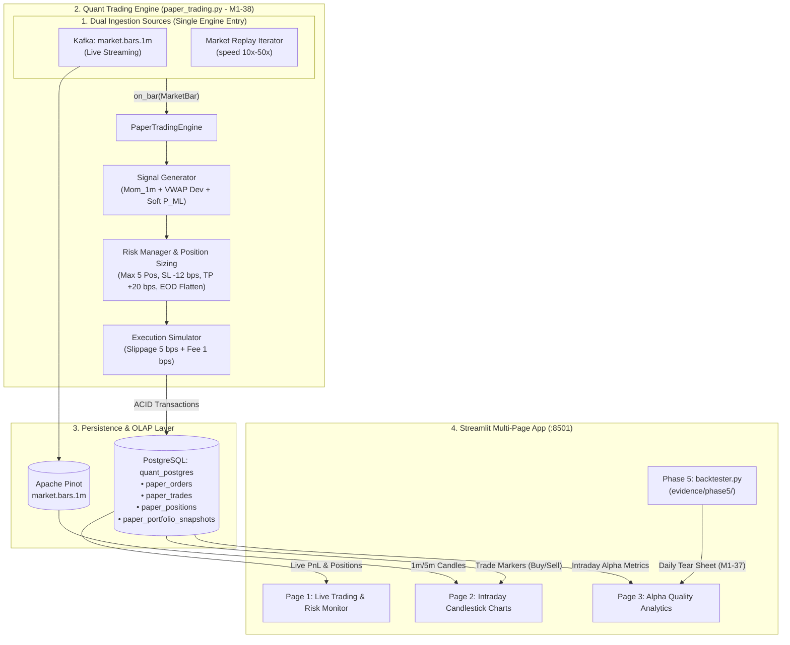
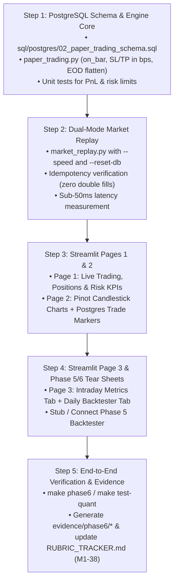

# Technical Specification: Intraday Trading System & Real-Time Alpha Dashboard

> **Target Rubrics**: 
> - **M1-38** (Phase 6 - Real-Time Paper Trading Simulation: 10.0 pts)
> - **M1-37** (Phase 5 - Quant Alpha Backtester & Tear Sheet: 10.0 pts)  
> **Status**: Approved Design / Ready for Implementation  
> **Scope**: Event-Driven Paper Trading Engine, Dual-Mode Replay, PostgreSQL Ledger, Pinot Candlestick Serving, and 3-Page Streamlit Analytics App.

---

## 1. Executive Summary & Architecture

The **Intraday Trading System** extends the Quant Data Platform from offline feature generation and model training (Phases 1–4) into an active, event-driven trading simulation. It ingests 1-minute market bars, evaluates technical momentum and optional ML directional signals, applies institutional risk controls, executes paper trades with realistic execution slippage, persists accounting ledgers in PostgreSQL, and serves interactive visualization dashboards via Streamlit and Apache Pinot.



---

## 2. Key Architecture & Methodology Decisions

### 1. Rubric Mapping & Module Boundaries (No Conflation)
| Component | Module Name | Rubric ID | Phase | Evidence Target |
|---|---|---|---|---|
| **Intraday Trading Engine** | `src/quant_edai/quant/paper_trading.py` | **M1-38** (10 pts) | Phase 6 | `evidence/phase6/paper_trading_execution.json` |
| **Market Replay Runner** | `src/quant_edai/quant/market_replay.py` | M1-38 support | Phase 6 | `evidence/phase6/paper_trading_latency.json` |
| **Daily Alpha Backtester** | `src/quant_edai/quant/backtester.py` | **M1-37** (10 pts) | Phase 5 | `evidence/phase5/backtest_summary.json` |
| **Streamlit Analytics App** | `src/quant_edai/serving/dashboard/` | Ops / Demo | Phase 6 / UI | Dashboard screenshots in `evidence/phase6/` |

> [!IMPORTANT]
> **Strict Separation**: The intraday trading engine (`paper_trading.py`) operates exclusively on 1-minute bars with intraday position accounting. The daily backtester (`backtester.py`) operates on EOD Gold Iceberg tables across years to compute multi-year factor IC and benchmark alpha. They share standard financial math from `src/quant_edai/quant/metrics.py` but run separate pipelines.

### 2. Intraday Signal Formulation & Soft ML Coupling
Phase 4 trained a **daily directional model** on EOD features. It does not provide high-frequency 1m alpha. Therefore:
- **Primary Signals**: Intraday momentum (fast EMA 5m vs slow EMA 20m) and intraday VWAP deviation:
  $$\text{VWAP Dev}_{i, t} = \frac{\text{Close}_{i, t} - \text{VWAP}_{i, t}}{\text{VWAP}_{i, t}}$$
- **Soft ML Filter ($P_{\text{ML}}$)**: Queried from KServe v2 mock if available; treated strictly as a **macro regime bias** with low weight ($w_{\text{ml}} \le 0.2$):
  $$Z_{i, t} = 0.50 \cdot \text{zscore}(\text{Momentum}_{1\text{m}}) + 0.30 \cdot \text{zscore}(\text{VWAP Dev}_{1\text{m}}) + 0.20 \cdot \text{zscore}(P_{\text{ML}} - 0.5)$$
- **Rolling Window**: Z-scores are computed per-ticker over an explicit rolling window of **$N = 45$ bars** (min periods = 15) to prevent look-ahead bias and avoid cold-start distortion.
- **Entry Thresholds**:
  - Open **LONG**: $Z_{i, t} \ge +0.80$
  - Open **SHORT**: $Z_{i, t} \le -0.80$
  - Hold / No Action: $|Z_{i, t}| < 0.80$

### 3. Scalping Risk Controls (Basis Points, NOT % Swings)
On 1-minute equity bars, targets of $+4\% / -2\%$ are unrealistic swing targets. Default thresholds are configured in **basis points (bps)**:

| Parameter | Default (Intraday Profile) | Swing Profile (`PROFILE=swing`) | Description |
|---|---|---|---|
| **Take-Profit (TP)** | **$+20\text{ bps}$** ($+0.20\%$) | $+3.00\%$ | Active profit taking threshold |
| **Stop-Loss (SL)** | **$-12\text{ bps}$** ($-0.12\%$) | $-1.50\%$ | Strict capital preservation stop |
| **Execution Slippage** | **$5\text{ bps}$** ($0.05\%$) | $5\text{ bps}$ | Institutional market impact assumption |
| **Transaction Commission** | **$1\text{ bps}$** ($0.01\%$) | $1\text{ bps}$ | Brokerage & exchange fees |

### 4. Mandatory Risk Management Limits
1. **Position Sizing**: Fixed notional size of **$\$10,000$ per trade** (or max $20\%$ of starting cash).
2. **Max Concurrent Positions**: At most **$5$ open positions** across the entire portfolio.
3. **Single Ticker Limit**: Exactly **$1$ position per ticker** (no averaging down / position stacking).
4. **Max Daily Drawdown Circuit Breaker**: If total portfolio intraday loss reaches **$-2.0\%$ of starting equity**, all open positions are immediately flattened and trading halts for the remainder of the trading day.
5. **EOD Flatting**: All open positions are automatically liquidated at **15:55 EST** (`America/New_York`) to eliminate overnight gap risk.

### 5. Dual-Mode: Single Codepath Architecture
To ensure test integrity and prevent logic drift between live and replay:
```python
# Shared Engine Interface
class PaperTradingEngine:
    def on_bar(self, bar: MarketBar) -> Optional[TradeExecution]:
        # 1. Update mark price & unrealized PnL
        # 2. Check risk stops (SL, TP, Circuit Breaker, EOD Flatten)
        # 3. Generate signals & execute new entry if capacity allows
        # 4. Atomic commit to PostgreSQL
```
- **Live Mode (`make trader-run`)**: `KafkaConsumer('market.bars.1m')` reads streaming events and invokes `engine.on_bar(bar)`.
- **Replay Mode (`make trader-replay SPEED=20`)**: `MarketReplayIterator('streaming_ticks.jsonl' or 'market_bars.parquet')` invokes the **exact same** `engine.on_bar(bar)`.
- `--speed` only tunes the interval between bars; mathematical calculations, slippage, and state transitions remain 100% identical.

### 6. Idempotency & ACID Accounting (M1-38)
- **Database Backend**: PostgreSQL container `quant_postgres` (`quant_platform` database).
- **Idempotency Key**: Deterministic unique constraint:
  `UNIQUE (ticker_symbol, bar_timestamp, action)`
  Re-running replay against the same session will not duplicate trades or distort PnL.
- **Clean Slate**: Replay CLI supports `--reset-db` to drop and recreate clean tables for deterministic testing.
- **ACID Transactions**: Order placement, trade execution, position update, and cash balance deduction are wrapped in a single database transaction (`with conn.transaction(): ...`).
- **Latency SLA**: Measure and record processing latency per bar (Sub-50ms SLA recorded in evidence).

---

## 3. Database Schema Specification (PostgreSQL)

File: `sql/postgres/02_paper_trading_schema.sql`

```sql
-- 1. Orders Table
CREATE TABLE IF NOT EXISTS paper_orders (
    order_id VARCHAR(64) PRIMARY KEY,
    session_id VARCHAR(64) NOT NULL,
    ticker_symbol VARCHAR(16) NOT NULL,
    order_type VARCHAR(16) NOT NULL,    -- 'MARKET', 'STOP_LOSS', 'TAKE_PROFIT', 'EOD_FLAT'
    direction VARCHAR(8) NOT NULL,      -- 'BUY', 'SELL'
    quantity NUMERIC(14, 4) NOT NULL,
    requested_price NUMERIC(14, 4) NOT NULL,
    status VARCHAR(16) NOT NULL,        -- 'FILLED', 'REJECTED', 'CANCELLED'
    created_at TIMESTAMP WITH TIME ZONE NOT NULL,
    CONSTRAINT uq_order_idempotency UNIQUE (ticker_symbol, created_at, direction, order_type)
);

-- 2. Executed Trades Table
CREATE TABLE IF NOT EXISTS paper_trades (
    trade_id VARCHAR(64) PRIMARY KEY,
    order_id VARCHAR(64) REFERENCES paper_orders(order_id),
    session_id VARCHAR(64) NOT NULL,
    ticker_symbol VARCHAR(16) NOT NULL,
    direction VARCHAR(8) NOT NULL,      -- 'BUY', 'SELL'
    fill_price NUMERIC(14, 4) NOT NULL,
    fill_quantity NUMERIC(14, 4) NOT NULL,
    slippage_bps NUMERIC(8, 2) NOT NULL DEFAULT 5.0,
    commission NUMERIC(10, 4) NOT NULL DEFAULT 0.0,
    realized_pnl NUMERIC(14, 4) NOT NULL DEFAULT 0.0,
    executed_at TIMESTAMP WITH TIME ZONE NOT NULL
);

-- 3. Live Positions Table
CREATE TABLE IF NOT EXISTS paper_positions (
    ticker_symbol VARCHAR(16) PRIMARY KEY,
    session_id VARCHAR(64) NOT NULL,
    side VARCHAR(8) NOT NULL,           -- 'LONG', 'SHORT'
    quantity NUMERIC(14, 4) NOT NULL,
    average_entry_price NUMERIC(14, 4) NOT NULL,
    current_mark_price NUMERIC(14, 4) NOT NULL,
    unrealized_pnl NUMERIC(14, 4) NOT NULL DEFAULT 0.0,
    unrealized_pnl_pct NUMERIC(8, 4) NOT NULL DEFAULT 0.0,
    updated_at TIMESTAMP WITH TIME ZONE NOT NULL
);

-- 4. Portfolio Snapshots Table (for Sharpe, Drawdown & Equity Curve)
CREATE TABLE IF NOT EXISTS paper_portfolio_snapshots (
    snapshot_id BIGSERIAL PRIMARY KEY,
    session_id VARCHAR(64) NOT NULL,
    cash_balance NUMERIC(16, 4) NOT NULL,
    invested_equity NUMERIC(16, 4) NOT NULL,
    total_portfolio_value NUMERIC(16, 4) NOT NULL,
    realized_pnl_cumulative NUMERIC(16, 4) NOT NULL,
    unrealized_pnl_current NUMERIC(16, 4) NOT NULL,
    rolling_sharpe_ratio NUMERIC(8, 4) NOT NULL DEFAULT 0.0,
    max_drawdown_pct NUMERIC(8, 4) NOT NULL DEFAULT 0.0,
    active_positions_count INT NOT NULL DEFAULT 0,
    recorded_at TIMESTAMP WITH TIME ZONE NOT NULL
);
```

---

## 4. Pinot vs PostgreSQL Responsibilities

| Responsibility | Storage Engine | Query Method | Latency Target |
|---|---|---|---|
| **Intraday Candlestick Bars (1m / 5m)** | **Apache Pinot** | SQL via Pinot Broker REST (`:8099`) | $\approx 20\text{--}50\text{ ms}$ |
| **Live VWAP & Bar Volume** | **Apache Pinot** | SQL aggregation over `market_bars_1m` | $\approx 20\text{--}50\text{ ms}$ |
| **Active Orders, Positions & PnL** | **PostgreSQL** | SQL connection pool | $< 10\text{ ms}$ |
| **Sharpe Ratio & Drawdown History** | **PostgreSQL** | Time series select on `paper_portfolio_snapshots` | $< 10\text{ ms}$ |
| **Candle Buy/Sell Markers** | **Python Client (Join)** | Pinot candles joined with PostgreSQL trades | Sub-second client render |

---

## 5. Streamlit Multi-Page App Architecture

Directory: `src/quant_edai/serving/dashboard/`
- `app.py`: Entry point and navigation configuration.
- `pages/1_Live_Trading_and_Risk.py`:
  - **KPI Header**: Portfolio Net Worth, Realized PnL, Unrealized PnL, Intraday Sharpe, Current Drawdown.
  - **Open Positions Matrix**: Ticker, Side, Size, Entry Price, Mark Price, Unrealized PnL ($ / %), Distance to SL/TP.
  - **Live Execution Log**: Scrolling table of recent trade fills with execution reasons.
  - **Auto-Refresh**: Configurable refresh interval (default: 3 seconds).
- `pages/2_Candlestick_Charts.py`:
  - **Ticker Selector**: Dropdown of active tickers (AAPL, MSFT, NVDA, GOOGL, AMZN, etc.).
  - **Interactive Candlestick**: Candlesticks with SMA(20), SMA(50), and intraday VWAP curve.
  - **Trade Markers**: Overlay green upward triangles for BUY and red downward triangles for SELL / EXIT.
  - **Volume Subplot**: Color-coded volume bars.
- `pages/3_Alpha_Quality_Analytics.py`:
  - **Tab 1: Intraday Alpha Metrics (Live Phase 6)**:
    - Realized Win Rate (%), Profit Factor, Average Win / Average Loss ratio.
    - Intraday Drawdown curve (Underwater chart).
    - Trade duration distribution.
  - **Tab 2: Daily Alpha Metrics (Backtest Phase 5 - M1-37)**:
    - Reads contract `evidence/phase5/backtest_summary.json` (scalars: `ic_mean`, `rank_ic_mean`, `ic_ir`, `sharpe`, `max_drawdown`, `cum_return` vs `spy_*`).
    - Plots time series from `series.ic_series`, `series.equity_curve`, and `series.rolling_sharpe`.
    - Renders linked PNG tear sheets (`cumulative_returns_vs_benchmark.png`, `factor_ic_distribution.png`, `rolling_sharpe_ratio.png`).
    - *(Note: Displays a prominent fallback banner "Awaiting Phase 5 Backtest Run (`make phase5`)" if `evidence/phase5/backtest_summary.json` is missing).*

---

## 6. Operational Prerequisites & Makefile Targets

### Required Compose Services
For local execution and demo:
```bash
docker compose up -d quant_postgres quant_kafka quant_pinot
```
*(Flink and KServe are optional; if KServe is offline, trader operates in pure technical Momentum+VWAP mode).*

### Makefile Targets (`make/07_quant.mk`)
```makefile
trader-run: ## Run event-driven intraday trader consuming Kafka market.bars.1m
	PYTHONPATH=src $(PYTHON) -m quant_edai.quant.paper_trading --mode live

trader-replay: ## Run market replay test with configurable speed (default: SPEED=20)
	PYTHONPATH=src $(PYTHON) -m quant_edai.quant.market_replay --speed $(SPEED) --reset-db

dashboard: ## Launch Streamlit multi-page dashboard on port 8501
	streamlit run src/quant_edai/serving/dashboard/app.py --server.port 8501

test-quant: ## Run mathematical and functional tests for trading engine & metrics
	PYTHONPATH=src $(PYTHON) -m pytest tests/unit/test_quant_metrics.py tests/unit/test_paper_trading.py -v

phase6: ## Execute complete Phase 6 Paper Trading workflow and save evidence
	@mkdir -p evidence/phase6
	$(MAKE) trader-replay SPEED=50
	PYTHONPATH=src $(PYTHON) -m pytest tests/unit/test_paper_trading.py -v > evidence/phase6/pytest_test_run.txt
	@echo "Phase 6 Paper Trading completed successfully. Evidence saved to evidence/phase6/"
```

---

## 7. Recommended Implementation Sequence



---

## 8. Summary of Alignment Checklist
- [x] **Rubric Alignment**: Explicitly mapped M1-38 (`paper_trading.py`, Phase 6) and M1-37 (`backtester.py`, Phase 5).
- [x] **Methodology Disclaimers**: Clarified Phase 4 ML is daily EOD; intraday uses Momentum + VWAP with rolling 45-bar z-scores and soft $w_{\text{ml}} \le 0.2$.
- [x] **Realistic Intraday Scalping**: Switched default SL/TP to basis points (TP 20 bps, SL 12 bps, slippage 5 bps).
- [x] **Risk Limits**: Added position sizing (\$10k), max 5 positions, 1 per ticker, -2% daily loss circuit breaker, and 15:55 EST EOD flattening.
- [x] **Dual-Mode Single Codepath**: Shared `on_bar(bar)` logic across Kafka and Replay.
- [x] **Idempotency**: PostgreSQL unique constraints and `--reset-db` support.
- [x] **Data Separation**: Pinot for market candles; PostgreSQL for transactions and accounting.
- [x] **Page 3 Split**: Clear separation between live intraday metrics and Phase 5 daily backtest metrics.
