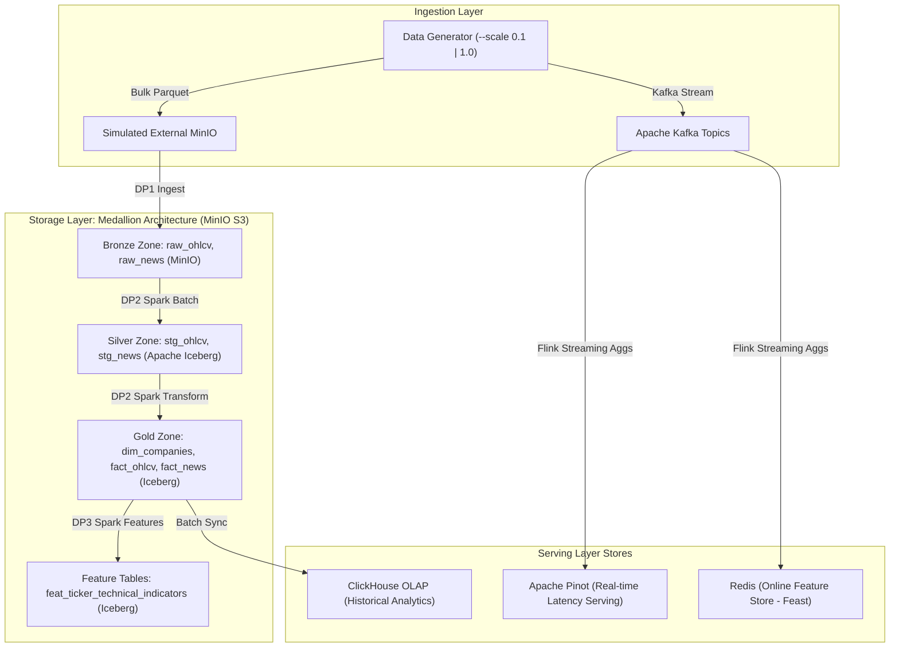

# Quant Finance - Data Platform Architecture & Design

## 1. Domain Overview

This domain focuses on quantitative market intelligence, algorithmic factor research, and automated financial news sentiment analysis for US Equities (Top 100 S&P 500 and Mega-cap Tech stocks, including AAPL, MSFT, NVDA, GOOGL, AMZN, META, TSLA).

The system handles two continuous data archetypes:
1. **Market Data (OHLCV & Trades)**: Continuous transactional time-series depicting price action, trading volumes, VWAP, and tick frequencies.
2. **Financial Text & Corporate Filings**: Unstructured news releases, earnings disclosures, and market commentary linked to ticker symbols.

---

## 2. Offline Data

These tables represent historical and reference data. They are generated in bulk and stored as Parquet files.

| Table | Grain | Key Columns |
|---|---|---|
| `market_ohlcv` | one row per ticker per trading day | trade_id, ticker_symbol, trade_date, open_price, high_price, low_price, close_price, volume, exchange, ingestion_timestamp, vwap, trade_count |
| `financial_news` | one row per news article | article_id, ticker_symbol, publish_date, published_ts, headline, summary, sentiment_score, source_outlet |
| `dim_companies` | one row per company version (SCD2) | company_key, ticker_symbol, company_name, sector, industry, market_cap_category, valid_from_ts, valid_to_ts, is_current |
| `labels` | one row per ticker per trading day | ticker_symbol, label_date, close_price, next_day_close, daily_return_fwd, direction_label |

Target volume: >= 100GB across all tables combined (with `--scale 0.1` generating ~10GB for fast testing).

### Field Descriptions (Offline Data)

#### 1. `market_ohlcv` (Historical Market Prices & Volumes)
- `trade_id` (string): Khóa định danh duy nhất của từng bản ghi giao dịch nến (ví dụ: `trd_AAPL_20240102`). Trường có **High-Cardinality** (tỉ lệ unique/total $\approx 0.98 - 1.0$), dùng làm surrogate key cho idempotency check, deduplication và Bloom Filter index.
- `ticker_symbol` (string): Mã chứng khoán định danh chuẩn (ví dụ: `AAPL`, `NVDA`, `MSFT`). Trường **Low-Cardinality** tối ưu với ClickHouse `LowCardinality(String)` và Parquet Dictionary.
- `trade_date` (date/string): Ngày giao dịch theo lịch thị trường chứng khoán Mỹ (định dạng `YYYY-MM-DD`). Khóa phân vùng vật lý (**Medium-Cardinality** ~218 ngày).
- `open_price` (float): Giá mở cửa chính thức của phiên giao dịch.
- `high_price` (float): Mức giá cao nhất đạt được trong phiên giao dịch.
- `low_price` (float): Mức giá thấp nhất được ghi nhận trong phiên.
- `close_price` (float): Giá đóng cửa chính thức khi kết thúc phiên.
- `volume` (bigint): Tổng khối lượng cổ phiếu giao dịch trong ngày (chứa 80% volume skew tập trung vào top 7 Mega-Caps).
- `exchange` (string): Sàn giao dịch niêm yết chính thức (`NASDAQ` cho Technology, `NYSE` cho Non-Tech). **Ultra-Low Cardinality** (2 giá trị).
- `ingestion_timestamp` (timestamp/string): Thời điểm bản ghi được tạo và thu nạp vào hệ thống (audit trail).
- `vwap` (float, nullable): Volume-Weighted Average Price (giá bình quân gia quyền theo khối lượng). *Cột xuất hiện sau mốc Schema Evolution (`2024-06-01`).*
- `trade_count` (int, nullable): Tổng số lệnh khớp được thực hiện trong phiên. *Cột xuất hiện sau mốc Schema Evolution (`2024-06-01`).*

#### 2. `financial_news` (Financial Articles & Corporate Disclosures)
- `article_id` (string): Khóa chính định danh duy nhất cho từng bài báo (ví dụ: `art_100001`).
- `ticker_symbol` (string): Mã cổ phiếu liên quan trực tiếp đến nội dung tin tức/sự kiện.
- `publish_date` (date/string): Ngày xuất bản bài báo (`YYYY-MM-DD`).
- `published_ts` (timestamp/string): Dấu thời gian chính xác (ISO 8601 UTC) khi bài báo được đăng tải (ví dụ: `2024-05-15T14:30:00Z`).
- `headline` (string): Tiêu đề tóm tắt sự kiện thị trường (kết quả kinh doanh, phê duyệt quy định, sản phẩm chip AI,...).
- `summary` (string): Đoạn văn bản tóm tắt nội dung bài báo, phục vụ chia chunk và sinh vector embedding cho RAG.
- `sentiment_score` (float): Điểm số cảm xúc định lượng từ `-1.0` (cực kỳ tiêu cực/Bearish) đến `+1.0` (cực kỳ tích cực/Bullish).
- `source_outlet` (string): Đơn vị xuất bản tin tức tài chính uy tín (`Bloomberg`, `Reuters`, `WSJ`, `CNBC`).

#### 3. `dim_companies` (Slowly Changing Dimension Type 2)
- `company_key` (bigint): Khóa thay thế (Surrogate Key) định danh phiên bản bản ghi theo thời gian (ví dụ: `100101`, `100102`).
- `ticker_symbol` (string): Mã niêm yết tự nhiên (Natural Business Key) của doanh nghiệp.
- `company_name` (string): Tên pháp lý đầy đủ của công ty (ví dụ: `Apple Inc.`, `NVIDIA Corporation`).
- `sector` (string): Phân ngành cấp cao (ví dụ: `Technology`, `Communication Services`, `Consumer Cyclical`).
- `industry` (string): Nhóm ngành kinh doanh chi tiết (ví dụ: `Semiconductors`, `Consumer Electronics`, `Software - Infrastructure`).
- `market_cap_category` (string): Nhóm phân loại quy mô vốn hóa thị trường (`Mega-Cap`, `Large-Cap`, `Mid-Cap`).
- `valid_from_ts` (timestamp/string): Thời điểm phiên bản thông tin công ty bắt đầu có hiệu lực (ví dụ: `2020-01-01 00:00:00`).
- `valid_to_ts` (timestamp/string): Thời điểm phiên bản thông tin hết hiệu lực (ví dụ: `2024-03-31 23:59:59` hoặc `9999-12-31`).
- `is_current` (boolean): Cờ boolean xác định phiên bản hiện hành đang có giá trị (`true`) hay là phiên bản lịch sử cũ (`false`).

#### 4. `labels` (Forward-Looking Target Labels for ML)
- `ticker_symbol` (string): Mã chứng khoán dùng để join với các bảng feature.
- `label_date` (date/string): Ngày giao dịch $t$ làm mốc tính toán đặc trưng.
- `close_price` (float): Mức giá đóng cửa thực tế tại ngày $t$.
- `next_day_close` (float): Mức giá đóng cửa tại ngày $t+1$ (được cách ly nghiêm ngặt, không rò rỉ vào tập feature).
- `daily_return_fwd` (float): Lợi suất dự báo kỳ hạn 1 ngày: $(Close_{t+1} - Close_t) / Close_t$.
- `direction_label` (int): Nhãn phân loại nhị phân mục tiêu cho mô hình ML (`1` nếu $Return_{t+1} > 0$ [Tăng], `0` nếu $Return_{t+1} \le 0$ [Giảm]).

---

## 3. Streaming Data

These are real-time events produced continuously and consumed by a stream processor.

| Event | Grain | Key Columns |
|---|---|---|
| `market_ticks` | one row per executed trade tick | trade_id, ticker_symbol, event_timestamp, price, size, exchange, arrival_timestamp, is_late, is_duplicate |
| `streaming_bars` | one row per 1-minute aggregated bar | ticker_symbol, event_timestamp, ingestion_timestamp, open_price, high_price, low_price, close_price, volume, vwap, replay_sequence_id |

### Field Descriptions (Streaming Data)

#### 1. `market_ticks` (Real-time Trade Tick Stream)
- `trade_id` (string): Khóa chính định danh duy nhất cho từng giao dịch tick (ví dụ: `trd_1715000000000_12`).
- `ticker_symbol` (string): Mã chứng khoán diễn ra giao dịch.
- `event_timestamp` (timestamp/string): Thời điểm giao dịch thực tế diễn ra tại sàn giao dịch (Event Time UTC, định dạng ISO 8601).
- `price` (float): Mức giá khớp của giao dịch đơn lẻ.
- `size` (int): Số lượng cổ phiếu được chuyển nhượng trong giao dịch (Trade volume).
- `exchange` (string): Sàn giao dịch thực thi lệnh (`NASDAQ`, `NYSE`).
- `arrival_timestamp` (timestamp/string): Thời điểm message được đẩy đến Kafka broker (Ingestion Time UTC).
- `is_late` (boolean): Cờ đánh dấu giao dịch bị trễ 5–10 phút do độ trễ mạng/sàn thứ cấp (mô phỏng 5% Late Arrivals phục vụ kiểm thử Watermarks).
- `is_duplicate` (boolean): Cờ đánh dấu bản ghi bị gửi lặp lại do cơ chế retry at-least-once của Kafka producer (mô phỏng 1.5% Duplicates phục vụ kiểm thử RocksDB Deduplication).

#### 2. `streaming_bars` (1-Minute Aggregated / Replayed Bars)
- `ticker_symbol` (string): Mã chứng khoán.
- `event_timestamp` (timestamp/string): Dấu thời gian đóng của khung nến 1 phút (ví dụ: `2024-10-15T15:59:00Z`).
- `ingestion_timestamp` (timestamp/string): Dấu thời gian khi thanh nến được phát vào Kafka topic.
- `open_price` (float): Mức giá mở cửa của khung thời gian 1 phút.
- `high_price` (float): Mức giá cao nhất trong khung 1 phút.
- `low_price` (float): Mức giá thấp nhất trong khung 1 phút.
- `close_price` (float): Mức giá đóng cửa của khung 1 phút.
- `volume` (bigint/int): Tổng khối lượng cổ phiếu khớp trong khung 1 phút.
- `vwap` (float): Mức giá bình quân gia quyền theo khối lượng của riêng khung 1 phút.
- `replay_sequence_id` (bigint): Số thứ tự tuần tự của bản ghi trong luồng phát lại (hỗ trợ kiểm thử Deterministic Replay).

---

## 4. Medallion Storage Architecture (Apache Iceberg + MinIO + ClickHouse + Pinot)

### Table Definitions & Grain

| Zone | Table Name | Format / Engine | Grain | Primary / Partition Keys | Description |
|---|---|---|---|---|---|
| **Bronze** | `raw_market_ohlcv` | Parquet (MinIO) | One row per bar/tick per ticker | `partition by (date)` | Raw ingested market data from source feed |
| **Bronze** | `raw_financial_news` | JSON / Parquet (MinIO) | One row per article | `partition by (publish_date)` | Raw external news articles & filings |
| **Silver** | `stg_market_ohlcv` | Apache Iceberg | One row per ticker per timestamp | `ticker_symbol, timestamp` | Deduplicated, schema-standardized, validated prices |
| **Silver** | `stg_financial_news` | Apache Iceberg | One row per article | `article_id, ticker_symbol` | Cleaned text, extracted metadata, deduplicated |
| **Gold** | `dim_companies` | Apache Iceberg (SCD2) | One row per company version | `ticker_symbol, valid_from_ts` | SCD Type 2 tracking sector, market cap, listing status |
| **Gold** | `fact_daily_ohlcv` | Apache Iceberg | One row per ticker per trading day | `ticker_symbol, trade_date` | Daily summary of prices, volume, VWAP |
| **Gold** | `fact_market_news` | Apache Iceberg | One row per news article | `article_id, published_ts` | Structured news with sentiment & relevance scores |
| **Gold** | `feat_ticker_technical_indicators` | Apache Iceberg | One row per ticker per calculation snapshot | `ticker_symbol, event_timestamp` | Gold features with `event_timestamp` & `created` columns |
| **Serving** | `quant_analytics_ohlcv` | ClickHouse | Columnar time-series | `ORDER BY (ticker_symbol, trade_date)` | OLAP warehouse for high-speed Quant backtesting |
| **Serving** | `realtime_minute_bars` | Apache Pinot | 1-minute real-time bar | `ticker_symbol, window_start` | Near-realtime OLAP queries (<50ms latency) |

---

## 5. Data Generator & Injected Anomalies (Rubric Compliance)

The data generator (`data_generator.py`) implements a **Hybrid Seed + Synthetic Multi-Worker** engine. It loads historical seeds for US Equities (via yfinance/Polygon) and scales them up using Geometric Brownian Motion (GBM) with volatility clustering.

### Dual-Scale Execution
- `--scale 0.1` (10% test mode, ~10 GB): Fast generation for local testing, CI/CD verification, and rapid pipeline iterations.
- `--scale 1.0` (Full mode, >= 100 GB): Benchmark scale for testing Spark skew handling, Flink streaming state, and Lakehouse compaction.

### Injected Data Problems

| Problem Type | Target Table / Stream | Description & Injected Ratio | Engineering Impact & Solution |
|---|---|---|---|
| **Volume Skew** | `raw_market_ohlcv`, `dim_companies` | 80% of total volume & news concentrated in 7 Mega-cap tickers (AAPL, NVDA, MSFT, AMZN, GOOGL, META, TSLA). | Spark joins and aggregations create severe executor stragglers. Solved via **Key Salting** and **Adaptive Query Execution (AQE)**. |
| **Schema Evolution** | `raw_market_ohlcv` | Mid-dataset (at partition `2024-06-01`), feeds add `vwap` (float) and `trade_count` (int); news adds `sentiment_score`. | Earlier files lack these fields. Handled via **Apache Iceberg native schema evolution** without rewriting historical data. |
| **Offline Duplicates** | `raw_market_ohlcv` | ~2.0% duplicate records injected due to upstream exchange connection retries. | Leads to inflated volume and incorrect metrics. Solved in PySpark via `row_number() over (partition by ticker, timestamp order by ingestion_ts desc)` or Iceberg MERGE. |
| **Streaming Late Arrivals** | `kafka://market_ticks` | 5-10 minute delay injected into 5% of OTC/secondary venue streaming ticks. | 1-minute streaming windows miss trades without proper handling. Solved in Apache Flink using **Event-time Watermarks** (`BoundedOutOfOrderness(10m)`). |
| **Streaming Duplicates** | `kafka://market_ticks` | ~1.5% duplicate messages emitted by the Kafka producer (at-least-once retries). | Inflates real-time price candles. Handled in Apache Flink using **RocksDB State Backend** with TTL deduplication filter. |
| **Data Drift** | `feat_ticker_technical_indicators` | Market regime shift from Bull market (low vol, high RSI) to High-Volatility Bear market. | Causes model prediction degradation. Monitored via KS-statistic / PSI drift tests pushing alerts to Prometheus and triggering Kubeflow retrain. |

---

## 6. Processing Layer (PySpark Batch & Apache Flink Streaming)

### PySpark Batch Processing Jobs
1. **Baseline Job**: Direct join and aggregation without optimization, highlighting partition skew on Spark UI.
2. **Skew-Optimized Job**:
   - Salting skewed keys (`ticker_symbol` + `rand(0, 15)`) for aggregations.
   - Enabling `spark.sql.adaptive.enabled = true` and `spark.sql.adaptive.skewJoin.enabled = true`.
   - Broadcasting `dim_companies` dimension table.
3. **Iceberg Compaction Job**:
   - Periodic compaction (`CALL catalog.system.rewrite_data_files()`) to merge small parquet files (<128MB) created by frequent micro-batches into target file sizes.

### Apache Flink Streaming Jobs
1. **Real-time 1m & 5m Window Aggregation**:
   - Source: Kafka topic `market_ticks`.
   - Event-time processing with Watermark: `WatermarkStrategy.forBoundedOutOfOrderness(Duration.ofMinutes(10))`.
   - Tumbling Window (1 minute) computing: Open, High, Low, Close, Volume, VWAP.
   - Sliding Window (5 minutes, 1 minute slide) computing rolling momentum and volatility.
2. **Stateful RocksDB Deduplication**:
   - Deduplication key: `hash(ticker, trade_id, trade_timestamp)`.
   - State TTL configured to 1 hour, maintaining low memory footprint while eliminating 1.5% duplicates.
3. **Sink**: Dual sink to Apache Pinot (for real-time OLAP queries) and Kafka topic `market_minute_features` (for Feast online ingestion).

---

## 7. Orchestration (Apache Airflow) & Data Governance (DataHub)

### Airflow DAGs
- **DP1 (`dag_raw_ingestion_bronze`)**: Ingests raw data from external staging MinIO into Lakehouse Bronze zone. Triggers Great Expectations checkpoint (checking non-null ticker, positive prices, valid timestamps).
- **DP2 (`dag_bronze_to_silver_gold`)**: Triggered upon DP1 data readiness. Runs PySpark transformation: schema evolution handling, deduplication, Iceberg write, SCD2 merge for `dim_companies`, and syncs Gold tables to ClickHouse.
- **DP3 (`dag_compute_offline_features`)**: Triggered upon DP2 completion. Computes 14-day RSI, 20/50-day SMA, Bollinger Bands, rolling volatility, and daily news sentiment aggregations, writing to Iceberg `feat_ticker_technical_indicators`.

### DataHub Governance & Lineage
- Uses `acryl-datahub-airflow-plugin` to track dataset lineage across DP1 -> DP2 -> DP3 -> Gold -> ClickHouse.
- Displays dataset schema documentation, data quality test assertion results from Great Expectations, and dataset ownership metadata on DataHub UI.
