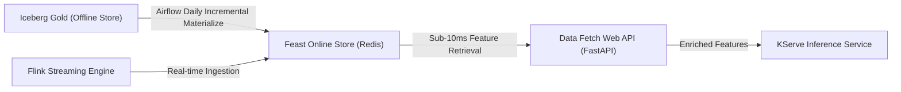
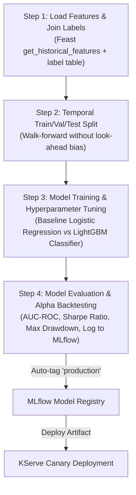

# Quant Finance - ML Platform Architecture & Design

## 1. ML Use Case: Next-Day Directional Prediction & Alpha Signal Generation

### Task Definition
Predict whether the next trading day's closing price for an individual equity will close higher than the current day's close:
$$\text{Return}_{t+1} = \frac{\text{Close}_{t+1} - \text{Close}_{t}}{\text{Close}_{t}}$$

- **Prediction Entity**: `ticker_symbol`
- **Prediction Cadence**: Evaluated daily at market close ($T$).
- **Prediction Target**: Directional classification $\mathbb{I}(\text{Return}_{t+1} > 0)$ and continuous expected return for alpha factor ranking.

---

## 2. Label Definition & Time-Series Splitting

### Label Table: `label_ticker_daily_return`
- **Columns**: `ticker_symbol`, `label_date`, `next_day_close`, `daily_return_fwd`, `direction_label` ($1$ for Up, $0$ for Down).
- **Grain**: One row per ticker per trading day.
- **Join Key**: `(ticker_symbol, label_date = event_timestamp)` joined against the offline feature snapshots.

### Split Strategy: Temporal Walk-Forward Split
To eliminate **look-ahead bias** and data leakage:
- **Train Set**: First 80% chronological trading days.
- **Validation Set**: Next 10% chronological trading days.
- **Test Set**: Final 10% chronological trading days.

---

## 3. Feature Store Plan (Feast)

### Offline & Online Architecture
- **Offline Store**: Apache Iceberg Gold table `feat_ticker_technical_indicators`.
- **Online Store**: Redis cluster for sub-10ms point-in-time feature lookup.

### Feature Definitions

#### Offline Historical Features (`feat_ticker_technical_indicators`)
> Features are sourced directly from the Lakehouse Gold layer produced by PySpark/Airflow DP3 (`feat_ticker_technical_indicators.parquet`).

| Tier | Feature Name | Type | Description | Source / Status |
|---|---|---|---|---|
| **[MVP Core]** | `close_price` | Float | Closing price of equity | DP3 `raw_market_ohlcv` |
| **[MVP Core]** | `sma_20` | Float | 20-day Simple Moving Average | `feature_calculator.py` |
| **[MVP Core]** | `sma_50` | Float | 50-day Simple Moving Average | `feature_calculator.py` |
| **[MVP Core]** | `sma_ratio_20_50` | Float | Ratio of 20-day SMA to 50-day SMA (trend proxy) | `feature_calculator.py` |
| **[MVP Core]** | `rsi_14d` | Float | 14-day Relative Strength Index (momentum/exhaustion) | `feature_calculator.py` |
| **[MVP Core]** | `macd_12_26` | Float | MACD line (12 EMA - 26 EMA) | `feature_calculator.py` |
| **[MVP Core]** | `macd_signal_9` | Float | MACD 9-day Signal line | `feature_calculator.py` |
| **[MVP Core]** | `macd_histogram` | Float | MACD histogram (MACD line - Signal line) | `feature_calculator.py` |
| **[MVP Core]** | `rolling_volatility_30d`| Float | 30-day annualized realized return volatility | `feature_calculator.py` |
| **[MVP Core]** | `intraday_return_1d` | Float | Close-to-close daily return | `feature_calculator.py` |
| **[MVP Core - Audit]**| `event_timestamp` | Timestamp | Point-in-time correctness timestamp (Rubric M1-34) | DP3 Gold table |
| **[MVP Core - Audit]**| `created` | Timestamp | Feature registration timestamp (Rubric M1-34) | DP3 Gold table |
| *[Stretch / v2]* | `bollinger_pct_b` | Float | Position of close price relative to Bollinger Bands | Planned v2 expansion |
| *[Stretch / v2]* | `news_sentiment_avg_3d` | Float | Rolling 3-day weighted average news sentiment score | Depends on RAG (Phase 7) |
| *[Stretch / v2]* | `news_article_count_3d` | Int | Surge in company-specific news mentions | Depends on RAG (Phase 7) |

#### Streaming Real-Time Features (Flink Push to Feast Online Store)
> Real-time feature push tier. Phase 4 MVP prioritizes robust batch-to-online materialization (Airflow DP $\to$ Redis); streaming feature push serves as an enhancement tier.

| Tier | Feature Name | Type | Description | Status |
|---|---|---|---|---|
| *[Stretch / v2]* | `intraday_return_1h` | Float | Price return over trailing 60 minutes | Streaming enhancement |
| *[Stretch / v2]* | `intraday_vwap_spread` | Float | Spread between current price & 1m rolling VWAP | Streaming enhancement |
| *[Stretch / v2]* | `order_flow_imbalance_15m`| Float | 15-minute buy vs sell trade volume ratio | Streaming enhancement |

---

## 4. Kubeflow Training Pipeline (KFP) & MLflow Registry

The training pipeline consists of 4 containerized components run via Kubeflow Pipelines:

### Models & Evaluation
- **Baseline**: Logistic Regression with L2 regularization.
- **Production Model**: LightGBM Classifier with early stopping on validation AUC-ROC.
- **MLflow Tracking**: Logs hyperparameters (`num_leaves`, `learning_rate`, `n_estimators`), metrics (AUC-ROC, Log-loss, F1), and model artifacts. Automatically tags the top-performing run as `latest` and `production`.

---

## 5. Model Serving (KServe v2 Protocol) & Canary A/B Testing

- Deployed using **KServe InferenceService** running standard v2 data plane.
- **Canary Traffic Split**:
  - `v1` (Current champion model): Serves 80% of inference requests.
  - `v2` (Challenger candidate model): Serves 20% of inference requests.
- Automatic routing through Kubernetes Ingress / Gateway.

---

## 6. Real-Time Drift Detection & Auto-Retraining Loop

1. **FastAPI Drift Detection Service**:
   - Computes Kolmogorov-Smirnov (KS) test and Population Stability Index (PSI) on incoming streaming features against training feature distributions.
   - Operates in real-time without requiring immediate ground-truth labels.
2. **Observability & Retraining Trigger**:
   - Pushes drift scores to Prometheus PushGateway, visualized on Grafana.
   - Airflow drift detection DAG triggers an automated call to the Kubeflow Pipeline Run API when feature drift exceeds threshold (PSI > 0.25).

---

## 7. Quant Alpha Backtesting & Signal Evaluation Module

A specialized, reproducible evaluation module using Python and Pandas/NumPy:
- **Signal Generation**: Maps model probability scores into long/short quintile rankings.
- **Factor Evaluation Metrics**:
  - **Information Coefficient (IC)**: Pearson correlation between predicted alpha and actual forward returns.
  - **Rank IC**: Spearman rank correlation assessing monotonic ranking power.
  - **Hit Rate**: Percentage of days with positive predicted directional accuracy.
- **Portfolio & Strategy Backtesting**:
  - **Cumulative Return**: Simulated returns of top-decile long portfolio.
  - **Annualized Sharpe Ratio**: Risk-adjusted excess return over risk-free rate.
  - **Maximum Drawdown (MDD)**: Peak-to-trough decline measurement.
  - **Benchmark Comparison**: Evaluated against SPY (S&P 500 ETF) Buy & Hold.
- **Artifacts**: Backtest performance curves and tear sheets logged directly to MLflow.
