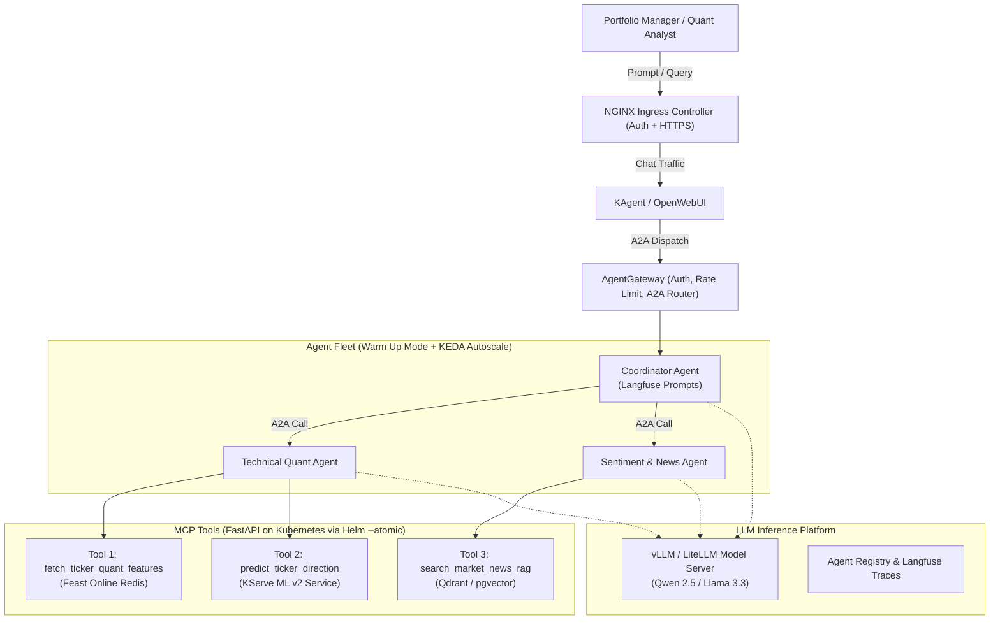

# Quant Finance - LLM & Multi-Agent Platform Architecture & Design

## 1. Agent Use Case: Multi-Agent Quantitative Research Assistant

### Problem Statement
Institutional investment decisions require synthesizing both quantitative signals (technical indicators, order flow, machine learning price predictions) and qualitative information (breaking financial news, earnings call transcripts, analyst revisions).

Instead of a single brittle monolithic LLM, this platform deploys an **Agent Fleet Architecture** coordinated via **Agent-to-Agent (A2A) Gateway** to deliver automated Investment Memorandums and real-time market intelligence.

---

## 2. Platform Architecture Overview



---

## 3. RAG Data Pipeline (Airflow + Qdrant / pgvector)

### Pipeline Stages (`dag_rag_financial_news`)
1. **Extraction**: Ingests new articles from Lakehouse Bronze `raw_financial_news`.
2. **Chunking**: Chunks text using hierarchical recursive character splitting (target: 512 tokens with 64-token overlap), preserving corporate metadata (ticker symbol, publication timestamp, source author).
3. **Embedding**: Generates dense vector representations using `BAAI/bge-large-en-v1.5` or `text-embedding-3`.
4. **Indexing**: Loads embeddings and metadata payloads into **Qdrant** (or **PostgreSQL pgvector**), linked with Feast feature schemas for cross-system data governance.
5. **Governance**: Lineage and execution assertions captured automatically in **DataHub**.

---

## 4. MCP Tools Specification (FastAPI Deployments)

The tools are packaged as standalone Docker containers and deployed to Kubernetes using Helm charts with rolling updates and atomic fallback (`helm upgrade --atomic`):

### Tool 1: `fetch_ticker_quant_features`
- **Purpose**: Retrieves sub-second technical and order flow features from Feast online store (Redis).
- **Input Schema**:
  ```json
  { "ticker_symbol": "NVDA", "feature_list": ["rsi_14d", "intraday_vwap_spread", "order_flow_imbalance_15m"] }
  ```
- **Output**: JSON payload containing the latest point-in-time values and timestamp.

### Tool 2: `predict_ticker_direction`
- **Purpose**: Queries the active KServe InferenceService to obtain the LightGBM model's directional forecast.
- **Input Schema**:
  ```json
  { "ticker_symbol": "NVDA" }
  ```
- **Output**:
  ```json
  {
    "ticker_symbol": "NVDA",
    "probability_up": 0.684,
    "predicted_direction": "UP",
    "model_version": "v1.2-champion"
  }
  ```

### Tool 3: `search_market_news_rag`
- **Purpose**: Semantic vector search retrieving relevant news articles, filings, and sentiment context.
- **Input Schema**:
  ```json
  { "ticker_symbol": "NVDA", "query": "Q3 GPU revenue growth and Blackwell supply", "top_k": 3 }
  ```
- **Output**: Ranked news chunks with similarity scores, published dates, and sentiment flags.

---

## 5. Multi-Agent Fleet Hierarchy & Interaction Flow

1. **Coordinator Agent**:
   - Acts as the orchestrator. It receives user prompts (e.g. *"Provide an investment brief for NVDA following today's market close"*).
   - Generates an execution plan, delegating analytical tasks to Sub-Agent 1 and Sub-Agent 2 in parallel.
   - Synthesizes findings into a structured **Investment Memorandum** (Technical Stance, Sentiment Backdrop, ML Confidence, Key Risks).
2. **Technical Quant Sub-Agent**:
   - Invocates `fetch_ticker_quant_features` and `predict_ticker_direction`.
   - Analyzes RSI oversold conditions, VWAP deviation, and model confidence scores.
3. **Sentiment & News Sub-Agent**:
   - Invocates `search_market_news_rag`.
   - Analyzes corporate developments, macro headwinds, and assigns an aggregate news tone score.

---

## 6. Deployment, Governance & Warm Up Mode

- **Agent Registry**: Registered in KAgent and tracked via Langfuse, storing system prompt versions, token consumption, and invocation traces.
- **Agent Fleet Warm Up Mode**: Deployed with a pre-warmed container worker pool (Substrate pattern), minimizing cold-start latencies (<200ms) while auto-scaling horizontally with KEDA based on concurrency.
- **Security & Gateway**: All agent-to-agent and external communications pass through AgentGateway with JWT authentication, policy enforcement, and per-user rate limiting.
